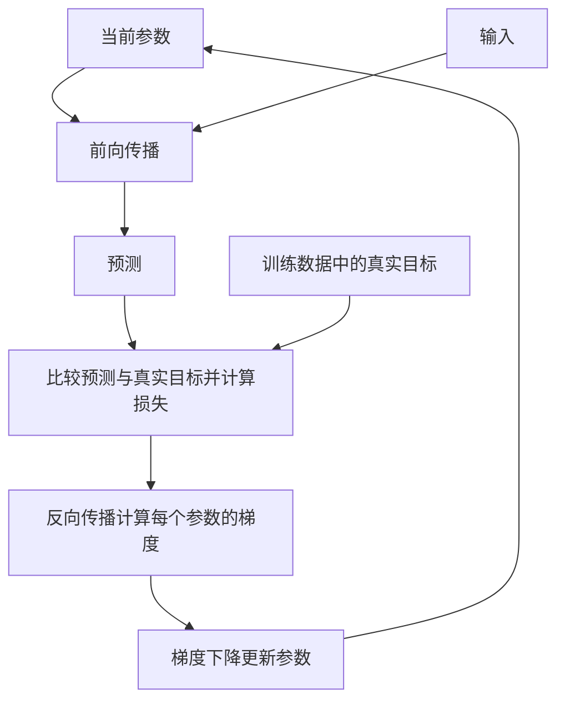
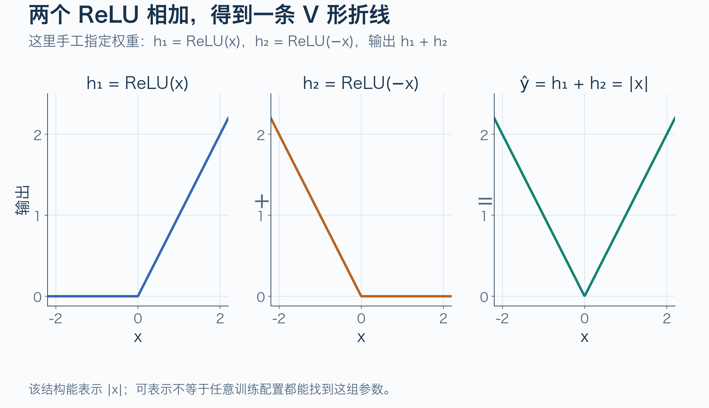
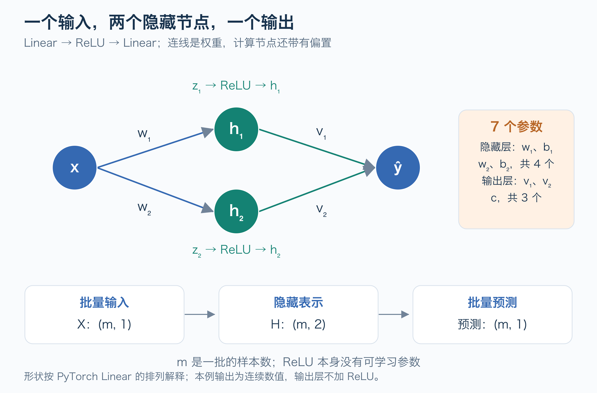
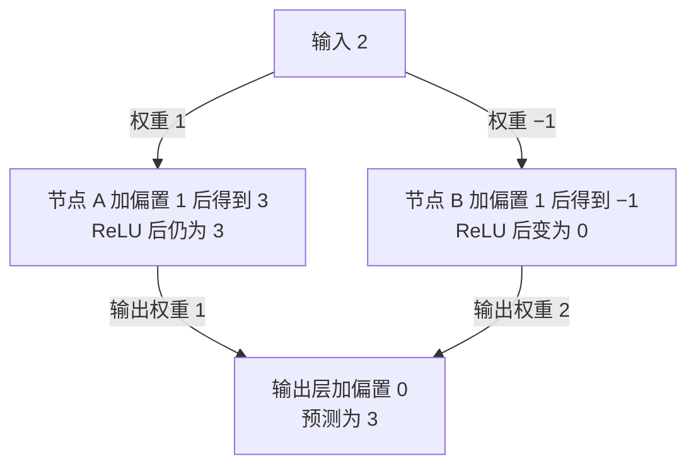
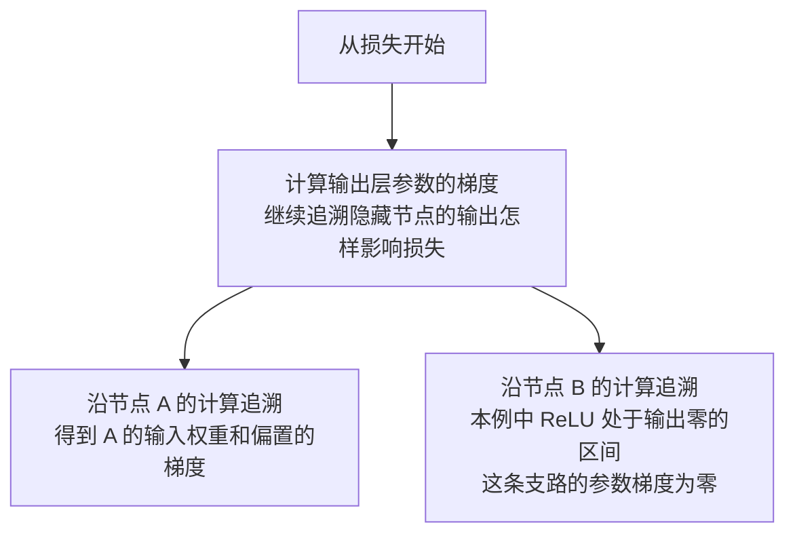
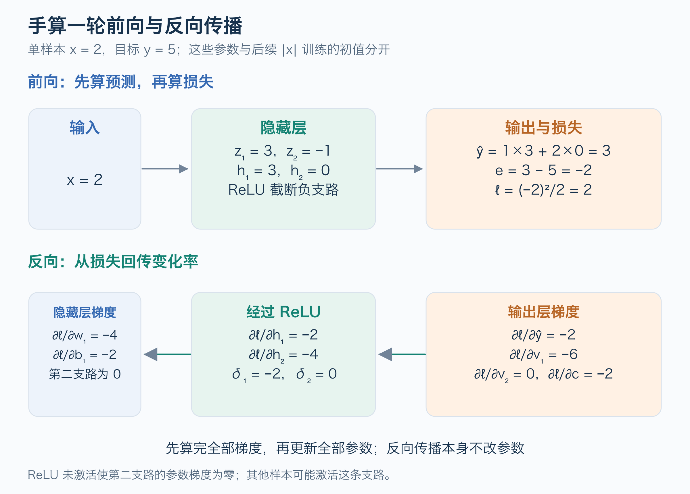
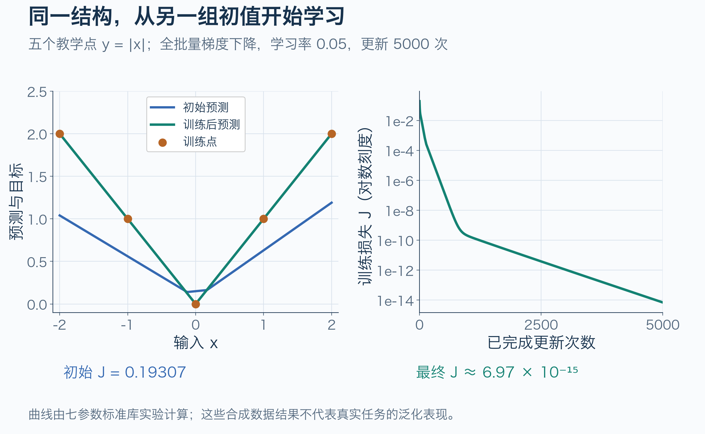

# 小神经网络与训练循环

小神经网络的训练可以分清三个动作：**前向传播算预测，反向传播算梯度，梯度下降改参数**。输入经过多个计算步骤，得到预测；预测与真实目标的差距形成损失；反向传播沿这些步骤计算每个参数怎样影响损失，再由优化器执行参数更新。[PyTorch 优化教程][pytorch-optimization]

先读 [线性回归与梯度下降](../machine-learning/线性回归与梯度下降.md)。这里用一个输入、两个 ReLU 隐藏节点和一个输出手算前向与反向传播，再运行同一结构的最小训练实验。它只有一层隐藏层，是进入深度学习的起点；更深的网络会继续叠加这些基本运算。



训练时，真实目标参与计算损失；前向预测只需要输入和当前参数。前向和反向计算使用同一轮的参数，梯度算完后才更新，下一轮再用新参数重新计算。

初读可以先顺着第 3 节、4.1 节、5.1 节和 5.2 节，观察一轮训练怎样连起来。第 2.2 节的批量形状、第 4.2 节的数学推导和第 5.3 节的框架代码可在理解过程后再读。

## 1 为什么需要非线性激活

把两次线性计算串起来，却不加入激活，仍然只能得到线性计算：

```text
h = a × x + d
ŷ = v × h + c
  = (v × a) × x + (v × d + c)
```

多输入、多节点时也一样：连续的仿射变换可以合并成一个仿射变换。这里的“仿射”指线性组合再加偏置。单纯堆叠这种层不会自动获得非线性表达能力。[Google 激活函数][google-activation]

ReLU 的定义是 `ReLU(z) = max(0, z)`。它把负数变为零、保留正数，让输出在 `z = 0` 处出现折点。两个 ReLU 可以表示最简单的 V 形函数：

```text
h₁ = ReLU(x)
h₂ = ReLU(−x)
ŷ  = h₁ + h₂ = |x|
```



图 1 展示的是一组**手工指定的参数**，用于证明这个结构可以表示 `|x|`。它不等于训练算法必然能从任意初值找到这些参数。后面会从另一组初值开始训练。

ReLU 网络的输出可以是分段线性函数；“具有非线性表达能力”并不要求每一段都是弯曲的。激活位置和参数共同决定折点与各段的斜率。[Google 激活函数][google-activation]

## 2 两个隐藏节点有哪些参数

### 2.1 节点与可学习参数

节点也叫神经元。这里的两个中间节点组成一层隐藏层，分别称为 A、B；“隐藏”表示它位于输入与最终输出之间，中间结果仍然可以查看。

给隐藏层加入可学习的权重和偏置，再给输出层加入权重与偏置：

```text
z₁ = w₁ × x + b₁       z₂ = w₂ × x + b₂
h₁ = ReLU(z₁)          h₂ = ReLU(z₂)
ŷ  = v₁ × h₁ + v₂ × h₂ + c
```

`z` 是激活前的数值，`h` 是激活后的数值。参数一共七个：`w₁, b₁, w₂, b₂, v₁, v₂, c`。节点数量与参数数量不是一回事；连线对应权重，每个计算节点还可以有偏置。[PyTorch 构建网络教程][pytorch-network]

其中，`w₁, b₁` 用于节点 A，`w₂, b₂` 用于节点 B；`v₁, v₂` 决定两个节点的输出怎样组合，`c` 是输出层的偏置。训练调整这七个参数，ReLU 的“负数变零、正数保留”规则保持不变。

### 2.2 批量计算与形状



图 2 按 PyTorch `Linear` 的权重排列解释批量计算；`m` 是当前批次的样本数，并不是隐藏节点数：

| 运算 | 输入形状 | 权重与偏置形状 | 输出形状 | 参数数 |
| --- | --- | --- | --- | --- |
| 第一层 Linear | `(m, 1)` | 权重 `(2, 1)`，偏置 `(2,)` | `(m, 2)` | 2 + 2 = 4 |
| ReLU | `(m, 2)` | 无可学习参数 | `(m, 2)` | 0 |
| 输出层 Linear | `(m, 2)` | 权重 `(1, 2)`，偏置 `(1,)` | `(m, 1)` | 2 + 1 = 3 |

批量输入按行保存样本时，线性层计算可写为 `Z = X × Wᵀ + b`，偏置加到每一行。PyTorch 将这样的加权变换放在 `nn.Linear` 中，把激活放在 `nn.ReLU` 中。[PyTorch Linear 源码][pytorch-linear]

这里预测连续数值，输出层保留线性输出；隐藏层使用 ReLU 不意味着输出层必须也使用 ReLU。分类任务的输出和损失需要另外设计。

## 3 手算一次前向传播

先只取一个教学样本：输入 `x = 2`，训练数据给出的真实目标 `y = 5`。目标来自数据，不是网络当前的预测。用以下参数开始计算：

```text
w₁ = 1，b₁ = 1，w₂ = −1，b₂ = 1
v₁ = 1，v₂ = 2，c = 0
```

这组参数用于手算，目标 `5` 与第 1 节的 V 形展示、第 6 节的 `|x|` 训练任务分开。先计算两个隐藏节点，再组合成预测。图中的箭头权重和节点偏置对应上面的参数：



```text
z₁ = 1×2 + 1 = 3        z₂ = (−1)×2 + 1 = −1
h₁ = max(0, 3) = 3      h₂ = max(0, −1) = 0
ŷ  = 1×3 + 2×0 + 0 = 3
```

现在得到预测 `3`，再与真实目标 `5` 比较。沿用“预测减目标”的残差定义和单样本平方损失：

```text
e  = ŷ − y = −2
ℓ  = e²/2 = 2
```

残差 `−2` 表示预测比目标少了 `2`；损失 `2` 是非负的错误程度。到这里，只计算了数值，**参数还没有改变**。下一步需要知道每个参数怎样影响损失，才能决定调整方向。

## 4 手算一次反向传播

### 4.1 先理解梯度的作用

先观察节点 A 到输出层的权重 `v₁`，当前值为 `1`。为理解它的影响，假想只把它增加到 `1.01`，其他参数都保持原样：

```text
原预测：3×1 + 0×2 + 0 = 3
假想预测：3×1.01 + 0×2 + 0 = 3.03
假想损失：(3.03−5)²/2 = 1.94045
```

预测更接近目标，损失从 `2` 降到 `1.94045`。这说明：在当前位置，略微增大 `v₁` 有助于降低损失。反向传播把这种局部影响计算成梯度；本例中 `v₁` 的梯度为 `−6`，下一小节给出计算依据。

非零梯度的符号表示当前调整方向：梯度为负，略微增大该参数会降低损失；梯度为正，略微减小该参数会降低损失。这里说的是足够小的局部变化，`−6` 也不是把损失直接减去 `6`。它是损失对这个参数的变化率。

上述“假想改一点”只是帮助理解梯度；正式更新发生在第 5.1 节。实际反向传播沿前向计算记录的乘法、加法和 ReLU，从损失向前面的运算追溯，计算各参数的梯度，不需要逐个参数试错。[PyTorch 自动求导教程][pytorch-autograd]



节点 B 在 ReLU 前的数值为 `−1`。只要参数的小变化没有使这个数值超过零，ReLU 输出就一直是 `0`，这条支路也不改变预测。因此，本例中 `w₂, b₂, v₂` 的梯度为零；其他样本可能激活它。反向传播结束后，我们拿到了所有梯度，**参数仍然没有改变**。

### 4.2 梯度的数学依据

反向传播将链式法则系统地应用在计算图上。从损失向前面的运算逐步传递变化率；它计算梯度，参数更新仍由优化器完成。[PyTorch 自动求导教程][pytorch-autograd]

首先 `∂ℓ/∂ŷ = e = −2`。输出层中，每个权重只需乘上对应输入：

```text
∂ℓ/∂v₁ = e × h₁ = −6
∂ℓ/∂v₂ = e × h₂ =  0
∂ℓ/∂c  = e       = −2

∂ℓ/∂h₁ = e × v₁ = −2
∂ℓ/∂h₂ = e × v₂ = −4
```

再经过 ReLU。`z > 0` 时导数为 `1`，`z < 0` 时导数为 `0`；`z = 0` 处不可导，本篇标准库实现和 PyTorch ReLU 反向实现都采用 `0`。[PyTorch ReLU 导数规则][pytorch-relu]、[阈值反向实现][pytorch-threshold]和 [CPU 阈值核][pytorch-threshold-cpu]

定义 `δ₁ = ∂ℓ/∂z₁`、`δ₂ = ∂ℓ/∂z₂`：

```text
δ₁ = (−2) × 1 = −2      因为 z₁ = 3 > 0
δ₂ = (−4) × 0 =  0      因为 z₂ = −1 < 0

∂ℓ/∂w₁ = δ₁ × x = −4   ∂ℓ/∂b₁ = δ₁ = −2
∂ℓ/∂w₂ = δ₂ × x =  0   ∂ℓ/∂b₂ = δ₂ =  0
```

第二支路的梯度为零，仅表示它在**这个样本、这组参数**下没有被激活。其他样本可能激活它。若某个节点在所有训练样本上长期都不激活，这条支路便可能长期得不到梯度；不能把一次零梯度直接叫作整个网络“无法学习”。



图 3 上半部分是前向传播，负责得到预测和损失；下半部分是反向传播，负责计算当前参数的梯度。两者使用同一轮前向计算保存的数值。

## 5 从一个样本走到训练循环

### 5.1 更新参数并重新预测

梯度下降根据已经算出的梯度更新参数。学习率决定这次调整的步幅；取 `0.01`，更新规则和 `v₁` 的计算如下：

```text
新参数 = 旧参数 − 学习率 × 梯度
新 v₁ = 1 − 0.01×(−6) = 1.06
```

减去负梯度使 `v₁` 增大，符合第 4.1 节观察到的调整方向。七个参数的更新结果为：

| 参数 | 含义 | 旧值 | 梯度 | 新值 |
| --- | --- | --- | --- | --- |
| w₁ | A 的输入权重 | 1 | −4 | 1.04 |
| b₁ | A 的偏置 | 1 | −2 | 1.02 |
| w₂ | B 的输入权重 | −1 | 0 | −1 |
| b₂ | B 的偏置 | 1 | 0 | 1 |
| v₁ | A 到输出层的权重 | 1 | −6 | 1.06 |
| v₂ | B 到输出层的权重 | 2 | 0 | 2 |
| c | 输出层的偏置 | 0 | −2 | 0.02 |

所有梯度必须先用旧参数算完，再统一更新。例如，求隐藏层梯度时使用的 `v₁` 应是旧值 `1`，不是刚更新的 `1.06`。更新的是权重和偏置，ReLU 规则保持不变。

现在用新参数重新进行前向传播，仍然输入 `2`：

```text
节点 A：2×1.04 + 1.02 = 3.10，ReLU 后输出 3.10
节点 B：仍然输出 0
新预测：3.10×1.06 + 0×2 + 0.02 = 3.306
新损失：(3.306−5)²/2 = 1.434818
```

| 比较项 | 更新前 | 更新后 |
| --- | --- | --- |
| 预测 | 3 | 3.306 |
| 残差 | −2 | −1.694 |
| 损失 | 2 | 1.434818 |

预测更接近真实目标 `5`，这次更新取得了改善。它只展示一次成功下降；学习率过大时，更新也可能让损失上升。神经网络目标一般不具备上一章凸二次函数的简单保证；结构可表示某种函数，也不保证当前训练配置能找到理想参数。

### 5.2 重复计算形成训练循环

下一轮从当前参数重新开始：前向算预测，比较真实目标，反向算梯度，再更新参数。梯度依赖当前参数和样本，不能一直沿用第一次的梯度。[PyTorch 优化教程][pytorch-optimization]

对当前批次的 `m` 个样本，继续使用 `J = (1/(2m)) × Σ eᵢ²`。每个样本先产生自己的梯度，再取平均，最后更新一次参数。共享参数在多条路径或多个样本上的贡献要相加；不能只保留最后一个样本的梯度。[PyTorch 自动求导教程][pytorch-autograd]

一个普通训练批次依次做五件事：

1. 清除上一批的梯度，或建立新的零梯度容器。
2. 用当前参数进行前向计算。
3. 用预测和真实目标计算损失。
4. 反向传播，计算这批样本的平均参数梯度。
5. 优化器使用梯度更新参数，然后进入下一批。

标准库实验在每次 `loss_and_grad` 内新建零梯度容器；PyTorch 通常调用 `optimizer.zero_grad()`。PyTorch 默认累加梯度，有意累加多批梯度时会另行管理清除与归一化。[PyTorch 优化教程][pytorch-optimization]

一次 **step** 在这里指一次参数更新；一个 **epoch** 指完整遍历一遍训练集。假设有 100 个样本，每批 20 个且每批更新一次，那么一个 epoch 包含 5 次更新。本实验一批就是全部五个样本，所以一轮遍历恰好更新一次；不能把这当作一般关系。[Google 批大小与 Epoch][google-hyper]

### 5.3 框架流程对照

这个结构在 PyTorch 中可写为以下对照代码。`0.5 * loss_fn(prediction, y)` 对齐本篇的半均方误差；预测与标签都使用 `(m, 1)`，避免错误广播：

```python
import torch
from torch import nn

model = nn.Sequential(nn.Linear(1, 2), nn.ReLU(), nn.Linear(2, 1))
optimizer = torch.optim.SGD(model.parameters(), lr=0.05)
loss_fn = nn.MSELoss()

# X 与 y 为浮点张量，形状均为 (m, 1)。
model.train()
optimizer.zero_grad()
prediction = model(X)
loss = 0.5 * loss_fn(prediction, y)
loss.backward()
optimizer.step()

model.eval()
with torch.no_grad():
    prediction = model(X_new)
```

MSELoss 默认对所有输出元素取平均；本例每个样本只有一个输出，乘以 `0.5` 后与 `J` 一致。[PyTorch MSELoss 源码][pytorch-mse]

该片段对照框架流程，采用默认初始化，不承诺复现下节数值。`model.eval()` 设置某些层的评估行为，`torch.no_grad()` 关闭梯度记录；当前只有 Linear 与 ReLU，评估模式不会改变这两层的计算公式。[PyTorch 优化教程][pytorch-optimization]

## 6 运行两个节点的训练实验

完整代码见 [tiny_neural_network.py](examples/tiny_neural_network.py)。它只用 Python 标准库，显式实现七个参数的前向、反向和更新。从仓库根目录执行：

```bash
python3 knowledge/ai/deep-learning/examples/tiny_neural_network.py
```

训练数据为 `x = −2, −1, 0, 1, 2`，目标为 `y = |x|`。固定初值为 `w₁=0.8, b₁=0.1, w₂=−0.6, b₂=0.1, v₁=0.7, v₂=0.8, c=0`，学习率 `0.05`，使用全批量梯度下降，更新 5000 次。这些设置属于教学实验，七个参数都参与训练。



图 4 的曲线由脚本计算。训练损失从 `0.19307` 降到约 `6.97 × 10⁻¹⁵`；在未参与参数更新的几个教学输入 `−1.5, −0.5, 0.5, 1.5` 上，预测也接近 `|x|`。这里检查的是预先构造函数的实现；真实任务需要独立且适合目标场景的评估数据，这几个教学输入不能代替泛化评估。[Google 数据集划分][google-splits]

最终参数不必与第一节手工构造完全相同。例如第一支路的权重约 `1.04076`，输出权重约 `0.96084`，两者乘积接近 `1`，仍能得到几乎相同的正半轴斜率。不同参数可以表示相同或接近的函数，比较参数数值之外还要比较输出。

脚本还用**中心差分**核对第三、四节手算样本的七个梯度：依次把一个参数增加和减少很小的 `ε`，计算 `(J(θ+ε)−J(θ−ε))/(2ε)`，再与反向传播结果比较。这个核对点的 `z₁=3, z₂=−1`，避开了 ReLU 折点；默认误差约 `4.94 × 10⁻¹⁰`。差分适合小模型排查梯度，实际大模型训练使用自动求导，不会为每个参数反复运行这样的差分。

## 7 常见卡点与自测

| 现象或疑问 | 先检查什么 |
| --- | --- |
| 加了多层仍只有直线 | 层之间是否加入非线性激活 |
| 预测形状正确但损失异常 | 标签是否具有相同形状，是否发生意外广播 |
| 手算和代码梯度差两倍 | 使用的是 MSE 还是 MSE/2 |
| 隐藏层梯度对不上 | 是否误用了已更新的输出层权重 |
| 某个 ReLU 节点没有梯度 | 它在当前样本上的激活前数值是否小于等于零 |
| 训练损失下降 | 还需单独检查验证数据与实际评价指标 |

初始化也会影响学习。若把两个隐藏节点的全部参数都设得完全相同，确定性的梯度更新可能一直保持对称，两个节点难以学出不同作用；把所有参数都设为零，还可能遇到 ReLU 不激活的问题。偏置初始化为零与所有权重也为零是不同情况。本实验用明确且不同的支路初值方便复查，不是普遍适用的初始化策略。

尝试回答：为什么 `∂ℓ/∂v₂ = 0`，却有 `∂ℓ/∂h₂ = −4`？为什么 ReLU 没有参数仍影响训练？为什么训练结束后推理不需要真实标签？

参考回答：`v₂` 的梯度乘的是当前输入 `h₂=0`，而 `h₂` 的梯度乘的是权重 `v₂=2`；ReLU 改变数值与局部导数，从而改变表达能力和梯度传播；标签用于训练或评估时计算差距，前向预测只需要输入与参数。

掌握这一例后，可以继续学习向量和矩阵、批量自动求导及更深的网络。先能解释每个张量的形状、损失定义和梯度去向，再增加层数，比较容易定位训练问题。

## 来源与验证边界

机制来源及章节映射见 [小神经网络证据包](../../../evidence/ai/deep-learning/tiny-neural-network/manifest.json)。数值是对本篇七参数模型的推导，插图为原创；标准库实验、手算更新和差分梯度核对已执行。PyTorch 示例仅用于机制对照，未执行 PyTorch 训练；未验证真实数据、设备、性能或部署效果。

[google-activation]: https://developers.google.com/machine-learning/crash-course/neural-networks/activation-functions
[pytorch-network]: https://github.com/pytorch/tutorials/blob/ca960b6a7cd299ba00a644aa918bbcffdeb70152/beginner_source/basics/buildmodel_tutorial.py
[pytorch-autograd]: https://github.com/pytorch/tutorials/blob/ca960b6a7cd299ba00a644aa918bbcffdeb70152/beginner_source/basics/autogradqs_tutorial.py
[pytorch-optimization]: https://github.com/pytorch/tutorials/blob/ca960b6a7cd299ba00a644aa918bbcffdeb70152/beginner_source/basics/optimization_tutorial.py
[pytorch-linear]: https://github.com/pytorch/pytorch/blob/80acc2b144797cf7135614e6696ccf660f831356/torch/nn/modules/linear.py
[pytorch-relu]: https://github.com/pytorch/pytorch/blob/80acc2b144797cf7135614e6696ccf660f831356/tools/autograd/derivatives.yaml
[pytorch-threshold]: https://github.com/pytorch/pytorch/blob/80acc2b144797cf7135614e6696ccf660f831356/aten/src/ATen/native/Activation.cpp
[pytorch-threshold-cpu]: https://github.com/pytorch/pytorch/blob/80acc2b144797cf7135614e6696ccf660f831356/aten/src/ATen/native/cpu/Activation.cpp
[pytorch-mse]: https://github.com/pytorch/pytorch/blob/80acc2b144797cf7135614e6696ccf660f831356/torch/nn/modules/loss.py
[google-hyper]: https://developers.google.com/machine-learning/crash-course/linear-regression/hyperparameters
[google-splits]: https://developers.google.com/machine-learning/crash-course/overfitting/dividing-datasets
