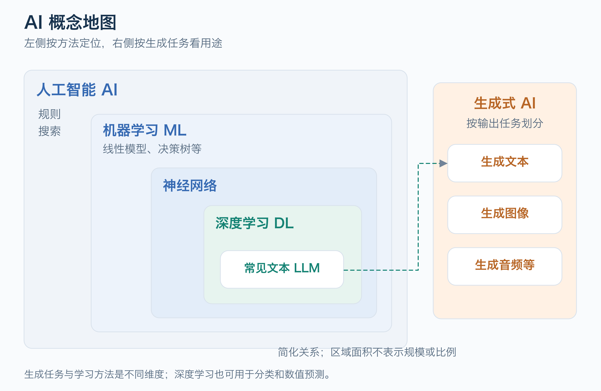
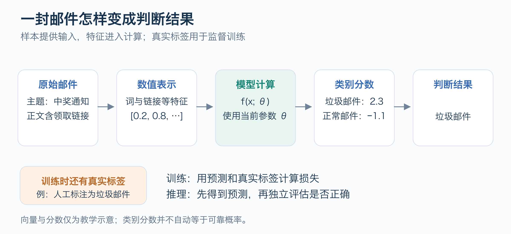
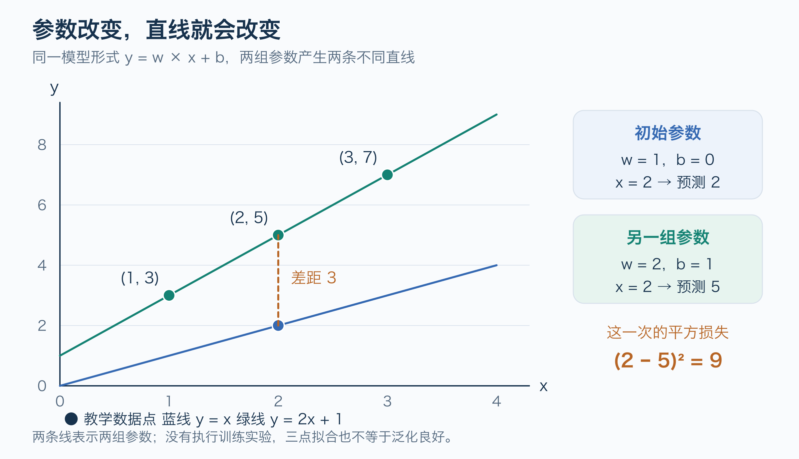
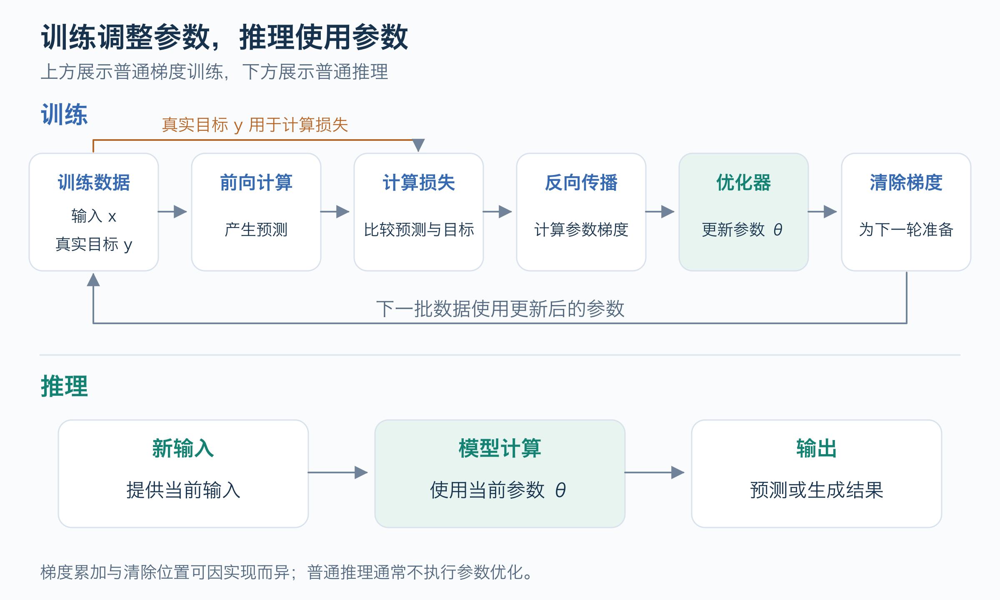
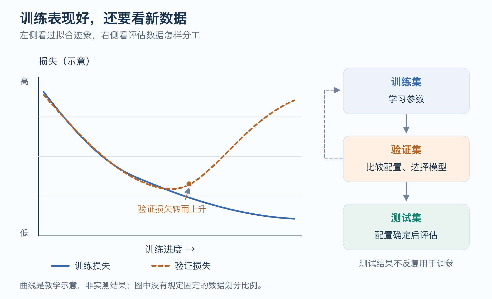
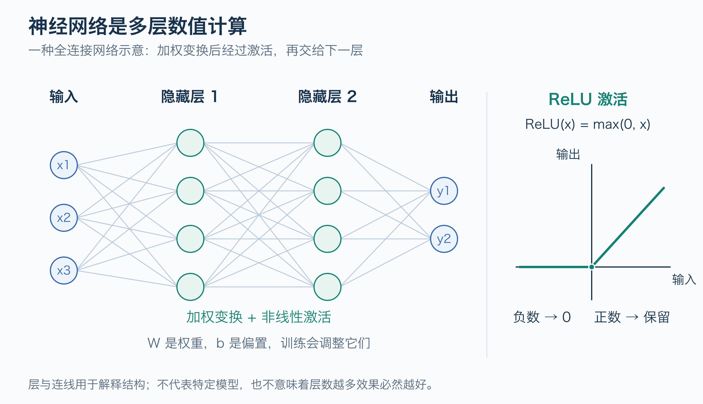
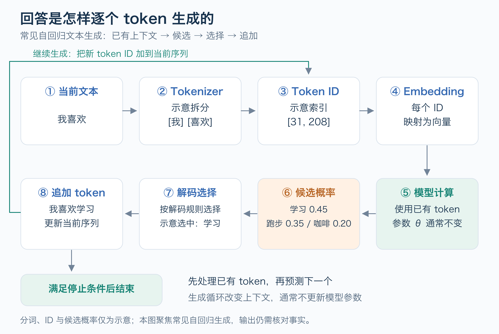

# AI基础与知识地图

学习 AI，先理解一个系统怎样把输入变成输出，再理解它怎样从数据中改善这种转换。掌握数据、模型、训练、推理和评估之间的关系，就能进一步阅读神经网络和大模型，而不用先背一长串名词。

这篇面向第一次系统接触 AI 的读者。可以先看每节的图，把关系和流程连起来，再读图下的定义与边界。数学推导、代码实践和具体产品教程留给后续专题；图中的数据、分数和曲线均为教学示意，不是实测结果。

## 1 AI 与机器学习的关系

人工智能（Artificial Intelligence，AI）是一个广泛的研究与工程领域，研究怎样让计算机完成图像识别、语音与语言处理、搜索和推理等任务。实现这些能力可以采用显式规则、搜索等方法，也可以让系统从数据中学习。[Microsoft AI 入门][ms-ai-intro]

机器学习（Machine Learning，ML）是 AI 中从数据学习的一类方法。例如，程序员可以手写垃圾邮件识别规则，也可以提供已标注的邮件，让模型学习哪些模式与垃圾邮件相关。后一种方式仍需要程序员设计数据处理、模型和评估流程；变化在于判断模式的获得方式。[Google 机器学习入门][google-ml]

图 1 是常见方法的简化地图，区域面积没有数量含义。左侧表示方法关系，右侧表示生成任务；生成式 AI 仍属于 AI，单独放置是为了区分分类维度。[Microsoft 深度学习与机器学习说明][ms-ml-intro]、[Hugging Face Transformer 概览][hf-transformers]

| 概念 | 核心含义 |
| --- | --- |
| AI | 让计算机完成需要智能能力的任务的广泛领域 |
| 机器学习 ML | 利用数据学习可用于预测、决策或生成的模式 |
| 神经网络 | 由可学习的数值变换与连接构成的模型，常组织成若干层 |
| 深度学习 DL | 使用具有多层结构的神经网络进行学习 |
| 生成式 AI | 生成文本、图像、音频等内容，从输出任务划分 |
| 大语言模型 LLM | 以大规模语言数据训练的语言模型，现代常见实现采用深度神经网络 |

生成式 AI 从“生成什么”描述任务；深度学习从“用什么模型学习”描述方法。深度学习也可以用于分类和数值预测，生成式 AI 也不等于大语言模型。[Google 机器学习入门][google-ml]

## 2 数据与模型怎样配合

以垃圾邮件识别为例。输入是一封邮件，输出是“垃圾邮件”或“正常邮件”。使用监督学习时，训练数据既包含邮件，也包含对应类别。

图 2 中，一条邮件记录是一个**样本**；供模型计算的信息是**特征**；训练时提供的目标类别是**标签**。特征可以人工设计，也可以由神经网络学习表示。普通推理不需要预先知道真实标签。

**模型**定义输入到输出的计算方式，**参数**决定这种计算中的具体数值。可以把模型记为 `f(x; θ)`：`x` 是输入，`θ` 是参数，`f` 是计算规则。训练改变参数，推理使用模型和当时的参数计算输出。[PyTorch 参数优化教程][pytorch-optimization]

图中的向量和分数只用于演示流程。分类分数能否解释为可靠概率，还需要评估，不能只看输出长得像百分比。

同样的框架可以用于其他任务：预测一个连续数值叫**回归**，选择预先定义的类别叫**分类**，创建文本或图像等内容属于**生成**。这些任务会影响数据组织、输出形式和评估方法。[Google 机器学习入门][google-ml]

## 3 训练与推理

### 用两个参数理解模型

选择模型 `预测值 = w × x + b`，其中 `w` 和 `b` 是参数。这个表达式规定了模型只能表示一条直线。

图 3 把两组参数放在同一坐标系中：蓝线在 `x = 2` 时预测 `2`，与目标 `5` 相差 `3`，平方损失为 `9`；绿线 `y = 2x + 1` 恰好经过三个点。这是参数对比，没有执行训练实验；三点拟合也不能证明真实规律或泛化能力。

### 训练怎样调整参数

**损失函数**把预测与目标之间的差距转成可优化的数值。**优化器**根据损失提供的信息调整参数。神经网络常用的反向传播计算梯度；梯度反映参数变化会怎样影响损失，优化器再据此决定更新的方向和幅度。

图 4 上方的反向传播负责**计算梯度**，优化器负责**更新参数**。下方推理使用当前参数计算结果，通常不执行参数优化。

清除梯度是为了避免在不打算累加时把多轮梯度混在一起。有些实现把清梯度放在下一轮反向传播之前；有些训练方法则有意累加多批梯度。这里采用固定 PyTorch 入门源码中的普通训练顺序，不把它当作所有机器学习算法的共同实现。[PyTorch 参数优化教程][pytorch-optimization]

**学习率**控制参数更新的步幅，通常属于训练前设定的**超参数**。参数与超参数的区别是：前者通常由训练优化得到，后者用于配置模型结构或训练过程。学习率过大或过小都可能影响训练效果，不能把“更新越猛”当作“学得越快”。

### 推理怎样使用参数

**推理（Inference）**是在给定输入上使用模型计算结果。对于普通已训练模型，推理不执行参数优化。上面的玩具模型在 `w = 2`、`b = 1` 时，输入 `x = 4` 得到 `9`；这只是模型按当前参数进行的外推，需要新数据才能检验。

在 PyTorch 中，`model.eval()` 设置某些层的评估行为，`torch.no_grad()` 关闭该代码块中的梯度记录；两者作用不同。评估模式本身不会自动关闭梯度，也不是模型“更聪明”的开关。[PyTorch 参数优化教程][pytorch-optimization]

## 4 常见的学习方式

这些名称描述训练信号从哪里来，而不是给所有系统贴一个互斥标签。同一个模型可以在不同阶段采用不同学习方式。

| 学习方式 | 训练信号 | 入门例子 |
| --- | --- | --- |
| 监督学习 | 数据中已有输入和目标的对应关系 | 用标注邮件学习分类 |
| 无监督学习 | 没有为当前任务提供目标标签，寻找数据结构 | 把相似邮件聚成组，类别名称再由人解释 |
| 自监督学习 | 从数据本身构造预测目标 | 用句子的前文预测后续 token |
| 强化学习 | 从与环境交互所得的奖励等反馈学习策略 | 游戏中根据行动和奖励学习怎样选择下一步 |

自监督学习仍然有训练目标和损失，只是目标不需要逐条人工标注。它常被归入广义的无监督学习，也可以单独讨论。生成式 AI 则描述输出任务，例如生成文本，并不是与这四种方式并列且互斥的训练信号类别。[Google 机器学习入门][google-ml]、[Hugging Face Transformer 概览][hf-transformers]

## 5 评估与泛化

**泛化**是模型在未用于训练的新数据上表现良好的能力。记住训练样本和学到能处理新样本的规律，会产生不同结果。

图 5 左侧展示一种**过拟合迹象**：训练损失继续下降，验证损失却转而上升。过拟合是过度贴合训练数据、在新数据上表现变差；**欠拟合**则连训练数据中的主要规律都没有学好。示意曲线不是实测结果，训练损失降低也不能单独证明泛化良好。[Google 过拟合说明][google-overfitting]

右侧给出分工：**训练集学习参数，验证集选择配置，测试集在配置确定后评估**。验证结果可以帮助调整配置，再进入下一轮训练。[Google 数据集划分][google-splits]

如果不断根据测试集结果调整模型，测试集就参与了决策，最后的分数会变得更难代表未知数据上的效果。训练集与评估集存在重复样本，也可能使分数虚高。这属于**数据泄漏**的一种情况。[Google 数据集划分][google-splits]

这里不规定固定划分比例。评估数据应能回答实际要验证的问题；比如用历史邮件预测未来邮件时，还要考虑邮件分布随时间变化。即使某次测试表现好，后续真实输入变化仍可能影响效果。[Google 数据集划分][google-splits]

## 6 神经网络与深度学习

线性模型对输入做一次加权计算。一个入门神经网络可以把多次计算串起来：先做加权变换，再经过**激活函数**，再交给下一层。

图 6 的连线对应加权计算，权重与偏置是可学习参数。非线性激活帮助模型表示更复杂的变化；右侧的 ReLU 把负数变为零、保留正数。PyTorch 入门网络用 `Linear` 与 `ReLU` 的组合展示了这个过程；图中节点数量用于解释结构，不对应某个实测模型。[PyTorch 神经网络教程][pytorch-network]

**深度学习**使用多层神经网络学习数据表示。理解它时，应关注每层的数值运算、参数和训练目标；“神经”这个名字并不意味着它就是人脑的复制，也不能由网络结构直接推出意识或人类式理解。

在实际阅读代码时，先辨认四件事：输入表示是什么，网络怎样计算，损失优化什么，怎样评估输出。先建立这些问题，再进入网络层数、参数量和具体架构，比较容易理解。[Microsoft 深度学习与机器学习说明][ms-ml-intro]、[PyTorch 神经网络教程][pytorch-network]

## 7 文本大模型怎样生成回答

这里聚焦常见的**自回归文本生成模型**，也就是根据已有文本逐步生成后续文本的模型。其他语言模型还可以用来生成表示、分类或预测被遮住的内容，不能把所有语言模型都理解为聊天机器人。[Hugging Face Transformer 概览][hf-transformers]

图 7 的分词、ID 与候选概率均为示意。沿 ①–⑧ 阅读一次生成流程；未满足停止条件时，新 token ID 加入当前序列，再进入下一轮计算。

### Token 与数值表示

模型先用**分词器（Tokenizer）**把文本转换成 **token**，再映射到数字 ID。Token 不一定对应一个完整单词或一个汉字，也可能是词的一部分、标点或其他单位；具体划分取决于分词器。

数字 ID 是词表中的索引，不是意义本身。**Embedding（向量表示）**再把这些 ID 映射到一组数值，供模型计算。不要因为两个 ID 的数字接近，就认为它们的含义接近。[Hugging Face 分词器教程][hf-tokenizers]、[Hugging Face 模型输入与输出][hf-representations]

### Transformer 与注意力

**Transformer**是一类神经网络架构。其核心机制之一是**注意力（Attention）**：计算一个位置的表示时，按相关程度组合其他位置的信息，帮助模型利用上下文。对自回归生成而言，下一 token 的预测不能使用尚未出现的未来文本。

Transformer 可以采用编码器、解码器或两者组合。解码器式模型适合根据已有文本继续生成；编码器式模型常用于文本表示等任务。因此，“Transformer”“LLM”和“聊天产品”分别处于架构、模型和应用层面。[Google Transformer 入门][google-transformers]、[Hugging Face Transformer 概览][hf-transformers]

### 下一 Token 预测

在常见的因果语言模型训练中，原文本提供目标：给定前文，预测下一个 token。生成时，模型计算候选 token 的分数或概率，生成过程按解码规则选择下一个 token，再把它加入已有文本，重复这个过程。

这里的“预测”不必每次都选择概率最大的候选；解码可以采用不同选择规则。下一 token 预测解释了生成流程，但不能单独证明某个模型具备什么推理能力，也不能保证它生成的句子符合事实。[Hugging Face Transformer 概览][hf-transformers]

### 预训练 微调与提示词

**预训练**先在广泛数据上学习一般模式；**微调**从已有模型继续训练，使它适应某种任务或行为。用于跟随指令的训练属于后续适配的一种形式，并不等于每一次用户提问都在训练模型。

**提示词（Prompt）**是这次输入中提供的指令、背景或示例。普通提示词使用模型已有能力，不更新模型参数。例如，把“请用三句话解释”改成“请给一个具体例子”，改变的是输入条件。[Google 微调与提示词说明][google-tuning]

因此，至少要分清两种变化：训练改变参数；普通对话在给定参数下利用当前可用的上下文。应用保存聊天记录、检索外部资料或另行安排训练，是不同机制，不能只从“它记住了我说的话”推断权重已经变化。

### 生成能力的边界

语言模型可能生成流畅但不正确或无依据的内容，常称为**幻觉（Hallucination）**。它也可能受到训练数据中偏差的影响。流畅度和篇幅都不能替代正确性评估。[Google 大模型问题说明][google-transformers]

对一个知识性回答，可以分别检查：结论是否正确，来源是否直接支持结论，生成的代码或计算是否通过实际验证。某一次生成成功，只能说明该输入上的表现，不能替代系统性评估。

## 8 自测与后续学习

读完后，先不看参考回答，尝试用自己的话解释：

1. 手写垃圾邮件规则与用标注邮件训练模型，区别在哪里？
2. 在 `预测值 = w × x + b` 中，输入、模型和参数分别是什么？
3. 为什么训练损失很低仍可能处理不好新邮件？
4. 验证集与测试集的用途有什么不同？
5. 自监督学习没有逐条人工标签，为什么仍能计算损失？
6. Token 是不是固定等于一个字？改写提示词是不是微调？
7. 模型能生成一段自然的回答，是否足以证明回答正确？

### 参考回答

1. 规则由人直接写出；机器学习从数据中调整参数以获得判断模式。两者都需要人设计系统与验证结果。
2. `x` 是输入；`w × x + b` 定义模型计算；`w` 和 `b` 是参数。训练调整参数，推理代入输入计算。
3. 模型可能过拟合，也可能遇到与训练数据不同的输入。需要在独立、适合目标场景的数据上评估。
4. 验证集帮助选择配置；测试集用于配置确定后的评估。反复按测试结果调参会影响评估的独立性。
5. 数据本身可以构造目标，比如以原文中实际出现的下一 token 作为答案，再比较预测与目标。
6. Token 的单位由分词器决定。普通提示词改变输入；微调执行进一步训练并更新可训练参数。
7. 不足以。语言流畅和事实正确是不同维度，需要核对证据或执行相应验证。

后续可以先沿两条线深入：用线性回归理解损失与梯度下降，再用一个小神经网络理解层、激活和训练循环。掌握这些以后，进入 token 化、向量表示和 Transformer；RAG 与工具调用放在应用专题中学习。

## 来源与证据边界

关键概念和机制对应 [基础篇证据包](../../../evidence/ai/foundations/ai-basics/manifest.json)。其中记录来源与章节映射，固定文档源码的 revision、SHA-256 和短字符串断言；动态官方网页记录其实际更新时间与检索日期。

本篇讨论通用入门模型。PyTorch 来源用于说明该教程的网络和训练流程，Hugging Face 来源用于说明语言模型与分词机制；这些资料不构成任何具体模型、产品、设备或生产系统的能力保证。插图按这些机制绘制，数字与曲线仅作教学说明，没有执行训练实验。

[ms-ai-intro]: https://github.com/microsoft/AI-For-Beginners/blob/392d0df1b2647cbee104942390551f1ed9e072c8/lessons/1-Intro/README.md
[ms-ml-intro]: https://github.com/MicrosoftDocs/azure-docs/blob/d3f6cad1dc6eb96ad90d7b407b9147605435952c/articles/machine-learning/concept-deep-learning-vs-machine-learning.md
[google-ml]: https://developers.google.com/machine-learning/intro-to-ml/what-is-ml
[google-splits]: https://developers.google.com/machine-learning/crash-course/overfitting/dividing-datasets
[google-overfitting]: https://developers.google.com/machine-learning/crash-course/overfitting/overfitting
[google-transformers]: https://developers.google.com/machine-learning/crash-course/llm/transformers
[google-tuning]: https://developers.google.com/machine-learning/crash-course/llm/tuning
[pytorch-optimization]: https://github.com/pytorch/tutorials/blob/ca960b6a7cd299ba00a644aa918bbcffdeb70152/beginner_source/basics/optimization_tutorial.py
[pytorch-network]: https://github.com/pytorch/tutorials/blob/ca960b6a7cd299ba00a644aa918bbcffdeb70152/beginner_source/basics/buildmodel_tutorial.py
[hf-transformers]: https://github.com/huggingface/course/blob/8b893f0ede6c781045692a7f892f25a0c92b4805/chapters/en/chapter1/4.mdx
[hf-tokenizers]: https://github.com/huggingface/course/blob/8b893f0ede6c781045692a7f892f25a0c92b4805/chapters/en/chapter2/4.mdx
[hf-representations]: https://github.com/huggingface/course/blob/8b893f0ede6c781045692a7f892f25a0c92b4805/chapters/en/chapter2/2.mdx
