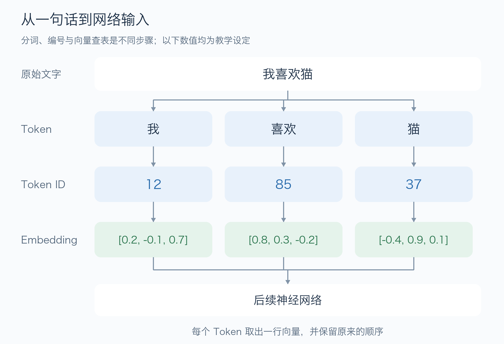
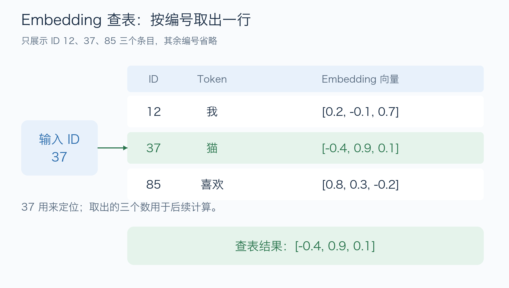
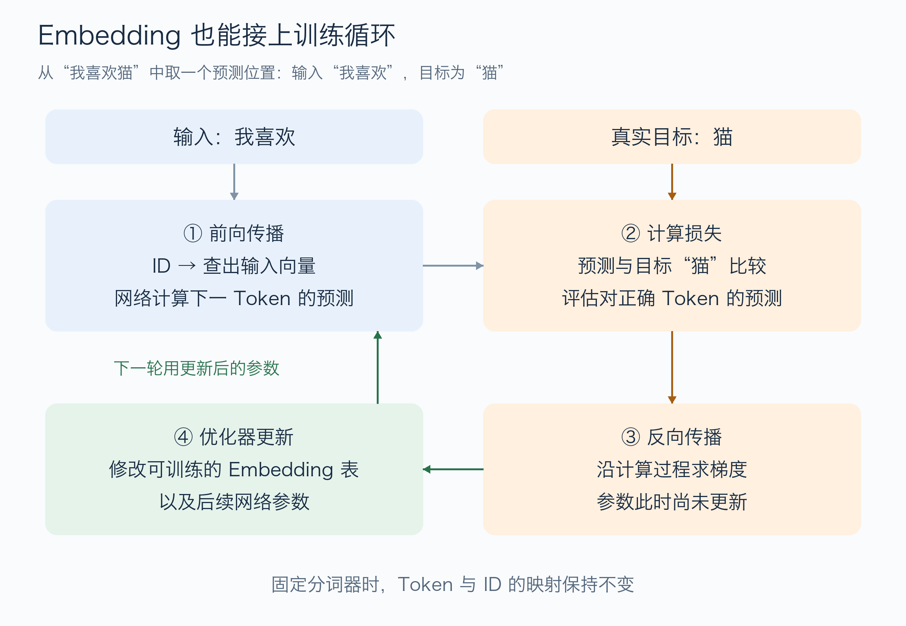
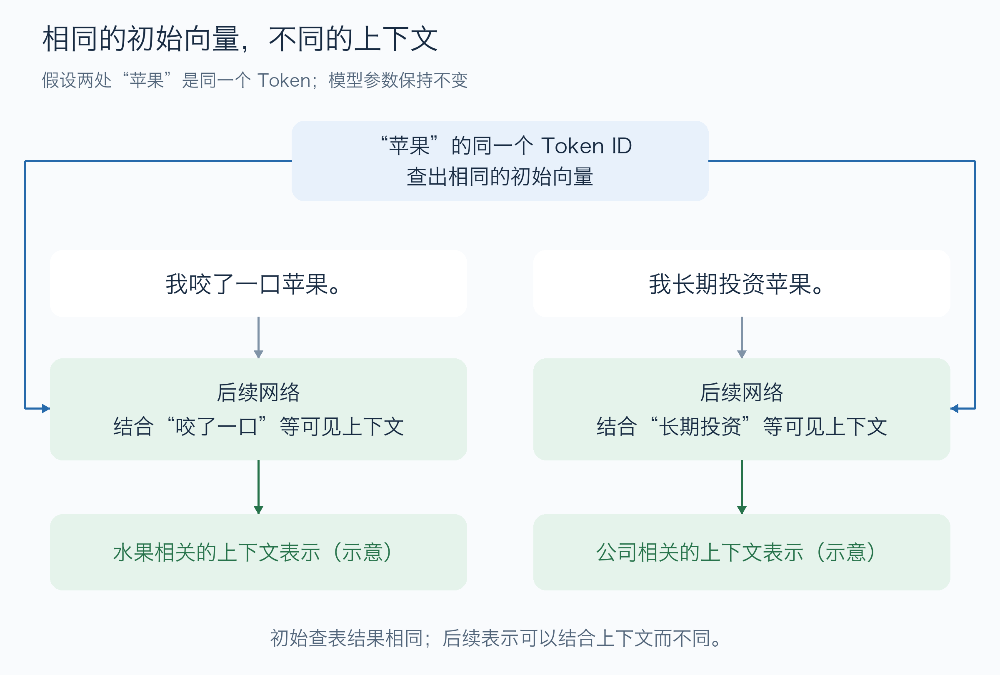

# Token 与 Embedding 入门

**Token 是文字的处理单位，Token ID 是编号，Embedding 是按编号取出的一组数字。** 这些数字交给后续神经网络，文字就接上了已经学过的前向计算与训练过程。

先读过 [小神经网络与训练循环](../deep-learning/小神经网络与训练循环.md) 即可。这里用一句话串起分词、查表、训练和上下文，不要求先学矩阵运算。

下文中文分词、ID 和三维向量均为教学设定，不对应某个实际模型。这里只画文字进入网络的主要路径，省略特殊 Token、位置与其他输入信息。

## 1 从一句话到数字

以前的小网络输入是 `2` 这样的数值。现在换成一句话：

> 我喜欢猫

先把文字拆成处理单位，再查到编号，再按编号取出向量，最后交给网络继续计算。[Hugging Face 分词器教程][hf-tokenizers]、[PyTorch Embedding 源码][pytorch-embedding]

图 1 中，“我”“喜欢”“猫”各占一个 Token；对应的 `12、85、37` 是任意选定的示意编号。三个 Token 各取出一个向量，按原来的顺序送入网络。

## 2 Token 和 ID 各自的作用

**Token 可以先理解为模型处理文字的小单位。** 分词器，也就是 Tokenizer，决定怎样拆分。不同分词器可能得到不同结果：一个 Token 可能对应一个字、一个词、词的一部分、标点或字节片段，不能固定理解成“一个 Token 就是一个汉字”。[Hugging Face 分词器教程][hf-tokenizers]

拆分之后，每个 Token 在词表中都有对应的 **Token ID**。这里把它理解为查找条目用的编号，类似通讯录中的联系人编号。

例如，`37` 对应“猫”，只是在说“到编号 37 的位置去找”。编号大不表示含义更强，两个编号相邻也不能说明对应的文字含义相近。把“猫”和“狗”随意编号为 `37` 和 `900`，也不妨碍后续学习它们之间的关系。

使用已有模型时，分词规则和词表应与模型配套；不能随意换一套编号再交给原模型。原来按“猫”训练的那一行表示，不会因为换了编号就自动变成另一个 Token 的表示。[Hugging Face 分词器教程][hf-tokenizers]

## 3 Embedding 怎样查表

**Embedding 把每个 ID 映射成一组数字。** 这组数字叫作“向量”；现阶段，把向量理解为“一排有固定顺序的数字”就够了。

图 2 只画出表中的三个条目，省略其他编号。输入 `37` 时，查表取出 `[-0.4, 0.9, 0.1]`；输入 `12、85、37` 时，就按顺序取出三行。PyTorch 的 `nn.Embedding` 使用整数索引取出相应向量，表中的权重可以参与学习。[PyTorch Embedding 源码][pytorch-embedding]

这里用三个数字方便展示，称为“三维向量”。真实模型的向量长度由模型设计决定；同一张表中的每行长度一致，才能接入后续网络。

为什么要用一组数字？编号只负责定位，而向量中的多个数值可以参与加权、组合和训练，使模型形成对任务有用的表示。**ID 负责找到哪一行，向量负责提供后续计算的输入。**

不要急着把每个位置解释成“动物程度”“喜欢程度”。实际学到的维度通常没有这样直接的人类含义；向量之间的关系取决于训练数据与任务。[Google Embedding 训练说明][google-embeddings]

## 4 Embedding 怎样学出来

Embedding 表里的数字也可以是模型参数。从零训练时可以先初始化这些数字，再通过训练调整；加载已有模型时，可以沿用已经学到的值。是否继续更新这张表，取决于它是否被设为可训练。[PyTorch Embedding 源码][pytorch-embedding]

现在接回熟悉的三个动作：**前向算预测，反向算梯度，优化器改参数。** 优化器负责执行参数更新，这里可以先沿用之前的梯度下降来理解。

假设训练文本中有“我喜欢猫”，并沿用图 1 的分词方式。取其中一个预测位置：输入“我喜欢”，目标是文本中实际出现的下一个 Token“猫”。这个目标来自当前训练样本，不是说“我喜欢”后面永远只能接“猫”。因果语言模型可以从原文本构造这样的预测目标。[Hugging Face 语言模型教程][hf-language-models]

沿图 3 看一轮训练：

1. **前向传播**：把输入转换成 ID，查出向量，后续网络计算下一个 Token 的预测。
2. **计算损失**：比较预测与目标“猫”。这里关注模型对正确 Token 的预测情况，不把两个 ID 当连续数值相减；编号差得近并不表示预测得更好。
3. **反向传播**：沿着计算过程，求出可训练参数怎样影响损失。此时参数还没有更新。
4. **优化器更新**：调整可训练的 Embedding 表和后续网络参数。下一轮使用更新后的参数重新计算。[PyTorch 优化教程][pytorch-optimization]、[Google Embedding 训练说明][google-embeddings]

在这类使用固定分词器的常见训练中，“猫”的编号仍然是 `37`；参与调整的是可训练的数值表示和网络权重。编号映射与 Embedding 表是两个不同的东西。

当模型只是处理一次普通输入时，查出向量、运行前向计算即可；查表本身不等于又训练了一次。推理与训练的区别，可以回看 [小神经网络与训练循环](../deep-learning/小神经网络与训练循环.md#5-从一个样本走到训练循环)。

## 5 从初始向量到上下文表示

先看两句话：

> 我咬了一口苹果。
>
> 我长期投资苹果。

第一句里的“苹果”指水果，第二句里指公司。假设两处“苹果”都作为同一个 Token，在相同参数下，仅从同一张 Token Embedding 表查出的向量相同。

区别发生在后续计算中：网络结合当前可见的上下文，形成包含上下文信息的表示。**查表得到的初始向量，与后续网络算出的上下文表示，需要分开理解。** 图 4 用水果和公司说明这种区别，不对应一次真实模型输出。[Google 上下文表示说明][google-embeddings]

注意力机制是让不同位置交换信息的一种方法。后面会继续学习：计算“苹果”这个位置时，怎样利用其他位置的信息。对于自回归文本生成，只能利用当前位置及之前可见的内容，不能提前看到后面尚未出现的文本。[Google 上下文表示说明][google-embeddings]、[Hugging Face 语言模型教程][hf-language-models]

## 6 自测与后续学习

先尝试用自己的话回答：

1. 一个 Token 一定等于一个汉字吗？
2. “猫”的编号是 `37`，是否说明它和编号 `38` 的 Token 含义相近？
3. 输入 ID `37` 时，Embedding 层先做什么？
4. 训练时可以更新的是编号，还是表里的向量数值？
5. 同一个 Token 查出了相同向量，为什么在两句话中仍可能形成不同表示？

参考回答：

1. 不一定，具体单位取决于分词器。
2. 不能，编号本身不表达这种关系。
3. 按编号取出对应的一行向量。
4. 在固定分词器的常见训练中，编号映射保持不变；可训练的向量数值可以更新。
5. 后续网络还会结合可见上下文继续计算。

理解这些以后，下一步学习注意力与位置信息，再把它们连接到 Transformer。继续沿用“先看数据怎么走，再看每一步解决什么问题”的方式。

## 来源与适用边界

关键机制对应 [Token 与 Embedding 证据包](../../../evidence/ai/language-models/token-embedding/manifest.json)。这里聚焦语言模型输入端的 Token Embedding 查表；句子向量、检索向量的生成方法，以及完整 Transformer 架构，分别需要后续展开。

[hf-tokenizers]: https://github.com/huggingface/course/blob/8b893f0ede6c781045692a7f892f25a0c92b4805/chapters/en/chapter2/4.mdx
[pytorch-embedding]: https://github.com/pytorch/pytorch/blob/80acc2b144797cf7135614e6696ccf660f831356/torch/nn/modules/sparse.py
[google-embeddings]: https://developers.google.com/machine-learning/crash-course/embeddings/obtaining-embeddings
[hf-language-models]: https://github.com/huggingface/course/blob/8b893f0ede6c781045692a7f892f25a0c92b4805/chapters/en/chapter1/4.mdx
[pytorch-optimization]: https://github.com/pytorch/tutorials/blob/ca960b6a7cd299ba00a644aa918bbcffdeb70152/beginner_source/basics/optimization_tutorial.py
