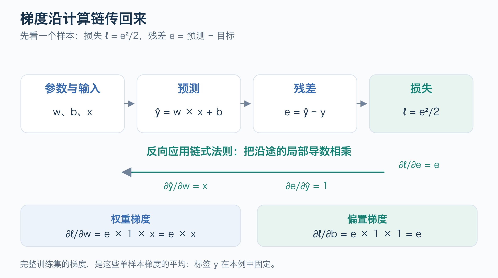
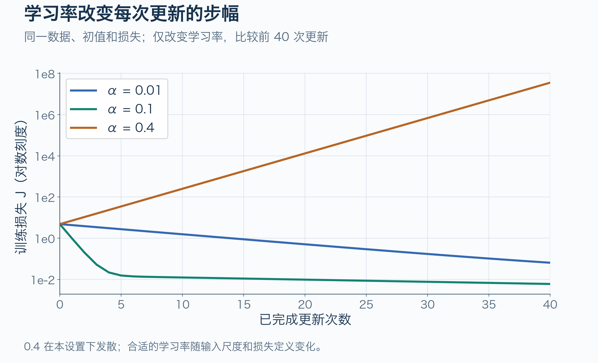

# 线性回归与梯度下降

线性回归规定了预测的形式，损失函数规定了“差多少”，梯度告诉我们参数向哪边改，学习率决定一次改多少。把这四件事连起来，就能理解最小的训练循环。

先读过 [AI基础与知识地图](../foundations/AI基础与知识地图.md) 即可。这里沿用三个教学数据点，不要求先掌握完整微积分：遇到偏导数时，把它理解为“暂时固定其他参数，只看这个参数变化对损失的影响”。图中的数据均为人工构造；训练曲线由附带的标准库 Python 实验计算。

## 1 一条直线怎样产生误差

模型为 `ŷ = w × x + b`。`ŷ` 读作预测值，`x` 是输入，`y` 是目标；`w` 决定斜率，`b` 决定截距。这里的 `x`、`y` 没有实际业务单位。


图 1 中，三个点为 `(1, 3)`、`(2, 5)`、`(3, 7)`。本例人为选定初始参数 `w = 1, b = 0`，所以预测为 `1, 2, 3`。定义**残差** `e = ŷ − y`，得到 `−2, −3, −4`。这里统一采用“预测减目标”，后续梯度的符号也据此计算。

初始参数的选择、图中最优直线的求解，以及更新公式的数学依据，见 [线性回归的最优解与更新依据](线性回归的最优解与更新依据.md)。

线性回归可以有多个输入特征，这里只研究单个特征。它对可学习参数做线性组合；当前模型只能表示一条直线。训练调整这条直线，不能凭空让它变成任意曲线。[Google 线性回归推导][google-gradient]

## 2 为什么用平方损失

直接平均残差可能让正负误差抵消。例如 `+3` 与 `−3` 平均为零，但两个预测都错了。平方能去掉符号，也会放大较大的误差：误差从 `2` 增加到 `4`，平方项从 `4` 增加到 `16`。[Google 损失函数][google-loss]

对 `n` 个样本，这里使用平均平方误差的一半：

```text
MSE(w, b) = (1/n) × Σ (w × xᵢ + b − yᵢ)²
J(w, b)   = MSE(w, b) / 2
          = (1/(2n)) × Σ eᵢ²
```

`Σ` 表示把所有样本的项加起来；`i` 是样本编号。多出来的 `1/2` 让求导时平方产生的 `2` 抵消，**不改变最小值所在的参数位置**，但会让梯度减半。比较不同资料或代码的学习率前，先确认它们使用的是 `MSE` 还是 `MSE/2`。

| x | 目标 y | 初始预测 ŷ | 残差 e | 平方 e² |
| --- | --- | --- | --- | --- |
| 1 | 3 | 1 | −2 | 4 |
| 2 | 5 | 2 | −3 | 9 |
| 3 | 7 | 3 | −4 | 16 |

因此初始 `J = (4 + 9 + 16) / 6 = 29/6 ≈ 4.833333`。损失是对当前参数的评价；它本身还没有说明该怎样更新参数。

平方损失是这个实验的选择。实际任务也可能使用绝对误差等目标；对异常值的敏感度和错误代价会影响选择。最小化某种损失，并不等于已经优化了所有实际关心的指标。[Google 损失函数][google-loss]

## 3 梯度怎样从误差算出来

**导数**描述局部变化率。模型参数有 `w` 和 `b` 两个，用 `∂J/∂w` 表示固定 `b` 时，`w` 的微小变化怎样影响 `J`；`∂J/∂b` 同理。这两个偏导数组成当前点的**梯度**。

先看一个样本的损失 `ℓ = e²/2`。计算被串成了 `w、b → ŷ → e → ℓ`，因此可以沿链条把局部变化率相乘，这就是**链式法则**。



图 2 的两条路径分别给出：

```text
∂ℓ/∂w = (∂ℓ/∂e) × (∂e/∂ŷ) × (∂ŷ/∂w)
       = e × 1 × x = e × x

∂ℓ/∂b = e × 1 × 1 = e
```

这里用到了三个很小的规则：`e²/2` 对 `e` 的导数是 `e`；`ŷ − y` 对 `ŷ` 的导数是 `1`；`w × x + b` 对 `w` 的导数是 `x`，对 `b` 的导数是 `1`。标签 `y` 固定，不作为本例的可训练参数。

再对所有样本取平均，就得到完整训练集的梯度：

```text
g_w = ∂J/∂w = (1/n) × Σ eᵢ × xᵢ
g_b = ∂J/∂b = (1/n) × Σ eᵢ
```

这是从本篇 `J = MSE/2` 推导出的公式；官方教程直接使用 MSE 时会多一个系数 `2`。[Google 梯度推导][google-gradient]

梯度为正，表示在当前点略微增大这个参数会使损失上升；梯度为负，则表示略微增大它会使损失下降。这个判断是**局部**的，不能据此随意迈很大一步。

## 4 手算一次参数更新

把初始残差代入上式：

```text
g_w = [(-2)×1 + (-3)×2 + (-4)×3] / 3 = −20/3
g_b = [−2 − 3 − 4] / 3 = −3
```

普通梯度下降使用 `参数的新值 = 参数的旧值 − 学习率 × 梯度`。选 `α = 0.1`，得到：

```text
w_new = 1 − 0.1 × (−20/3) = 5/3 ≈ 1.666667
b_new = 0 − 0.1 × (−3)    = 0.3
```

两个梯度都要用**同一组旧参数**算完，再一起更新。若先改 `w`，又按新 `w` 重新计算 `b` 的梯度，就不是这里推导的这一步普通梯度下降。

| x | 更新后的预测 | 更新后的残差 |
| --- | --- | --- |
| 1 | 59/30 ≈ 1.966667 | −31/30 |
| 2 | 109/30 ≈ 3.633333 | −41/30 |
| 3 | 53/10 = 5.3 | −17/10 |

更新后 `J = 5243/5400 ≈ 0.970926`，低于初始 `4.833333`。这说明本次更新改善了这个训练目标。继续重复前向计算、梯度计算和更新，参数会接近 `w = 2, b = 1`。


图 3 的横轴、纵轴是**参数** `w、b`，不是样本的 `x、y`。等高线连接损失相同的参数组合，圆点表示实际更新步骤。训练就是在参数空间中寻找更低的损失。[Google 梯度下降][google-gradient]

本例的平方损失是凸二次函数，三个输入也足以区分斜率和截距，因此最优参数唯一。配合合适的学习率，普通梯度下降可以收敛到它；不能把这个性质直接推广到所有神经网络。若所有输入 `x` 都相同，就可能无法唯一确定 `w、b`。

## 5 学习率为什么会改变结果

学习率控制步幅，并不是样本误差，也不是由本例训练自动学出来的参数。[Google 超参数][google-hyper]



图 4 固定数据、初始参数和损失定义，只改变学习率。前 40 次更新中，`0.01` 改善较慢，`0.1` 下降较快，`0.4` 使损失越来越大。这些数值只适用于当前教学设置；改变输入尺度或损失系数，合适的学习率也会改变。

图中的纵轴为对数刻度，用于同时显示很小和很大的损失。`1e2` 表示 `100`，`1e-2` 表示 `0.01`；指数增加 `1` 表示数值乘以 `10`。它没有改变训练中实际计算的 `J`。

每次用所有样本计算平均梯度，叫**全批量梯度下降**。一次使用一个随机样本通常叫 SGD，使用一小批样本叫 mini-batch SGD。小批梯度会随抽到的数据变化，损失不必每一步都下降。PyTorch 的优化器名 `SGD` 不会替你决定批大小；输入全量数据时，它也可以执行本例的全批量更新。[Google 超参数][google-hyper]、[PyTorch 优化教程][pytorch-optimization]

真实输入若尺度差异很大，某些方向的更新可能更难协调。特征缩放及其对优化的影响，留到后续数据处理内容中展开。

## 6 运行最小实验

完整代码见 [linear_regression.py](examples/linear_regression.py)。它只使用 Python 标准库，显式计算前面两个梯度，不依赖自动求导。以下命令从仓库根目录执行：

```bash
python3 knowledge/ai/machine-learning/examples/linear_regression.py
python3 knowledge/ai/machine-learning/examples/linear_regression.py --lr 0.4 --steps 40
```

核心更新只有几行，注意梯度来自更新前的参数：

```python
errors = [w * x + b - y for x, y in data]
n = len(data)
dw = sum(e * x for e, (x, _) in zip(errors, data)) / n
db = sum(errors) / n
w, b = w - learning_rate * dw, b - learning_rate * db
```

默认实验的部分输出如下，小数有舍入：

| 已完成更新次数 | w | b | J |
| --- | --- | --- | --- |
| 0 | 1.000000 | 0.000000 | 4.833333 |
| 1 | 1.666667 | 0.300000 | 0.970926 |
| 10 | 2.182556 | 0.584003 | 0.012404 |
| 100 | 2.061606 | 0.859955 | 0.001407 |
| 2000 | 2.000000 | 1.000000 | 约 1.56 × 10⁻²³ |

第 10 次更新的 `w` 超过 `2`，但 `b` 还小于 `1`；两个参数共同决定预测，单看一个参数是否接近答案不能代替检查损失。浮点运算使最终损失接近零，而非必须精确等于零。

将 `x = 4` 代入最终模型得到约 `9`。本实验的数据正好来自 `y = 2x + 1`，所以这是预先构造规律下的结果；真实任务还需要独立数据检验，不能把三个点的训练拟合当作泛化证据。[Google 数据集划分][google-splits]

## 7 自测与下一步

1. 为什么不能直接用残差的平均值当作“错误大小”？
2. 将 `J = MSE/2` 改为 `J = MSE`，梯度和最优参数各有什么变化？
3. `g_w < 0` 时，普通梯度下降会增大还是减小 `w`？
4. 为什么一次更新要先算完两个梯度？

参考回答：正负残差会抵消；梯度变为两倍而最优位置不变；会增大 `w`；两个梯度需要对应同一个参数点，才能构成这里的一步梯度下降。

接下来读 [小神经网络与训练循环](../deep-learning/小神经网络与训练循环.md)：保留同样的损失与更新规则，把“一个线性计算”扩展成“线性层、激活、线性层”，再沿计算链求梯度。

## 来源与验证边界

机制来源及章节映射见 [线性回归证据包](../../../evidence/ai/machine-learning/linear-regression/manifest.json)。公式和数值是对本文教学模型的推导；插图为原创，训练曲线由附带脚本计算。标准库实验已运行并核对梯度及一次更新；PyTorch 官方来源用于对照优化器流程，未执行 PyTorch 训练，也未验证真实数据、设备或部署效果。

[google-loss]: https://developers.google.com/machine-learning/crash-course/linear-regression/loss
[google-gradient]: https://developers.google.com/machine-learning/crash-course/linear-regression/gradient-descent
[google-hyper]: https://developers.google.com/machine-learning/crash-course/linear-regression/hyperparameters
[pytorch-optimization]: https://github.com/pytorch/tutorials/blob/ca960b6a7cd299ba00a644aa918bbcffdeb70152/beginner_source/basics/optimization_tutorial.py
[google-splits]: https://developers.google.com/machine-learning/crash-course/overfitting/dividing-datasets
