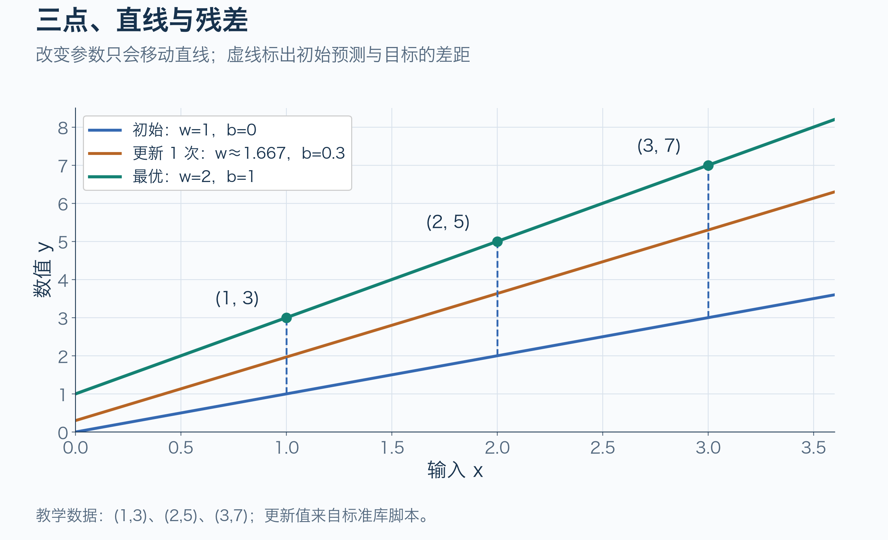
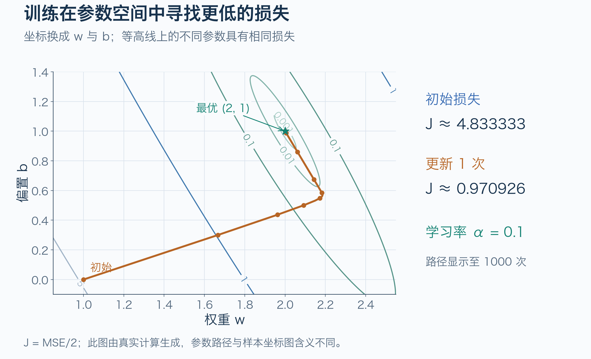
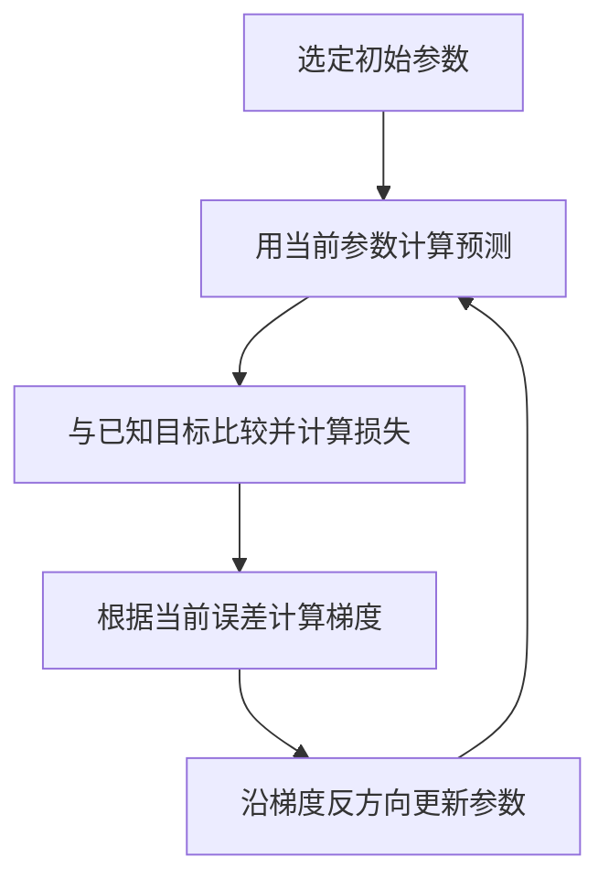

# 线性回归的最优解与更新依据

**初始参数是人为选定的起点，最优参数是训练希望找到的结果。更新时，算法只使用数据和当前误差，不需要提前知道答案。**

这是 [线性回归与梯度下降](线性回归与梯度下降.md) 的数学补充，解释最优解如何确定、为什么可以从 `w = 1、b = 0` 开始，以及梯度和更新公式从哪里来。学习率比较、批量训练和可运行实验继续由主篇维护。

沿用三个人工构造的数据点 `(1, 3)`、`(2, 5)`、`(3, 7)`。模型是 `ŷ = wx + b`：`x` 是输入，`y` 是已知目标，`ŷ` 是预测；`w` 决定斜率，`b` 决定截距。这里没有业务单位。

## 1 最优参数如何确定

首先要规定“怎样算好”。本例选择：**让所有预测与目标之间的平方误差尽可能小**。

三个点对应的损失是：

```text
J(w, b) = [(w+b−3)² + (2w+b−5)² + (3w+b−7)²] / 6
```

这里除以 `6`，来自“三个样本取平均，再乘 `1/2`”。所以 `J` 是平均平方误差 MSE 的一半；这个正系数不改变最优参数，但会改变梯度的大小。训练要解决的问题是：哪一组 `w、b` 能让 `J(w, b)` 最小？[Google 平方损失][google-loss]

本例恰好可以直接算出来。从前两个点求直线：

```text
w = (5−3)/(2−1) = 2
b = 3−2×1 = 1
```

再检查第三个点：`2×3+1 = 7`，也完全吻合。

此时三个误差都是零，因此 `J = 0`。**平方不可能小于零，所以这已经是全局最小值。** 两个不同输入点已经唯一确定这条直线，第三个点用于核对它也满足数据。



图中提前画出最优直线，是为了比较训练过程。最优参数不参与后续梯度计算。

真实数据往往不能被一条直线全部穿过，此时“最优”仍然指所选平方损失最小，损失通常大于零。不能只用前两个点确定答案，再忽略其他样本。训练集上的最优拟合，也不等于已经证明对新数据预测准确；评估边界见 [主篇](线性回归与梯度下降.md#6-运行最小实验)。

## 2 初始参数如何选择

`w = 1、b = 0` 是本例人为选定的初始参数，没有从三个数据点中推导出来。对这个模型，也可以从 `w = 0、b = 0` 或其他有限参数开始；能否稳定接近最优点还取决于学习率。

**参数与预测值是两件事。** 先设定参数，再把输入代入公式，才得到预测：

```text
人为设定参数：w = 1，b = 0
代入预测公式：ŷ = w×x+b

x = 1 → ŷ = 1×1+0 = 1
x = 2 → ŷ = 1×2+0 = 2
x = 3 → ŷ = 1×3+0 = 3
```

目标值 `y = 3、5、7` 来自训练数据。因此用“预测减目标”定义残差，就得到 `e = ŷ−y = −2、−3、−4`。

训练的任务就是逐渐改好初始参数。如果恰好从本例的最优参数 `w = 2、b = 1` 开始，残差和梯度已经为零，普通梯度下降不会继续移动。

选定初值后，再根据当前损失反复调整参数，是梯度下降的迭代过程；初值的具体数值属于这个教学例子的设置。[Google 梯度下降][google-gradient]

## 3 从平方展开推导梯度

更新的依据是：**改变某个参数，会让损失怎样变化？**

导数描述这种局部变化率。损失同时依赖 `w、b`，所以分别计算偏导数：计算一个参数的影响时，暂时固定另一个参数。记号 `∂ℓ/∂w` 表示单个样本损失 `ℓ` 对参数 `w` 的偏导数。

先看单个样本：

```text
残差：e = wx+b−y
损失：ℓ = e²/2
```

如果 `w` 增加一个很小的量 `δ`，残差就从 `e` 变成 `e+xδ`。`δ` 读作 delta，表示参数的改变量。展开平方：

```text
新损失 − 旧损失
= [(e+xδ)²−e²]/2
= exδ + x²δ²/2
```

对于非零 `δ`，再除以参数的改变量：

```text
损失变化 / 参数变化 = ex + x²δ/2
```

当 `δ` 越来越接近零，后一项趋近零，于是：

```text
∂ℓ/∂w = e×x
```

同样，`b` 增加 `δ`，残差就增加 `δ`：

```text
新损失 − 旧损失 = [(e+δ)²−e²]/2 = eδ + δ²/2
损失变化 / 参数变化 = e + δ/2

当 δ 趋近零：∂ℓ/∂b = e
```

把三个样本的贡献取平均，就是整个训练集的梯度：

```text
g_w = ∂J/∂w = (e₁x₁ + e₂x₂ + e₃x₃)/3
g_b = ∂J/∂b = (e₁ + e₂ + e₃)/3
```

这些公式是从损失函数推导出来的。它们与 [主篇的链式法则推导](线性回归与梯度下降.md#3-梯度怎样从误差算出来) 相同，只是这里从平方展开和变化率的极限出发。Google 教程使用完整 MSE，因此梯度比这里的 `MSE/2` 多一个系数 `2`。[Google 梯度推导][google-gradient]

## 4 负梯度为什么能降低损失

梯度为正，表示略微增大参数会使损失上升，所以应减小参数；梯度为负，则应增大参数。普通梯度下降把两种情况统一写成：

```text
新参数 = 旧参数 − 学习率×梯度
```

这里的学习率记作 `α`，由实验设置决定，控制每次移动的幅度。更具体的数学依据是：对很小的参数改动，损失变化可以用当前点的偏导数作一阶近似：

```text
ΔJ ≈ g_w×Δw + g_b×Δb
```

`Δ` 也表示改变量；`Δw、Δb` 是两个参数的改动，`ΔJ` 是相应的损失改动。选择沿梯度反方向移动：

```text
Δw = −αg_w
Δb = −αg_b

ΔJ ≈ −α(g_w²+g_b²)
```

当 `α > 0`、梯度不为零时，这个近似值为负。**只要步长足够小，负梯度方向就能降低当前损失。**

这里的“足够小”很关键：近似式省略了更高阶的变化，步子太大可能跨过最低点，损失反而上升。梯度为零时，这条更新规则不移动；本例的目标函数允许确定其唯一最优解，但不能把“梯度为零就一定是最优”推广到任意模型。[Google 梯度下降][google-gradient]



这张图画的是参数空间。沿路径移动，表示同时调整 `w、b`；损失由这两个参数共同决定。学习率改变路径和损失的具体比较见 [主篇](线性回归与梯度下降.md#5-学习率为什么会改变结果)。

## 5 完整的一次更新与循环

代入初始残差 `−2、−3、−4`：

```text
g_w = [(−2)×1 + (−3)×2 + (−4)×3]/3 = −20/3
g_b = (−2−3−4)/3 = −3
```

本例选定学习率 `α = 0.1`：

```text
w_new = 1 − 0.1×(−20/3) = 5/3 ≈ 1.666667
b_new = 0 − 0.1×(−3)    = 0.3
```

两个梯度都根据**同一组旧参数**计算完，再一起更新。此时初始损失 `29/6 ≈ 4.833333` 变为 `5243/5400 ≈ 0.970926`。更新后的逐样本预测和残差见 [主篇的一次更新](线性回归与梯度下降.md#4-手算一次参数更新)。

之后用新参数重新预测、重新计算残差和梯度，继续更新：



这个小例子可以直接求出最优直线；采用梯度下降，是为了理解逐步求解的训练过程。训练循环每一步只使用当前参数、输入和目标，不会把已知最优参数作为更新依据。运行方法与完整轨迹见 [主篇的最小实验](线性回归与梯度下降.md#6-运行最小实验)。

## 来源与验证边界

来源与章节映射见 [补充推导证据包](../../../evidence/ai/machine-learning/linear-regression-derivation/manifest.json)。平方展开、零损失最优解和一阶近似是对上述教学模型的数学推导；插图复用主篇的原创图，更新轨迹由 [标准库实验](examples/linear_regression.py) 计算。公式与一次更新已核对，标准库实验已运行；这些结果不涉及真实数据、PyTorch 训练或部署效果的验证。

[google-loss]: https://developers.google.com/machine-learning/crash-course/linear-regression/loss
[google-gradient]: https://developers.google.com/machine-learning/crash-course/linear-regression/gradient-descent
