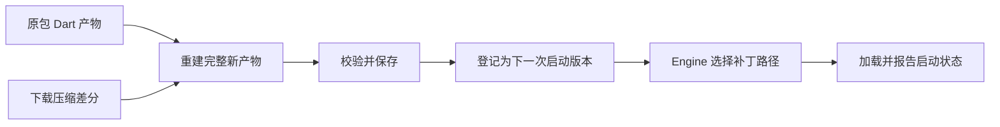

# Shorebird 热更新：Engine 加载与 Dart 混合执行

Shorebird 的主要改动位于启动加载、Dart 工具链和更新生命周期。Android 使用重新编译的 Dart AOT 产物；iOS 通过原包 AOT 复用与解释执行组合运行补丁。二进制差分负责传输，新产物如何被加载和执行是另一层机制。

## 范围与证据基线

- 范围：Android/iOS Code Push 的产物、启动入口、iOS 编译器优化和失败恢复。
- 非范围：接入教程、具体应用状态、商店政策判断、渲染管线优化及设备性能实测。
- 核对日期：2026-09-10。Engine 固定为 `shorebirdtech/engine@e4575c7403bd3453d04bfa03e01218e5a0bca0c6`；updater 为 `57d2e7cdf874703b2c99782cd8df8bf9cc0819cc`；官方文档仓库为 `936848886b5f2d83b3d5dd9e7ad7f68c1710896d`。
- 三个 revision 是分别核对的来源基线，不表示它们组成经过构建验证的同一 SDK 发行版，也不表示独立 Engine 仓库覆盖所有最新 Flutter 版本。
- [证据包](../../../evidence/flutter/engine/shorebird-code-push/manifest.json)保存 claim 映射、固定源码路径、SHA-256 与字符串断言；断言验证来源内容，不替代运行时测试。

## 更新对象与生效时机

证据：`shorebird-001`、`shorebird-002`。

| 对象 | 内容或职责 | 更新关系 |
| --- | --- | --- |
| Android `libflutter.so` | Engine、Dart Runtime，以及预置的 updater 集成 | 随安装包分发；不是 Dart patch 的替换对象 |
| Android `libapp.so` | 应用及其依赖的 Dart AOT 产物 | 作为差分重建基线，产生下一次启动使用的新产物 |
| iOS 基础 snapshot 与补丁 | 原 IPA 中的 AOT 和可供定制运行时读取的新产物 | 按可复用关系组合执行，不能套用 Android 动态库替换模型 |

Code Push 不等于开发态 hot reload。默认流程是本次启动后台检查、下载并保存，下一次应用重启运行补丁；不是在当前 isolate 中保持对象状态并现场重载代码。每个 patch 对应指定 release，产物必须与基础版本配套。

按所固定的官方文档，Dart 业务代码和纯 Dart 依赖可更新；Engine/Flutter 版本、Java/Kotlin/Swift/Objective-C 实现及资源变更不能靠这条 Dart patch 通道完成。插件更新需按其变更内容判断，不能仅凭依赖名判断。

来源：[更新范围](https://docs.shorebird.dev/code-push/)、[系统架构](https://docs.shorebird.dev/code-push/system-architecture/)。

## Android：在启动前切换 AOT 来源

证据：`shorebird-003`。

在固定 Engine revision 中：

1. `FlutterMain::Init` 在 `FLUTTER_RELEASE` 分支调用 `ConfigureShorebird`，传入缓存目录、持久目录、配置和版本。
2. `ConfigureShorebird` 将原始库路径交给 `shorebird_init`，随后通过 `shorebird_next_boot_patch_path()` 查询本次启动应采用的补丁。
3. 非解释器分支清空 `settings.application_library_path` 并填入补丁路径；没有补丁时保留原路径。
4. `runtime/dart_snapshot.cc` 中的静态函数 `SearchMapping` 按库路径加载 native library，解析 VM/isolate 的 snapshot 数据和指令符号。

关键符号为 `kDartVmSnapshotData`、`kDartVmSnapshotInstructions`、`kDartIsolateSnapshotData` 和 `kDartIsolateSnapshotInstructions`。文件名变化不是全部机制；加载器还必须取得与运行时相容的数据和指令。

从启动时序可以推导：此方案无需在运行中的旧 Dart heap 上迁移旧对象、闭包和栈帧。它的主要工程问题是加载入口、版本匹配和恢复能力；这些证据不要求以修改 Skia/Impeller 或帧调度作为热更新前提。

源码入口：[Android 初始化](https://github.com/shorebirdtech/engine/blob/e4575c7403bd3453d04bfa03e01218e5a0bca0c6/shell/platform/android/flutter_main.cc)、[ConfigureShorebird](https://github.com/shorebirdtech/engine/blob/e4575c7403bd3453d04bfa03e01218e5a0bca0c6/shell/common/shorebird/shorebird.cc)、[snapshot 加载](https://github.com/shorebirdtech/engine/blob/e4575c7403bd3453d04bfa03e01218e5a0bca0c6/runtime/dart_snapshot.cc)。

## 差分重建与补丁生命周期

证据：`shorebird-002`、`shorebird-006`。

构建端 `make_patch` 使用 `bidiff::simple_diff_with_params` 生成二进制差分并以 Zstd 压缩。设备端 `inflate` 解压后用 `bipatch::Reader` 结合基础产物重建输出文件。Android 的 `patch_base` 明确读取原包 `libapp.so`；没有对正在执行的机器指令逐个就地改写。

固定 updater 的 `install_downloaded_patch` 先重建，再调用 `check_hash(&installed_path, &patch.hash)`，随后记录完成并 `promote_to_next_boot`。这里核验的是重建产物；不要将它写成只有下载压缩包的哈希检查，也不要把哈希等同于发布者签名。

Engine 先选定本次启动路径，再报告 launch start，并按配置启动更新线程。updater 能检查前一次未完成的启动状态、标记失败补丁并重新选择可用版本。

恢复能力有边界：固定 Engine 的 `Shell` 构造函数根据 `vm_` 是否存在报告 success/failure，旁边还有接入位置的 FIXME。这不是“首帧显示成功”或“业务初始化完成”的判据，也不能保证自动识别所有运行中崩溃和业务错误。多 Engine 等场景的生命周期行为需要单独验证。

源码入口：[差分构建](https://github.com/shorebirdtech/updater/blob/57d2e7cdf874703b2c99782cd8df8bf9cc0819cc/patch/src/lib.rs)、[重建与状态管理](https://github.com/shorebirdtech/updater/blob/57d2e7cdf874703b2c99782cd8df8bf9cc0819cc/library/src/updater.rs)、[Engine 成功判据](https://github.com/shorebirdtech/engine/blob/e4575c7403bd3453d04bfa03e01218e5a0bca0c6/shell/common/shell.cc)。

## iOS：保留基础 AOT，加载可解释补丁

证据：`shorebird-004`、`shorebird-005`。

官方架构描述的是函数级复用：能复用的部分执行原 IPA 中已编译的机器码，无法复用的部分交给定制解释器。它不使用开发态 Dart JIT。这里的“无法复用”不能简化为“源码文本有变化”。

公开 Engine 中可以核实以下接入点：

| 接入点 | 固定 revision 中的行为 |
| --- | --- |
| `SetBaseSnapshot` | 保存基础 VM/isolate snapshot mapping，通过 `Shorebird_SetBaseSnapshots` 交给定制 Dart Runtime |
| `SHOREBIRD_USE_INTERPRETER` 分支 | 将补丁路径插到列表前面，保留原路径以继续解析基础 VM snapshot |
| `SearchMapping` 的 `.vmcode` 分支 | 识别补丁、读取 `Shorebird_ReadLinkHeader`，再调用 `Dart_LoadELF` |
| ELF 加载权限 | 参数明确选择只读而非 RX；从补丁取得 isolate 数据，VM 部分回退原有查找 |

因此，ELF 只是容器格式，不能由它推断“下载内容被直接映射成可执行机器码”。保留基线 mapping 的生命周期也是混合执行的要求；该版本有关静态持有对象的注释还提示多 Engine 支持需要重构，不应泛化为所有版本均已解决。

源码入口：[基线 snapshot 与路径处理](https://github.com/shorebirdtech/engine/blob/e4575c7403bd3453d04bfa03e01218e5a0bca0c6/shell/common/shorebird/shorebird.cc)、[只读 ELF 加载](https://github.com/shorebirdtech/engine/blob/e4575c7403bd3453d04bfa03e01218e5a0bca0c6/runtime/dart_snapshot.cc)。

## 编译器优化：最大化安全复用

证据：`shorebird-005`、`shorebird-007`。

只增加解释器还不够。官方架构将两个关键改动放在构建端：编译器参考以前的编译产物，尽量生成相似的新产物；新增 linker 比较两版程序，在函数级决定原 AOT 的复用资格。

一个具体问题是 Object Pool 索引。假设旧机器码以槽位 42 读取常量，新编译结果把该常量移到 43，那么即使函数源码未变，也不能直接把旧指令与新池组合使用。官方设计说明介绍了参考基础 release、稳定 Object Pool 等有序结构编号的优化，减少无关代码失去复用资格。这是构建布局优化，与下载用的 binary diff 不同。

另一个问题是类型流分析和内联造成的非局部变化。原函数只收到非空值时，编译器可能删除空值检查；补丁新增可传空值的调用者后，旧优化前提失效。函数正文未修改，也可能需要新的执行表示，相关调用者还可能连带失去复用资格。

所以“小源码 diff”不保证“小解释执行范围”。性能评估应检查补丁实际行为和热点，不能把函数数量或代码复用比例直接换算成 CPU 时间比例。

官方文档的“典型 98% 以上代码复用”只是经验描述，不是具体应用的性能保证；2024 年博客中“解释器约慢 100 倍”描述当时未优化解释器的执行速度，不能当作当前整个应用的减速倍率。

来源：[系统架构](https://docs.shorebird.dev/code-push/system-architecture/)、[补丁性能](https://docs.shorebird.dev/code-push/performance/)。补充设计动机：[Eric Seidel，2024-05-17，How we built Flutter code push](https://shorebird.dev/blog/how-we-built-code-push)，由 Shorebird 创始人介绍编译器改动；作为历史一手说明采用，不代表当前私有实现已经被源码审计。

## 公开证据与待验证边界

证据：`shorebird-008`。

固定官方架构文档明确说明 Dart SDK fork 为 private。公开 Engine 能证明集成接口、基础 snapshot 保留和补丁只读加载，但不足以验证解释器内部实现。

以下属于工程约束推断：混合执行必须正确衔接参数、返回值、对象引用、异常传播、栈展开与 GC 可达性。Shorebird 的具体 trampoline、寄存器/栈约定、解释器 opcode、GC 扫描和内联失效传播算法仍未公开核验，不能直接套用通用 VM 实现并称为它的事实。

本页仅完成文档与源码静态研究；尚未构建该 Engine、验证其与所选 updater 的版本配套、执行 Android/iOS 真机补丁、测量启动和帧耗时，也未验证重启状态持久化、多 Engine 或运行中故障恢复。

继续阅读：[Engine 专题入口](README.md)。
