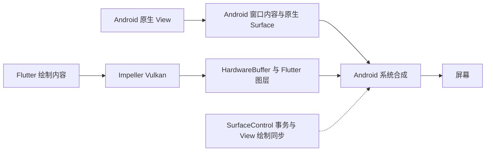

# Flutter Android Platform Views 与原生渲染

本文解释原生控件或原生生成的画面如何进入 Flutter 页面，以及 VD、TLHC、HC、HCPP 在绘制、合成、线程和交互上的区别。核心判断是：需要复用完整原生 View 时使用 Platform Views；只需要显示连续画面时，可使用外部 Texture。TLHC 将原生 View 的绘制结果交给 Flutter 合成，HCPP 则通过 Android 图层事务协调 Flutter 与原生内容。

源码基线：Flutter **3.44.0**，固定提交 `559ffa3f75e7402d65a8def9c28389a9b2e6fe42`；核对日期为 **2026-10-03**。Framework 与 Engine 均使用该提交中的源码，Engine 位于 `engine/src/flutter/`。官方文档另行记录检索与页面更新日期，不将动态文档视为该提交的快照。本文不声称该版本是最新版本，也不把它的默认配置、API 或内部类视为未来版本的承诺。

证据入口：[manifest.json](../../../evidence/flutter/rendering/android-platform-views/manifest.json)。下文的 `flutter-platform-views-*` 对应其中的 claim。通用线程模型先读 [线程模型与性能同步](../engine/线程模型与性能同步.md)；设备性能验收采用 [运行时性能验证链](../engine/运行时性能验证链.md)。

## 术语与集成方案

本专题使用官方术语 **TLHC（Texture Layer Hybrid Composition）**、**HC（Hybrid Composition）** 和 **HCPP（Hybrid Composition++，也写作 HC++）**。本次核对的官方资料没有名为 HLDC 的模式；遇到该缩写，应先核对原始上下文，不把它作为第五种实现。

Flutter 的 Widget 并不逐个对应 Android View。接入原生内容时，应先选择需要跨越的边界，而不是先选择某个合成开关。

| 方案 | 接入内容 | 交互与适用边界 |
| --- | --- | --- |
| Platform Views | 完整 Android View，如 WebView、地图、原生输入框 | 需要协调原生布局、触摸、焦点、输入法、无障碍和生命周期 |
| 外部 Texture | 相机、视频解码器、原生 GPU 渲染器生成的画面 | 纹理本身不带原生控件交互；控制 UI 与语义可由 Flutter 提供 |
| 原生页面或宿主层覆盖 | 独立 Activity、Fragment 或宿主 View | 由宿主负责导航、布局和层级；不能自动参与任意 Flutter Widget 的交错绘制 |
| 静态快照 | 原生内容的某一时刻画面 | 可作为动画占位；快照期间没有实时原生交互，捕获方式还需适配独立 Surface |
| Flutter 重绘 UI | 原生侧提供数据、算法或设备能力 | 不再复用原生控件，需自行实现所需交互与语义 |

后三项是工程组织方式，不是新增的 Platform Views 合成模式。外部 Texture 的能力由固定 [Texture 源码][texture]支持，创建与交互由 [Framework 平台视图源码][widgets]支持；快照用于动画的建议见 [Android 官方指南][android-guide]。对应证据：`flutter-platform-views-001`、`011`、`012`。

## Android 四种合成路径

| 模式 | 原生 View 放在哪里 | 原生内容如何与 Flutter 混合 | 主要成本与边界 |
| --- | --- | --- | --- |
| VD，Virtual Display | 虚拟显示上的 Presentation | 虚拟显示输出成为纹理，由 Flutter 合成 | 虚拟显示及缓冲生命周期、输入连接与无障碍桥接 |
| TLHC | 当前 Android View 层级中的 wrapper | wrapper 重定向子树绘制，Flutter 使用生成的纹理 | 纹理生产和消费的同步；独立 Surface 内容不能直接由父 Canvas 捕获 |
| HC | 当前 Android View 层级中的原生 View | Flutter 背景和覆盖内容经 ImageReader 支撑的 View 进入 Android 层级 | Flutter 输出路径切换、额外图层与动态 raster/platform 合并 |
| HCPP | 原生 View 层级及其相关 Surface | Flutter 图层使用 SurfaceControl 事务，与 Android 绘制协调后由系统合成 | Android 版本和 Vulkan 要求、跨线程协调、部分复杂叠加限制 |

表中描述的是 **Flutter 与原生内容在哪里混合**。即使 Flutter 已在自己的输出中合成原生纹理，最终呈现仍进入 Android 系统显示链路；不能理解成 TLHC 绕过了 SurfaceFlinger。

以下各节分别提供对应源码和 claim，比较表不代表所有设备上的性能排名。

## TLHC 重定向 View 的绘制

在固定源码中，`PlatformViewsController.configureForTextureLayerComposition()` 创建 `PlatformViewWrapper`，把原生 View 加入 wrapper，再把 wrapper 加入 `FlutterView`。原生 View 仍参与 Android 的布局与焦点管理，但其视觉输出被重定向。[Controller 源码][legacy-controller]

```text
Android View 子树
  → PlatformViewWrapper.draw()
  → RenderTarget 的 Surface 与硬件 Canvas
  → Flutter 外部纹理
  → TextureLayer 与 Flutter 内容一起绘制
  → Flutter 输出 Surface
  → Android 系统合成与显示
```

`PlatformViewWrapper.draw()` 从目标 Surface 获取 `lockHardwareCanvas()`，清空为透明，调用 `super.draw(targetCanvas)` 绘制子树，然后通知渲染目标调度帧并 `unlockCanvasAndPost()`。因此，TLHC 中的 Hybrid 指原生 View 仍在 Android 层级中；最终视觉结果以纹理参与 Flutter 绘制。[Wrapper 源码][wrapper] 对应证据：`flutter-platform-views-002`。

纹理可以随 Flutter 内容移动、缩放、旋转和裁剪。不过 Android 产生内容与 Flutter 消费纹理仍有时序边界，快速滚动时需要检查生产端绘制、缓冲等待与消费端采样。纹理也不等于每帧 CPU 截图：固定实现按能力选择 SurfaceProducer、ImageReader 或 SurfaceTexture 渲染目标，而不是经 MethodChannel 逐帧传送 Bitmap。不能仅凭“纹理”二字断言零拷贝或固定拷贝次数。[渲染目标选择][legacy-controller]

### SurfaceView 与回退

`SurfaceView` 通过独立 Surface 生产像素，父 View 的普通 `draw(Canvas)` 不能直接捕获这些内容。固定 Controller 将 `SurfaceView.class` 列入非 TLHC 类型，在创建时检查子树；若不支持纹理层模式，则根据创建请求回退 HC，或在非软件渲染路径回退 VD。对应证据：`flutter-platform-views-003`。

这个检查不等于任意后续 View 子树变化都会自动迁移合成模式。动态加入 SurfaceView、原生组件内部切换渲染目标、文本放大镜与无障碍，均应在实际插件和设备上验证。官方指南也单独列出了纹理模式的快速滚动、SurfaceView 无障碍及文本放大镜限制。[Android 官方指南][android-guide]

## VD 通过虚拟显示获得纹理

```text
原生 View
  → SingleViewPresentation
  → VirtualDisplay
  → 指定 RenderTarget 的 Surface
  → Flutter 纹理与合成
```

`VirtualDisplayController.create()` 将渲染目标的 Surface 交给 `DisplayManager.createVirtualDisplay()`，再在这个虚拟显示上建立 `SingleViewPresentation`。它和 TLHC 最终都可以提供纹理，区别在于纹理的生产路径。[VD 源码][virtual-display]

VD 引入独立显示环境，需要维护尺寸、Presentation、输入连接和资源释放。固定实现针对不同 Android API 有不同 resize 路径，不能一概说“每次 resize 都重建虚拟显示”。其额外显示与缓冲环节可能增加内存和时序成本，具体代价应由 trace 确认。对应证据：`flutter-platform-views-004`。

## HC 将 Flutter 输出加入 Android View 层级

传统 HC 保留原生 View 的正常绘制路径，并把 Flutter 内容拆成背景与覆盖内容。例如视觉顺序为 Flutter 背景、原生 WebView、Flutter 按钮时，可概括为：

```text
FlutterView
  ├─ FlutterImageView                 Flutter 背景
  ├─ FlutterMutatorView               原生 WebView 及变换包装
  └─ PlatformOverlayView             Flutter 覆盖内容
```

这里的 overlay 属于 ImageReader 支撑的 FlutterImageView 路径；示意图不规定每个 Widget 都单独对应一个 overlay。Controller 在需要同步原生层级时调用 `FlutterView.convertToImageView()`；FlutterImageView 以 ImageReader 的 Surface 接收 Flutter 输出，再在 Android Canvas 中显示。[FlutterView][flutter-view]、[FlutterImageView][flutter-image-view] 对应证据：`flutter-platform-views-005`。

HC 的另一项成本是动态 raster/platform 合并：`AndroidExternalViewEmbedder::PostPrerollAction()` 检查当前帧是否含 platform layers，必要时调用 `MergeWithLease()`，转换帧可能跳过并重试。它并不表示所有 Flutter 页面都合并，也不表示所有 Platform Views 模式都合并。[传统 embedder][legacy-embedder]

需要分清两个维度：Dart UI/platform 的 runner 拓扑由 Shell 设置决定；HC 的 raster/platform 动态 merger 是另一条条件路径。不能把一种合并的性能结论直接套到另一种。对应证据：`flutter-platform-views-006`；通用解释见 [线程模型与性能同步](../engine/线程模型与性能同步.md)。

## HCPP 使用 SurfaceControl 协调图层

HCPP 仍创建真实原生 View。`PlatformViewsController2` 通过 `FlutterMutatorView` 将其加入 `FlutterView`，并维护位置、尺寸、变换及显示状态。改变的是 Flutter 图形输出与 Android 绘制的组合方式，并不是把原生控件转换成 Flutter RenderObject。[HCPP Controller][hcpp-controller]



这是合成关系图。普通 Android View 通常共享窗口的绘制目标；它不意味着每个 View 都拥有独立 Surface，也不保证系统一定使用硬件 overlay 而非 GPU 合成。

### HardwareBuffer 与图层事务

Vulkan 的 swapchain 选择逻辑在支持且启用 SurfaceControl 时尝试 AHB 路径。`AHBSwapchainVK` 检查 SurfaceControl 与 HardwareBuffer 能力，持有 Impeller 的 SurfaceControl；交换链实现负责缓冲获取、GPU 提交与呈现。Android Vulkan surface 将创建事务的回调接到 JNI。[交换链选择][vk-swapchain]、[AHB 交换链][ahb-swapchain]、[提交实现][ahb-impl]、[Android Vulkan 接口][android-vulkan] 对应证据：`flutter-platform-views-007`。

在固定 `PlatformViewsController2.onEndFrame()` 中，Engine 合并待应用事务，调用 `flutterView.invalidate()`，再通过 `getRootSurfaceControl().applyTransactionOnDraw(tx)` 把事务附到 Android View 绘制上。Android API 将它与下一次 ViewRoot 的绘制缓冲事务原子地应用；该 API 本身不会安排一次绘制，所以显式 invalidate 有意义。[HCPP Controller][hcpp-controller]、[Android API][attached-surface] 对应证据：`flutter-platform-views-008`。

应区分两种同步：事务协调哪些缓冲和显示属性一起生效；fence 约束 GPU 何时完成生产、合成器何时可读取，以及缓冲何时可再次写入。`SurfaceControl.Transaction.setBuffer()` 的文档规定合成器等待提交的 fence，释放回调返回的有效 fence 也需在复用前等待。[Buffer 与 fence 语义][surface-transaction]

这些机制不意味着任意第三方 SurfaceView 独立产生的视频帧，都与某一次 Dart build 自动一一对应。确认该场景仍需观察具体生产者和事务接入方式。

### 线程与叠加限制

`AndroidExternalViewEmbedder2::SupportsDynamicThreadMerging()` 明确返回 `false`，而传统 HC 的对应方法返回 `true`。HCPP 因而避开这条动态 raster/platform merger 路径；但它仍向平台 runner 投递 View 更新任务，首次创建 overlay 及销毁相关资源时还有等待，不能理解为没有同步或不会阻塞。[HCPP embedder][hcpp-embedder] 对应证据：`flutter-platform-views-006`。

固定 3.44.0 实现使用一个 Flutter overlay Surface，并通过 difference clip 模拟部分层级交错。当 Flutter 背景、原生 View、Flutter overlay 与另一透明原生 View 相互重叠时，单个 overlay 不能总是表达所需透明混合。这个版本还在直接处理 SurfaceView 的裁剪时采用路径的轴对齐包围矩形，不能从“支持 SurfaceView”推导出任意复杂裁剪都等价于 Flutter 像素裁剪。[覆盖层实现][hcpp-embedder]、[SurfaceView 裁剪实现][hcpp-controller] 对应证据：`flutter-platform-views-009`。

## 创建 API 与 HCPP 配置

以下映射针对固定源码中 **HCPP 未生效时的传统路径**；创建 API 表达请求，不足以单独证明最终后端。

| 入口 | 创建策略 |
| --- | --- |
| `AndroidView` | 通过 `initAndroidView` 创建 controller |
| `PlatformViewsService.initAndroidView` | 优先 TLHC，不支持时按传统实现回退 VD |
| `PlatformViewsService.initSurfaceAndroidView` | 优先 TLHC，不支持时回退 HC |
| `PlatformViewsService.initExpensiveAndroidView` | 请求传统 HC |

因此 `PlatformViewLink + AndroidViewSurface` 不等于“强制 HC”；`AndroidViewSurface` 会按 controller 的实际合成需要选择呈现方式。`initHybridAndroidView` 是专门的 HCPP 入口，不属于上表传统回退策略；直接使用时不能假定其自行完成所有兼容回退。固定实现提供 `HybridAndroidViewController.checkIfSupported()` 查询 SurfaceControl 是否实际启用。[Framework services][services]、[Widget 实现][widgets]

正常全局启用可在 AndroidManifest.xml 的 `<application>` 内配置：

```xml
<meta-data
    android:name="io.flutter.embedding.android.EnableHcpp"
    android:value="true" />
```

本地运行可用 `flutter run --enable-hcpp`；按核对时的官方文档，不能把该参数直接传给 `flutter build`，发布构建使用 manifest 配置。官方文档将 HCPP 标为从 Flutter 3.44 起提供的实验性功能，要求 Android API 34+ 和 Impeller Vulkan；仅启用 Impeller 而实际使用 OpenGLES 不足以启用 HCPP。[配置与要求][android-guide]

`PlatformViewsChannel` 收到创建消息后，先检查 `handler.isHcppEnabled()`；满足时优先分派到 HCPP，之后才是原有 hybrid/texture 分支。因此全局生效后，原有 API 请求也可能升级成 HCPP。设备不满足条件时，按原有创建策略选择后端，而不是统一回退到某一种模式。[平台消息分派][channel] 对应证据：`flutter-platform-views-010`。

API 34 是该 Flutter 功能的整体支持门槛，不能解释为 SurfaceControl 或 `applyTransactionOnDraw()` 首次在 API 34 出现；后者本身从 API 31 提供。也不应把 3.44 的 opt-in 默认值外推到其他 SDK 或开发分支。[Android API][attached-surface]

## 创建与交互的共同链路

1. 原生侧通过 `PlatformViewRegistry.registerViewFactory(viewType, factory)` 注册工厂；工厂返回实现 `PlatformView` 的对象，由 `getView()` 暴露原生 View。
2. Dart 提供同一 `viewType`、创建参数及匹配的 codec。controller、平台消息和 JNI 协作处理创建与后续控制；不同模式对首次尺寸的要求并不完全相同。
3. Framework 负责布局与命中测试。纹理路径以纹理位置参与 Flutter 绘制；View 合成路径把位置、尺寸与 mutator stack 交给原生包装层。
4. 触摸参与 Flutter 手势竞技场，获得分派权后交给原生 View；焦点和输入连接由相应桥接处理。控件离开时还需释放 View、纹理、Surface 及第三方组件持有的资源。

例如 Flutter 滚动容器内的 WebView，需要决定纵向拖动由哪一侧消费。`gestureRecognizers` 控制竞争；`EagerGestureRecognizer` 会积极认领命中的指针，不应作为所有嵌套滚动问题的通用修复。HCPP 改变合成方式，并不替代手势分派设计。[Widget 手势约定][widgets]、[原生包装层][mutator-view] 对应证据：`flutter-platform-views-011`。

平台通道主要传递创建、控制、触摸和状态；这里的逐帧图形内容通过 Surface/纹理缓冲链路传递。不要把图形传输成本一概归因于 MethodChannel 序列化。

## 外部 Texture 与 SurfaceProducer

```text
相机或解码器或原生渲染器
  → SurfaceProducer.getSurface()
  → 图形缓冲
  → 注册的 textureId
  → Texture(textureId: id)
```

Texture 根据注册 ID 引用后端画面；新帧可以由后端驱动重绘，通常不需要每帧执行 Dart build。它不自动附带完整原生 View 的点击、输入法和无障碍树，所需控制与语义由集成方设计。[Texture 源码][texture]

Android 插件可使用 `TextureRegistry.createSurfaceProducer()` 获取生产目标，由 Engine 选择底层实现。集成方应设置尺寸，处理 Surface 可用与清理回调，在清理时停止向旧 Surface 绘制，并在销毁时释放资源。相机还需确认裁剪与旋转由谁负责；不能假定 SurfaceProducer 自动解决所有方向问题。[TextureRegistry][texture-registry]、[迁移文档][surface-plugins] 对应证据：`flutter-platform-views-012`。

这里有三个不同概念：Dart `Texture` 是显示外部图像的 Widget；TLHC 是把完整原生 View 转为纹理的集成方式；Android `TextureView` 或宿主的 `RenderMode.texture` 则描述原生 View/Flutter 宿主的输出承载方式。不能仅因名称都有 texture 就将它们视为同一开关。

## 选型与运行时验证

以下是基于上述机制的工程判断，不是官方保证的性能排名：

| 需求 | 优先评估方向 | 必须验证的边界 |
| --- | --- | --- |
| 只显示视频、相机或原生渲染画面 | 外部 Texture | Surface 生命周期、旋转、尺寸、帧延迟及资源释放 |
| 完整 WebView、地图或原生输入控件 | Platform Views，比较实际 TLHC 与 HCPP 路径 | 输入法、焦点、无障碍、滚动与组件内部 Surface 类型 |
| 控件包含 SurfaceView | 查明传统回退策略，并评估 HC/HCPP | 创建后子树变化、透明度、裁剪、覆盖顺序 |
| Flutter 中有复杂变换或交错效果 | 评估纹理路径能否满足需求 | 不把普通变换支持扩大为所有滤镜和原生语义均正确 |
| 原生控件进入长列表 | 控制同时活跃实例，测量布局与绘制成本 | Android 主线程、Flutter raster、缓冲等待与实际呈现 |

每次对比应记录 Flutter/Engine 版本、Android API、GPU 后端、HCPP 实际启用状态、创建入口、实际回退模式和可见 View 数量。固定版本中的 `Using HCPP platform view rendering strategy.`、`Using legacy platform view rendering strategy.` 等日志可以作为线索，日志字符串本身不是稳定 API。

验证场景至少覆盖首次出现、快速滚动、resize、旋转、后台恢复、键盘弹出、TalkBack、Flutter overlay 与透明视图重叠。性能测量使用 profile/release，并将 Flutter UI/raster 信息与 Android 系统 trace 对齐；没有 raster/platform 动态合并，不代表主线程工作、GPU 工作或显示同步成本为零。方法见 [运行时性能验证链](../engine/运行时性能验证链.md)。

本次完成的是固定源码与文档核对，没有验证任何具体设备、插件版本、运行时回退、帧率或端到端延迟。

## iOS 与其他平台边界

iOS 的完整原生 View 通过 `UiKitView` 接入，官方文档描述为 Hybrid Composition。Android 的 VD、TLHC、HCPP 分类不能直接套用；iOS 的 `ShaderMask`、`ColorFiltered` 及部分 BackdropFilter 组合也有自己的支持边界。[iOS 官方指南][ios-guide] 对应证据：`flutter-platform-views-013`。

本文不展开 Web、桌面或 iOS 的底层实现，也不把本节当作这些平台的完整选型文档。需要深入时，应在各自平台事实源中固定版本并验证。

## 证据与源码阅读顺序

1. [Framework services][services] 与 [平台消息分派][channel]：先确认创建请求如何变成实际模式。
2. [传统 Controller][legacy-controller]、[Wrapper][wrapper] 与 [VD Controller][virtual-display]：再看 TLHC 的绘制重定向及传统回退。
3. [FlutterImageView][flutter-image-view]、[传统 embedder][legacy-embedder]：理解 HC 的图层与线程成本。
4. [HCPP embedder][hcpp-embedder]、[HCPP Controller][hcpp-controller]、[AHB 提交][ahb-impl]：理解新合成与同步边界。
5. [证据包](../../../evidence/flutter/rendering/android-platform-views/manifest.json)：复核不可变 revision、SHA-256、关键字符串断言和官方文档日期。断言证明固定源码包含指定机制入口，不替代设备上的行为测试。

[services]: https://github.com/flutter/flutter/blob/559ffa3f75e7402d65a8def9c28389a9b2e6fe42/packages/flutter/lib/src/services/platform_views.dart
[widgets]: https://github.com/flutter/flutter/blob/559ffa3f75e7402d65a8def9c28389a9b2e6fe42/packages/flutter/lib/src/widgets/platform_view.dart
[texture]: https://github.com/flutter/flutter/blob/559ffa3f75e7402d65a8def9c28389a9b2e6fe42/packages/flutter/lib/src/widgets/texture.dart
[wrapper]: https://github.com/flutter/flutter/blob/559ffa3f75e7402d65a8def9c28389a9b2e6fe42/engine/src/flutter/shell/platform/android/io/flutter/plugin/platform/PlatformViewWrapper.java
[legacy-controller]: https://github.com/flutter/flutter/blob/559ffa3f75e7402d65a8def9c28389a9b2e6fe42/engine/src/flutter/shell/platform/android/io/flutter/plugin/platform/PlatformViewsController.java
[virtual-display]: https://github.com/flutter/flutter/blob/559ffa3f75e7402d65a8def9c28389a9b2e6fe42/engine/src/flutter/shell/platform/android/io/flutter/plugin/platform/VirtualDisplayController.java
[flutter-view]: https://github.com/flutter/flutter/blob/559ffa3f75e7402d65a8def9c28389a9b2e6fe42/engine/src/flutter/shell/platform/android/io/flutter/embedding/android/FlutterView.java
[flutter-image-view]: https://github.com/flutter/flutter/blob/559ffa3f75e7402d65a8def9c28389a9b2e6fe42/engine/src/flutter/shell/platform/android/io/flutter/embedding/android/FlutterImageView.java
[legacy-embedder]: https://github.com/flutter/flutter/blob/559ffa3f75e7402d65a8def9c28389a9b2e6fe42/engine/src/flutter/shell/platform/android/external_view_embedder/external_view_embedder.cc
[hcpp-embedder]: https://github.com/flutter/flutter/blob/559ffa3f75e7402d65a8def9c28389a9b2e6fe42/engine/src/flutter/shell/platform/android/external_view_embedder/external_view_embedder_2.cc
[hcpp-controller]: https://github.com/flutter/flutter/blob/559ffa3f75e7402d65a8def9c28389a9b2e6fe42/engine/src/flutter/shell/platform/android/io/flutter/plugin/platform/PlatformViewsController2.java
[vk-swapchain]: https://github.com/flutter/flutter/blob/559ffa3f75e7402d65a8def9c28389a9b2e6fe42/engine/src/flutter/impeller/renderer/backend/vulkan/swapchain/swapchain_vk.cc
[ahb-swapchain]: https://github.com/flutter/flutter/blob/559ffa3f75e7402d65a8def9c28389a9b2e6fe42/engine/src/flutter/impeller/renderer/backend/vulkan/swapchain/ahb/ahb_swapchain_vk.cc
[ahb-impl]: https://github.com/flutter/flutter/blob/559ffa3f75e7402d65a8def9c28389a9b2e6fe42/engine/src/flutter/impeller/renderer/backend/vulkan/swapchain/ahb/ahb_swapchain_impl_vk.cc
[android-vulkan]: https://github.com/flutter/flutter/blob/559ffa3f75e7402d65a8def9c28389a9b2e6fe42/engine/src/flutter/shell/platform/android/android_surface_vk_impeller.cc
[channel]: https://github.com/flutter/flutter/blob/559ffa3f75e7402d65a8def9c28389a9b2e6fe42/engine/src/flutter/shell/platform/android/io/flutter/embedding/engine/systemchannels/PlatformViewsChannel.java
[mutator-view]: https://github.com/flutter/flutter/blob/559ffa3f75e7402d65a8def9c28389a9b2e6fe42/engine/src/flutter/shell/platform/android/io/flutter/embedding/engine/mutatorsstack/FlutterMutatorView.java
[texture-registry]: https://github.com/flutter/flutter/blob/559ffa3f75e7402d65a8def9c28389a9b2e6fe42/engine/src/flutter/shell/platform/android/io/flutter/view/TextureRegistry.java
[android-guide]: https://docs.flutter.dev/platform-integration/android/platform-views
[attached-surface]: https://developer.android.com/reference/android/view/AttachedSurfaceControl
[surface-transaction]: https://developer.android.com/reference/android/view/SurfaceControl.Transaction
[surface-plugins]: https://docs.flutter.dev/release/breaking-changes/android-surface-plugins
[ios-guide]: https://docs.flutter.dev/platform-integration/ios/platform-views
