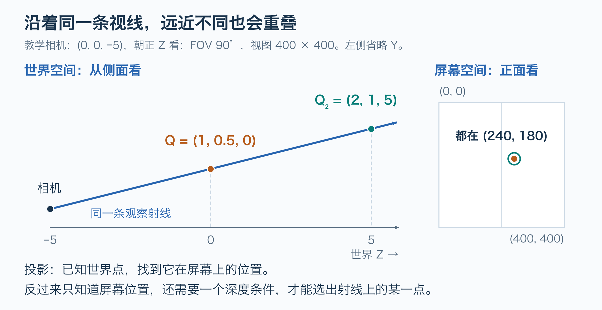
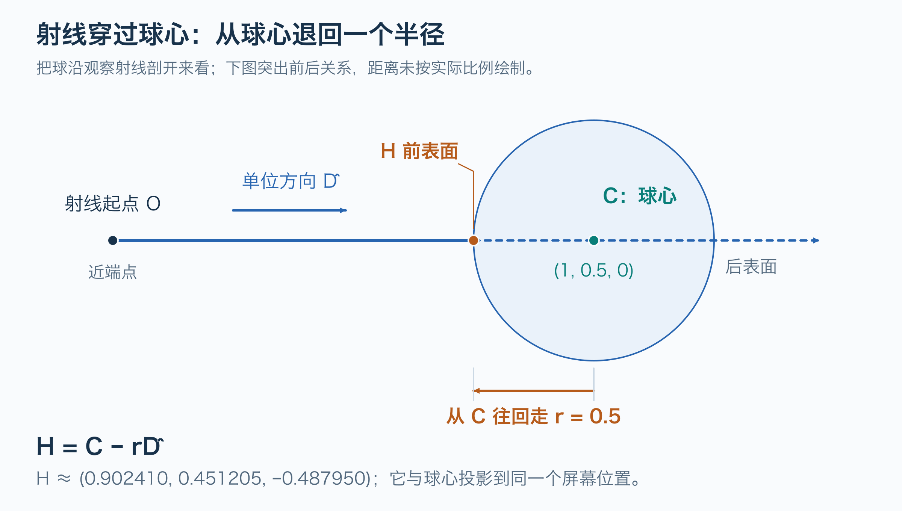
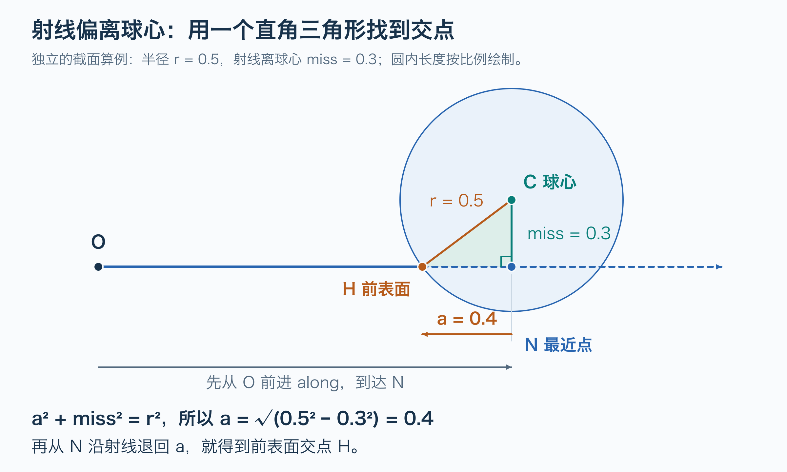
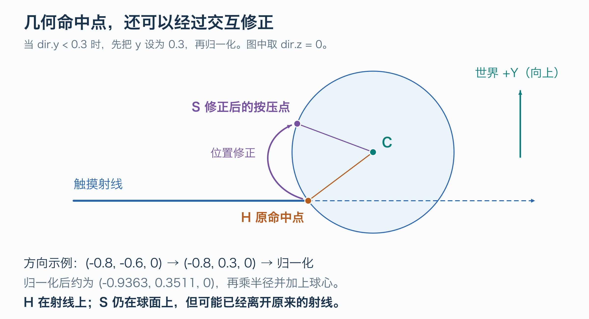

# Flutter Scene 的坐标转换与射线拾取

投影把一个 3D 点映射到屏幕位置；逆投影需要屏幕位置和深度，才能恢复一个 3D 点。触摸只提供二维位置，因此先逆投影出一条射线，再通过模型或工作平面确定交点。这条链路把页面交互、角色定位和局部形变连接起来。

本文以 Lantern Spirit 的固定源码解释通用坐标机制，包含投影、逆投影、平面求交、球体近似和网格拾取的数值例子。不维护案例应用的架构现状、运行配置或设备表现。角色父子节点与动画变换见 [Flutter Scene 的动画与交互叠加](Flutter-Scene动画与交互叠加.md)；粒子绘制与情绪联动见 [Flutter 触摸粒子反馈与爱心动效](Flutter-触摸粒子反馈与爱心动效.md)。

## 源码基线与阅读入口

| 来源 | 固定 revision | 用途 |
| --- | --- | --- |
| [bdero/lantern_spirit][app-repo] | `bc151089f4ecfeae6675ef98731b55f8770ed39b` | 页面输入、角色定位、头部命中与抚摸容差 |
| [bdero/flutter_scene][scene-repo] | `b8023c6261ed77ed4046d72c86496ed40c96b37b` | 相机矩阵、投影、射线与三角形求交 |

核对日期：2026-10-28。库版本由案例 [pubspec.yaml][dependency] 固定；本文使用该版本的相机约定，不将它推广为所有图形 API 的统一约定。来源哈希、关键断言和 claim 映射见 [证据包](../../../evidence/flutter/scene/scene-coordinate-picking/manifest.json)。数值例子是给定参数下的数学计算，不是设备测量值。

## 坐标空间与矩阵约定

从网格顶点到 Flutter 页面位置的完整方向为：

```text
模型局部坐标
  → M → 世界坐标
  → V → 相机坐标
  → P → 裁剪坐标（齐次坐标）
  → 除以 w → NDC 坐标
  → 视口映射 → SceneView 局部坐标
  → localToGlobal → Flutter 全局坐标
```

| 符号或空间 | 含义 |
| --- | --- |
| `M` | 节点局部到世界的矩阵，包含祖先变换 |
| `V` | 世界到相机的矩阵，由相机位置与方向决定 |
| `P` | 投影矩阵，由镜头、宽高比及近远平面决定 |
| NDC | 标准化设备坐标；可见视口的 X、Y 通常为 `[-1, 1]` |
| SceneView 局部坐标 | 视图左上角为原点，X 向右、Y 向下，单位为逻辑像素 |
| Flutter 全局坐标 | Flutter 视图内的全局逻辑坐标，不是桌面物理像素坐标 |

以下采用列向量和数学行列表示矩阵：`clip = P × V × M × localPoint`。已知世界位置时省去 `M`。源码的 `getViewTransform()` 返回 `P × V`，不能只按方法名把它当成 `V`。

本版本内置透视相机的相机空间正 Z 指向前方；其普通投影和拾取接口将近端映射到 NDC 深度 0、远端映射到 1。相机方向由下面的正交基确定：

```text
forward = normalize(target - position)
right   = normalize(up × forward)
up      = normalize(forward × right)

cameraPoint = (
  right · (worldPoint - position),
  up · (worldPoint - position),
  forward · (worldPoint - position)
)
```

相机目标不能等于位置，`up` 也不能平行于观察方向，否则无法建立有效坐标基。[相机接口与矩阵][camera]。对应证据：`scene-coordinate-001`。

## 投影与透视除法

可以先把投影理解为“相机给一个空间点拍照”：点在世界里有前后深度，照片上却只留下左右和上下的位置。沿着同一条视线放置两个点，即使距离不同，也会在照片上重叠。

下面选取一组便于手算的教学参数，并非应用实际配置：

```text
视图：400 × 400 逻辑像素
相机位置：(0, 0, -5)；目标：(0, 0, 0)；向上：(0, 1, 0)
垂直 FOV：90°；近距离 n = 1；远距离 f = 11
世界点 Q = (1, 0.5, 0)
```



先看图中较近的 Q：它在相机右方 1、上方 0.5、前方 5。更远的 Q₂ 距离和左右上下偏移都翻倍，所以观察方向相同。接下来公式里的“除以深度”，就是把这种方向关系算出来。

设垂直视野角为 `θ`、宽高比为 `a = W/H`、近平面距离为 `n`、远平面距离为 `f`。对于有限远平面、无投影抖动的普通透视矩阵：

```text
k = 1 / tan(θ/2)
A = f / (f - n)
B = -fn / (f - n)

clip = ((k/a) × camera.x, k × camera.y,
        A × camera.z + B, camera.z)
ndc = clip.xyz / clip.w

screenX = (ndc.x + 1) × W/2
screenY = (1 - ndc.y) × H/2
```

横向和纵向坐标除以前向深度，形成近大远小；Y 映射中的减号将相机向上为正转换成页面向下为正。`worldToScreen()` 返回视图内的逻辑像素位置。[透视矩阵][perspective]、[屏幕投影][project]。对应证据：`scene-coordinate-002`。

相机没有旋转，所以 `Q_camera = (1, 0.5, 5)`。此时 `k = 1`、`a = 1`，投影矩阵为：

```text
P = [ 1  0   0     0   ]
    [ 0  1   0     0   ]
    [ 0  0  1.1  -1.1 ]
    [ 0  0   1     0   ]

相机齐次坐标：(1, 0.5, 5, 1)
裁剪坐标：    (1, 0.5, 4.4, 5)
除以 w：     (0.2, 0.1, 0.88)
视口映射：    (240, 180)
```

案例中的 `_headScreen()` 直接调用 `camera.worldToScreen(c.headCenter, _headerSize)`。光晕路径随后执行 `header.localToGlobal(at)`，将头部或手部的投影位置交给页面覆盖层。[页面定位][park]。这里的最后一步与 3D 投影不同，它处理 Flutter 布局坐标。

`worldToScreen()` 对相机平面上及后方的点返回空值，但对视口外的点仍可返回负坐标或超过宽高的坐标。获得非空结果不代表点必然可见，也没有证明它未被其他几何体遮挡。[屏幕投影][project]

## 逆投影与缺失的深度

再取世界点 `Q₂ = (2, 1, 5)`，其相机坐标为 `(2, 1, 10)`。透视除法仍得到 `ndc.x = 0.2`、`ndc.y = 0.1`，因而也投影到 `(240, 180)`。它与 Q 处在相机的同一条观察方向上。

投影矩阵本身可以求逆；信息不足发生在只保留屏幕 X、Y 而没有深度。若完整 NDC 已知，就可以计算：

```text
h = inverse(P × V) × (ndcX, ndcY, ndcZ, 1)
world = h.xyz / h.w
```

逆变换返回的仍是齐次坐标，不能省略除以 `h.w`。若需要恢复模型局部点，则还要应用 `inverse(M)`。

本例中给定 `ndcZ = 0.88` 就能恢复 Q。深度关系为 `ndcZ = 1.1 - 1.1/cameraZ`，所以 NDC 深度既不是世界 Z，也不是线性距离；`ndcZ = 0.5` 不表示近远平面的中点。[逆投影实现][unproject]。对应证据：`scene-coordinate-003`。

## 从一个触点构造世界射线

可以把触点看成一个瞄准方向：它告诉相机“沿这里看”，但还没有说要走多远。先在这个方向上找一个近点、一个远点，将它们连起来，就得到后续用于求交的射线。

触摸没有提供深度，库便把同一屏幕位置分别逆投影到近端和远端。`screenPointToRay()` 的核心等价简写如下，省略矩阵退化时的回退分支：

```dart
final inverse = Matrix4.inverted(getViewTransform(viewSize));
final ndcX = screenPosition.dx / viewSize.width * 2 - 1;
final ndcY = 1 - screenPosition.dy / viewSize.height * 2;

Vector3 unproject(double z) {
  final h = inverse * Vector4(ndcX, ndcY, z, 1) as Vector4;
  return h.xyz / h.w;
}

final near = unproject(0);
return Ray.originDirection(near, unproject(1) - near);
```

对 `(240, 180)`，可得 `ndcX = 0.2`、`ndcY = 0.1`，以及：

```text
近端 N = (0.2, 0.1, -4)
远端 F = (2.2, 1.1,  6)

O = N
D = F - N = (2, 1, 10)
R(t) = O + tD，t ≥ 0
```

这里的射线起点在近平面上；透视情况下，它与从相机位置出发的观察射线共线。返回方向没有归一化，`t` 只是参数；方向归一化后，`t` 才是从射线起点出发的世界距离。远端点用于确定方向，不会自动把射线限制成近远平面之间的线段。[射线生成][unproject]。对应证据：`scene-coordinate-003`。

## 与工作平面求交

想象在空间里放一块透明玻璃板，让它拦住触摸射线。射线与玻璃板相交的位置，就是这次选择的 3D 落点；换一个平面，同一触点就可能得到不同的落点。

页面位置要控制 3D 角色时，可以先选定一个工作平面。案例的 `_outWorld()` 使用世界平面 `z = 0`：

```dart
final ray = _outCamera.screenPointToRay(
  global - _outRect.topLeft,
  _outRect.size,
);
final d = ray.direction.normalized();
return ray.origin + d * (-ray.origin.z / d.z);
```

减去覆盖视图左上角，把全局位置变成局部位置；这种减法对应此处按矩形平移放置的视图。有额外缩放或旋转的 Flutter 层级，应通过对应 `RenderBox.globalToLocal()` 转换。[平面映射][plane]。对应证据：`scene-coordinate-004`。

交点满足 `O.z + tD.z = 0`，所以 `t = -O.z/D.z`。使用上节未归一化的射线：

```text
t = 4/10 = 0.4
R(0.4) = (0.2, 0.1, -4) + 0.4 × (2, 1, 10)
       = (1, 0.5, 0)
```

这就闭合了“Q → 投影 → 射线 → z = 0 求交 → Q”。能恢复原点，是因为补上了“Q 位于 z = 0”这个约束。若按源码先归一化方向，同一个交点对应的距离参数约为 `4.098780`，而不是 `0.4`。

一般平面经过 A、法向量为 n 时：

```text
n · (X - A) = 0
X = O + tD
t = n · (A - O) / (n · D)
```

通用实现应处理分母接近零的平行情况，以及 `t < 0` 的反向交点；固定案例的 `z = 0` 公式依赖当前相机布局，没有包含这些通用保护。

## 球体近似与抚摸容差

把角色的头暂时看成一个球，把触摸射线看成一根从相机方向伸向头部的细杆。对准球心时，杆子先碰到球的前表面，继续伸进去才会经过球心。因此，“屏幕上点中了头的中心”并不意味着要把球心作为按压点。

### 穿过球心时为什么要减去一个半径

先看最容易理解的情况：细杆恰好穿过球心。下面把球沿这条射线剖开，画成一个圆。



读这张图只需要三个量：

- `C` 是球心，作为已知的位置起点。
- `D̂` 指向射线前进方向，长度为 1；它表示方向，不是一个位置。
- `rD̂` 表示沿这个方向走一个半径的位移。

所以，从 C 往回走一个半径，就是 `C - rD̂`。减号表示逆着射线方向；若使用加号，就会走到远离相机的后表面。**这个简式只适用于射线穿过球心的情况。**

继续采用教学相机，令球心 `C = (1, 0.5, 0)`、半径 `r = 0.5`。把方向乘以半径，再从球心逐项减掉：

```text
D̂ ≈ (0.195180, 0.097590, 0.975900)
rD̂ ≈ (0.097590, 0.048795, 0.487950)

H = C - rD̂
  ≈ (1 - 0.097590, 0.5 - 0.048795, 0 - 0.487950)
  ≈ (0.902410, 0.451205, -0.487950)
```

H 的世界 Z 是负数，是因为它位于球心朝相机的一侧；它仍然在位于 Z = −5 的相机前方。把 H 投影回去，仍然得到 `(240, 180)`，因为它与球心处在同一条观察射线上。

### 偏离球心时先找最近点

触摸也可能偏离球心。此时先从球心向射线所在直线作垂线，垂足 N 就是源码中的 `nearest`。在图示这种直线穿过球体的情况下，N 位于球内部，不是前表面交点。



沿着图读源码中的变量：

| 图中的距离或位置 | 源码变量 | 直观含义 |
| --- | --- | --- |
| O 到 N 的有向距离 | `along` | 先沿射线走到距离球心最近的位置；在图示布局中为正 |
| 垂足 N | `nearest` | 射线所在直线上距离球心最近的点 |
| C 到 N 的距离 | `miss` | 射线偏离球心多远；不是一定“没命中” |
| N 到 H 的距离 | `sqrt(r*r - miss*miss)` | 从最近点还要倒退多远，才能退到球面 |

因为 CN 垂直于 NH，三角形 CNH 是直角三角形，斜边 CH 就是半径 r。图中另取一个便于理解的截面例子：`r = 0.5`、`miss = 0.3`，于是需要倒退的距离为 `sqrt(0.5² - 0.3²) = 0.4`。这组偏心数值与前面的穿心算例分开。

案例的抚摸路径就是先前进到 N，再退回 H。设射线方向 d 已归一化：

```text
along   = (center - origin) · d
nearest = origin + d × along
miss    = length(nearest - center)

若 miss < r：
hit = nearest - d × sqrt(r² - miss²)
```

当 `miss > r` 时，直线从球外侧经过，没有几何交点；`miss = r` 时为相切。上面的公式描述头部位于射线前方的交互布局，作为通用射线球体算法时还需要检查交点是否位于正向射线上。

### 抚摸容差会再调整按压位置

找到几何交点后，若归一化方向的 y 分量小于 `0.3`，源码还会将球面方向调整得更偏向上半部；没有相交时也会给出近似按压位置。这是在选择更适合抚摸的反馈位置。



图中单独选取 `dir = (-0.8, -0.6, 0)` 示范源码操作：将 `dir.y` 改为 `0.3` 后，向量长度已经不是 1；重新归一化得到约 `(-0.9363, 0.3511, 0)`，再乘半径并加上球心，才得到新的球面位置。`0.3` 是归一化前设置的方向分量，不是最终按压点的固定世界高度。

因此要区分两种结果：H 回答“射线碰到了哪里”，S 回答“这次抚摸最终作用在哪里”。后者可能偏离原射线，不再严格投影回触点。前面的穿心和偏心算例都只演示未修正的几何交点。[抚摸位置计算][pet]。对应证据：`scene-coordinate-005`。

## 网格拾取与最近命中

普通点击通过 `_onHeaderTap()` 将局部触点变为射线，再传给角色 `poke()`。后者调用 `scene.raycast(ray, where: (n) => n == _head)`，只测试头部网格；没有命中时返回失败。[页面输入][park]、[角色点击][character]。

库的这条路径读取 CPU 侧可用的几何数据：先把射线变到节点局部空间，测试局部包围盒，再遍历候选三角形，用 Möller–Trumbore 算法求交，最终选择通过过滤的最近命中。它不需要先建立物理碰撞体。[求交实现][raycast]。对应证据：`scene-coordinate-006`。

三角形求交可以理解为解下面的方程，其中 A、B、C 是三角形顶点：

```text
O + tD = A + u(B - A) + v(C - A)

t > 0
u ≥ 0，v ≥ 0，u + v ≤ 1
```

将右侧展开后，`(1-u-v, u, v)` 是对应 A、B、C 的重心坐标，保证交点处在三角形内部，也可用于插值 UV。库返回世界命中点、法线、距离、UV 和命中的节点等信息。

实现中一个重要细节是先归一化世界方向，再变到局部空间，而局部方向不重新归一化：

```text
localOrigin = inverse(M) × worldOrigin
localTip    = inverse(M) × (worldOrigin + worldUnitDirection)
localDirection = localTip - localOrigin
```

这样保留了模型非均匀缩放的影响，局部求交参数仍对应世界距离，能够比较不同模型的命中顺序。重新归一化局部方向后，就不能不加换算地比较这些 `t`。

该固定版本的查询有边界：骨骼蒙皮网格按静止姿态测试，部分直接管理的顶点缓冲及非三角形拓扑会跳过，实例网格支持也仍有待办。着色器中的位移或透明裁切不应被默认视为 CPU 求交已考虑的表面。最近几何命中不能一概等同于最终画面中最先可见的像素。[查询约束][raycast]

## 世界命中点回到头部局部空间

角色通过 `_toHead()` 将世界命中点乘以头部世界矩阵的逆，再调用 `soft.impulse()`。软体控制点属于头部自身坐标系，所以头部移动、转向或缩放后，仍需知道触碰发生在自身哪个部位。[局部变换][character]。对应证据：`scene-coordinate-007`。

若教学球体由局部单位球先缩放 0.5，再平移到 C 得到：

```text
M = T(C) × S(0.5)
localHit = inverse(M) × H = (H - C)/0.5
         ≈ (-0.195180, -0.097590, -0.975900)
```

这个局部点的长度约为 1，位于单位球表面。一般有旋转或非均匀缩放时，不能仅减去中心并除以一个半径，应使用完整逆矩阵。

最终链路是：触点 → 逆投影近远端 → 世界射线 → 模型命中 → 头部局部点 → 软体形变。后续顶点如何共享形变及更新，继续阅读 [动画与交互叠加](Flutter-Scene动画与交互叠加.md)。

## 使用案例相机参数复算

案例默认头部相机位置为 `(0, 1.55, 7.6 × kFaceZ)`，其中 `kFaceZ = -1`；目标为 `(0, 1.38, 0)`，垂直 FOV 为 27°，近远距离沿用库默认的 `0.1` 和 `1000`。相机略向下看。以下仅采用房间未展开时的相机参数，视图尺寸 `400 × 300` 和世界点 `Q = (0.5, 1.8, 0)` 是算例假设，不代表设备布局或动画当帧的头中心。[相机与页面][park]、[角色常量][character]、[相机默认值][camera]。对应证据：`scene-coordinate-008`。

```text
Q_camera ≈ (0.500000, 0.419895, 7.592509)
NDC 的 X、Y ≈ (0.205727, 0.230357)
局部屏幕位置 ≈ (241.145489, 115.446433)

从该屏幕位置生成射线：
O ≈ (0.006585, 1.553293, -7.499901)
D̂ ≈ (0.065612, 0.032806, 0.997306)

与 z = 0 求交 → (0.5, 1.8, 0)
```

相机坐标 Y 不等于 `1.8 - 1.55`，因为视图矩阵还包含俯仰旋转。若视图左上角的全局坐标为 `(20, 100)` 且无额外缩放或旋转，投影点的全局位置约为 `(261.145489, 215.446433)`。以上计算采用未四舍五入的中间值；展示数值用于阅读。

## 验证方法与适用边界

排查坐标问题时，依次检查触点属于哪个视图、坐标和视图尺寸是否均为逻辑像素、投影和拾取是否使用相同的相机状态，以及最终采用了哪种深度约束。角色和相机变化时，还要核对状态采样的帧顺序；尚未推进的动画不会自动反映到提前读取的世界位置中。

有区分力的验证包括：

1. 已知点在工作平面上：投影后生成射线，再与同一平面求交，应恢复该点。
2. 已知几何命中点：将交点重新投影，应回到原局部触点；经抚摸容差修正的点不适用这一断言。
3. 只改变 DPR 或渲染分辨率、保持逻辑布局和相机不变：逻辑投影与拾取不应随物理像素倍率偏移。
4. 改变模型旋转和非均匀缩放：检查局部命中及不同物体的最近距离排序。
5. 分别检查平行射线、反向交点、相机后方点、视口外点以及几何遮挡。

本文的 0～1 深度约定属于 Camera 投影与射线接口。库实际光栅化还可能采用反向深度和拟合近平面；读取 GPU 深度缓冲并反推世界位置时，必须匹配当次光栅投影，不能直接套用普通相机深度。[光栅投影入口][raster-projection]。对应证据：`scene-coordinate-009`。

插图是基于本篇算例绘制的原创几何示意，不是应用截图。PNG 用于正文展示，同目录保留可编辑的 SVG；图中已区分按比例的局部三角形与强调前后关系的示意距离。

静态源码和公式复算尚未验证设备触摸精度、逐帧坐标一致性或具体模型的运行时拾取结果。证据中的哈希与字符串断言用于复核固定来源和入口，不能替代这些行为检查。

[app-repo]: https://github.com/bdero/lantern_spirit/tree/bc151089f4ecfeae6675ef98731b55f8770ed39b
[scene-repo]: https://github.com/bdero/flutter_scene/tree/b8023c6261ed77ed4046d72c86496ed40c96b37b
[dependency]: https://github.com/bdero/lantern_spirit/blob/bc151089f4ecfeae6675ef98731b55f8770ed39b/pubspec.yaml#L14-L35
[camera]: https://github.com/bdero/flutter_scene/blob/b8023c6261ed77ed4046d72c86496ed40c96b37b/packages/flutter_scene/lib/src/camera.dart
[perspective]: https://github.com/bdero/flutter_scene/blob/b8023c6261ed77ed4046d72c86496ed40c96b37b/packages/flutter_scene/lib/src/camera.dart#L495-L550
[project]: https://github.com/bdero/flutter_scene/blob/b8023c6261ed77ed4046d72c86496ed40c96b37b/packages/flutter_scene/lib/src/camera.dart#L150-L189
[unproject]: https://github.com/bdero/flutter_scene/blob/b8023c6261ed77ed4046d72c86496ed40c96b37b/packages/flutter_scene/lib/src/camera.dart#L129-L147
[park]: https://github.com/bdero/lantern_spirit/blob/bc151089f4ecfeae6675ef98731b55f8770ed39b/lib/ui/park_screen.dart
[plane]: https://github.com/bdero/lantern_spirit/blob/bc151089f4ecfeae6675ef98731b55f8770ed39b/lib/ui/park_screen.dart#L636-L643
[pet]: https://github.com/bdero/lantern_spirit/blob/bc151089f4ecfeae6675ef98731b55f8770ed39b/lib/ui/park_pet.dart#L112-L128
[character]: https://github.com/bdero/lantern_spirit/blob/bc151089f4ecfeae6675ef98731b55f8770ed39b/lib/lantern/character.dart
[raycast]: https://github.com/bdero/flutter_scene/blob/b8023c6261ed77ed4046d72c86496ed40c96b37b/packages/flutter_scene/lib/src/raycast.dart
[raster-projection]: https://github.com/bdero/flutter_scene/blob/b8023c6261ed77ed4046d72c86496ed40c96b37b/packages/flutter_scene/lib/src/camera.dart#L595-L643
