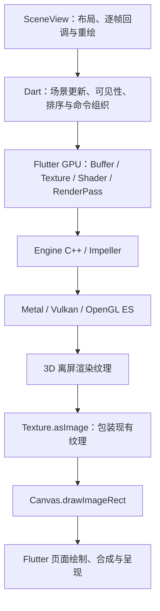

# Flutter Scene 的底层实现与性能边界

Flutter Scene 在 Dart 中维护场景、动画和绘制列表，通过 Flutter GPU 组织 GPU 资源与渲染命令；原生端由 Impeller 对接图形后端，先把 3D 场景渲染到离屏纹理，再把这张纹理交给 Flutter 绘制和合成。性能要分别看 CPU 场景工作、GPU 渲染、资源传输和最终呈现，不能仅从“使用 GPU”或某个 CPU 计时推导帧率。

本文解释库与 Engine 的接口、逐帧路径、资源生命周期和可测量的性能边界，不维护具体应用的设备成绩、画质配置或项目状态。角色控制的上层机制见 [Flutter Scene 的动画与交互叠加](Flutter-Scene动画与交互叠加.md)；线程与呈现端点的前置模型见 [线程模型与性能同步](../engine/线程模型与性能同步.md)。

## 源码基线与适用范围

| 来源 | 固定 revision | 用途 |
| --- | --- | --- |
| bdero/flutter_scene | `2ad6a8ab1d76010802dd08194b74ea2a3edfbb44` | 场景、渲染器、原生/Web 适配与测量工具 |
| flutter/flutter，3.47.0 标签对应提交 | `4cf24164269a5ebf0c16a028a00727d0e77bbb05` | 读取该 SDK 的 Engine 固定版本 |
| flutter/flutter，以上 SDK 的 Engine revision | `5f77625673248ee5846fbcaf5d3e1a3878386fd7` | Flutter GPU 的 Dart 原生绑定、C++ 命令提交与纹理包装 |

核对日期：2026-10-28。Scene 的 [pubspec][scene-package] 自报版本为 `0.24.3`，Flutter 约束为 `>=3.47.0`；这不等于验证了 pub.dev 发布状态或所有满足约束的 SDK。Engine revision 取自固定 SDK 的 [engine.version][engine-version]，不是把 Framework 提交号直接当成所下载 Engine 的版本。对应证据：`scene-internals-001`。

[证据包](../../../evidence/flutter/scene/scene-internals-performance/manifest.json)保存固定来源的 SHA-256、关键字符串断言与 claim 映射。本文只做静态源码核对，尚未在这些版本的实际构建、设备和浏览器上验证运行路径。

已有动画、转场案例固定在 Scene 的 `b8023c6261ed77ed4046d72c86496ed40c96b37b`。它们继续保留各自证据基线；本文的资源回收、提交节奏等细节不能反向当成案例旧版本已经验证的事实。

## 分层与纹理交接

原生端职责与数据流如下。箭头表示接口关系，不表示 CPU 等待每个 GPU 阶段完成后才继续：



[GPU 入口][gpu-shim]按 Dart 平台选择实现：原生使用 Flutter GPU，Web 使用包内后端。[原生 host][native-host]把 `textureToImage` 直接交给 `Texture.asImage()`。Engine 的 [Texture::AsImage][engine-texture]创建 `CanvasImage`，用现有 `texture_` 构造 `DlImageImpeller`，再形成 Dart 图像包装。Scene 最后调用 `canvas.drawImageRect`。对应证据：`scene-internals-002`。

这里的“无拷贝”限于原生端现有 GPU 纹理到 Flutter 图像的包装交接。它不要求把整帧像素读回 CPU 后重新上传，但仍有离屏渲染、最终纹理采样、页面合成和同步成本。几何体、骨骼、贴图等从 CPU 到 GPU 的数据上传也不在这个结论内。自定义截图、读回或其他平台后端需要另外核查。

Scene 管理的输出纹理环属于离屏资源，不能直接等同于操作系统窗口的 swapchain 或 Android BufferQueue。平台最终显示链路由 Engine 与系统负责；参见 [Android 输入到 Flutter 路由首帧](../engine/Android-输入到路由首帧.md)。

## 一帧的更新、可见性与绘制排序

### 更新与重绘

单视图的主要关系是：

```text
SceneView 的 Ticker
  → 应用 onTick
  → 通知 CustomPainter 重绘
  → painter 调用 Scene.render
  → 更新场景（调用方未显式 update 时）
  → 准备渲染数据并绘制
```

[SceneView][scene-view]在 `onTick` 返回后调用重绘通知；画笔通过 `super(repaint: repaint)` 接收通知。这条机制本身不要求每帧重建整棵页面 Widget 树，但应用回调仍可能调用 `setState`，不能据此断言整个页面没有 build/layout 工作。

[Scene.update][scene]执行 tick 并标记当帧已经更新；渲染入口检查这一标记，避免再做隐式 tick。动画案例的应用封装在 `onTick` 内显式推进场景，具体顺序和时间步边界继续由 [动画与交互文档](Flutter-Scene动画与交互叠加.md#从资源准备到每帧绘制)维护。对应证据：`scene-internals-003`。

### 可见对象与空间结构

[RenderScene][render-scene]保存用于绘制的扁平 `RenderItem` 和空间结构。BVH 按包围盒组织对象，便于按相机视锥筛选可见项；结构变化时重建，对象移动且结构未变时可以 refit，即更新层级包围盒。不能计算包围盒或不参与视锥剔除的对象仍需单独处理。

剔除减少的是后续可见绘制工作，不能据此认为屏外对象的组件、动画和所有场景更新都自动停用；这些阶段的执行条件必须分别检查。对应证据：`scene-internals-003`。

### 排序与合批

[SceneEncoder][scene-encoder]先收集绘制记录，再排序和编码：

| 类别 | 固定实现 | 性能含义 |
| --- | --- | --- |
| 不透明物体 | 先按 `renderOrder` 升序；同值内依次比较 pipeline、material、geometry、灯光相关状态与淡化值，最后按深度从前到后打破平局 | 尊重显式顺序，并在同序组内减少状态切换、创造合批机会 |
| 半透明物体 | 先按 `renderOrder` 升序；同值内按深度从远到近排序，使用预乘 alpha 混合 | 显式顺序优先于深度，同时承担排序与重叠像素成本 |

`renderOrder` 是各类绘制列表内部的首要排序键；不透明与半透明仍分阶段处理。不透明比较器在启用 froxel 灯光聚类时跳过逐物体灯光列表的比较，其他状态相同时才比较深度。

[自动合批条件][instance-batching]要求 pipeline、几何体、材质对象等兼容，还检查 LOD 淡化、灯光列表或通道等状态。内容相同但对象不同的材质不一定满足这里的 `identical` 条件。具有骨骼纹理、morph 权重、自定义实例属性或逐次绘制选择器的项会退出这条自动合批路径。对应证据：`scene-internals-004`。

因此，实例化静态物体与许多独立动画角色需要分别评估；不能用前者的对象数或 draw 数量推断后者的帧率，也不能认为任意相邻物体都会合并成一次 draw。

## 骨骼与动态几何体的 CPU/GPU 分工

[Skin][skin]在 CPU 侧读取骨骼节点世界矩阵，按 glTF 绑定关系构造：

```text
jointMatrix[j] = jointWorldMatrix[j] × inverseBindMatrix[j]
```

矩阵写入方形 `RGBA32F` 纹理：每个矩阵有 16 个 float，占四个 texel。实现复用骨骼纹理环与浮点数组，把上传延后到 `flushJointsUpload`；没有实际提交绘制的某些帧因此可以省去上传。

[蒙皮顶点 shader][skinning-shader]为每个顶点读取对应骨骼矩阵，按四个影响权重组合，再计算顶点位置。这里是 CPU 更新骨骼姿态、GPU 对网格顶点执行蒙皮；骨骼矩阵计算、打包和上传仍有 CPU/传输成本。公式解释的是此 shader 路径，不应当作所有网格、自定义顶点 shader 或形变方式的统一公式。对应证据：`scene-internals-005`。

动态几何体是另一条成本路径。[MeshGeometry][mesh-geometry]具有可更新属性流和环形 GPU buffer，可更新变化的属性范围；资源复用不消除计算新顶点和写入数据的成本。动画案例中的捏脸软体先在 Dart 更新头部与面部顶点，不能套用“骨骼蒙皮在 GPU 执行”来判断它的全部成本。案例坐标与形变写入关系见 [面部跟随包含变换和形变两个层次](Flutter-Scene动画与交互叠加.md#面部跟随包含变换和形变两个层次)。

## 多阶段渲染与资源生命周期

[Scene][scene]根据视图、材质需求和启用的效果建立渲染阶段，可能包含阴影、深度预处理、主场景颜色、屏幕空间效果、抗锯齿和输出颜色转换。Bloom 等效果会读取前序阶段的结果；并非每帧都执行所有阶段，具体顺序以该次配置实际构建的 graph 为准。

[RenderGraph][render-graph]是按插入顺序执行的 pass 列表，阶段之间通过 Blackboard 传递资源，并使用临时纹理池。源码明确声明它不自动插入 GPU barrier（同步由 Flutter GPU 内部处理）、不做临时内存生命周期别名复用，也不自动删除未使用的 pass。不能把“有 render graph”理解为已经具备这些全局优化。对应证据：`scene-internals-006`。

资源复用有几种不同机制：

| 资源 | 固定实现 | 边界 |
| --- | --- | --- |
| 输出颜色纹理 | [Surface][surface]为视图维护纹理环和尺寸相关的资源池，保留最近两个尺寸的资源 | 尺寸频繁变化仍可能引起分配和淘汰；多视图各自需要目标资源 |
| 每帧 uniform/实例数据 | [FrameTransients][frame-transients]在延迟执行后端使用分块暂存；提交前上传已用范围，以提交回调的完成水位控制块复用 | CPU 打包和上传仍然存在；复用安全依赖后端的同步与资源语义，回调边界见下文 |
| 骨骼与可变几何体 | 各自具有纹理或 buffer 轮换机制 | 不等于所有资源都采用相同数量、同一完成回调或同一种回收策略 |
| 原生资源释放 | [原生 host][native-host]的显式 `releaseTexture/releaseBuffer` 在此版本为空实现 | 移除库内引用不等于立即释放原生 GPU 内存 |
| WebGL2 资源释放 | [Web host][web-host]调用底层释放方法 | 生命周期与原生端不同，浏览器实际显存行为仍需观察 |

对应证据：`scene-internals-006`。纹理池减少重复分配，不代表峰值内存消失；评估时应计入颜色、深度、抗锯齿目标、后处理临时纹理以及同时存活的视图。

## 原生命令提交、线程与首次成本

### Dart 调用到 Engine

Flutter GPU 的 [Dart CommandBuffer][engine-command-dart]通过 `@Native` 符号进入 Engine C++。在固定 [CommandBuffer::Submit][engine-command-native]中：

- GLES 分支把编码和提交相关工作投递到 raster task runner。
- 其他分支在当前调用线程执行编码，并调用 Impeller command queue 提交；本文涉及的 Metal/Vulkan 走这一侧。

常规 SceneView 的更新和 paint 来自 Flutter UI isolate，因而场景遍历、排序、参数打包与部分原生命令工作会影响 UI 侧时间。task runner 到 OS thread 的实际对应仍要结合目标 SDK、embedder 和 trace 确认。对应证据：`scene-internals-007`。

CPU 提交之后，GPU 按自己的队列执行。UI 线程、raster 线程和 GPU 硬件是不同观测对象；它们可以跨帧重叠，也可能由于资源或队列背压发生等待。不能简单把 UI 时间与 raster 时间相加当成 GPU 时间或屏幕呈现延迟。

### 首次资源与 pipeline

[RenderPass::GetOrCreatePipeline][engine-pass]会按渲染目标、采样数、格式等状态解析实际 pipeline。GLES 缓存未命中时，代码在 raster task runner 创建管线，再在调用侧等待 future；首次创建可能阻塞 UI 并错过帧。预先准备 shader 不能直接证明所有管线组合都已创建。

[Scene.warmUp][scene]通过离屏编码场景、准备管线和资源，把部分首次成本前移。[SceneEncoder][scene-encoder]也有 pipeline 缓存。预热应覆盖实际相机、材质和渲染配置；它增加启动准备与资源占用，不能免除后续动画、绘制和合成的稳态成本。对应证据：`scene-internals-008`。

## GPU 背压与重复呈现

固定 [Scene][scene]默认 `maxGpuFramesInFlight = 1`，利用 [提交完成跟踪][frame-transients]记录尚未收到完成回调的渲染提交，并据此统计在途帧；提交异常也会清理对应记录。屏幕视图积压达到阈值、且已有匹配尺寸的输出等条件满足时，会再次绘制上一张纹理，跳过该次新的 3D 出图。待完成回调到达后，可以请求重绘。捕获和渲染到纹理等路径有自己的条件，不能概括为所有视图都会这样限速。对应证据：`scene-internals-009`。

完成回调的含义取决于后端。固定 [CommandBufferGLES::OnSubmitCommands][engine-gles-command]在 `reactor_->React()` 返回后报告成功或失败；延迟分支在对应 reactor 操作执行时报告完成。[ReactorGLES][engine-gles-reactor]处理的是待执行的 GL 操作列表，显式 `Finish()` 等待位于独立的 `OnWaitUntilCompleted` 方法。再经 [Flutter GPU 的 UI task runner][engine-command-native]把回调送回 Dart，Scene 才更新记录。因此，尤其在 GLES 上，这个计数不能直接证明 GPU 硬件完成、真实 GPU 队列深度或屏幕呈现；也不能用回调间隔代替 GPU 执行耗时。

该机制旨在减少继续堆积 GPU 工作造成的调用侧阻塞。它不等于提高 GPU 吞吐，也不表示所有场景状态更新都停止。因此，Flutter 页面的响应或帧回调仍然正常时，3D 图像可能已经重复旧帧；`pacedFrameCount` 可辅助识别这一点，但不是所有掉帧原因的总计数。

## 分辨率与性能判断

屏幕视图的 [目标尺寸计算][scene]近似为：

```text
有效比例 = pixelRatio × (视图 renderScale 或场景 renderScale) × 自适应比例
目标宽度 = ceil(逻辑视口宽度 × 有效比例)
目标高度 = ceil(逻辑视口高度 × 有效比例)
```

SceneView 默认取所属 Flutter View 的 device pixel ratio；显式传入时以传入值为准。这里的缩放规则针对屏幕视图，显式 RenderTexture 使用自己的尺寸。对应证据：`scene-internals-010`。

教学算例：逻辑区域为 300 × 300、DPR 为 3、自适应比例为 1，renderScale 为 1 时是 900 × 900 像素；renderScale 为 0.75 时是 675 × 675，像素数变为 56.25%。这是面积关系，不是帧时间下降 43.75% 的实测结论。节点更新、draw 编码、某些阴影目标及固定开销不会按这个比例同步缩减。

以下是由上述机制导出的诊断方向，需要受控实验验证：

| 现象或负载 | 优先检查 | 可比较的改动 |
| --- | --- | --- |
| 对象数增加时 CPU 耗时上升 | 更新、剔除、排序、draw 数和材质共享 | 减少逐帧逻辑，比较兼容实例化与独立对象 |
| 降低分辨率后耗时明显改善 | 像素着色、透明覆盖、后处理及带宽 | 固定内容，降低 renderScale 或关闭单个效果 |
| 多角色负载较高 | 动画更新、骨骼上传、蒙皮顶点数、自动合批退出 | 分别减少角色数、骨骼数或网格复杂度 |
| 阴影开启后成本上升 | 投影灯数量、阴影目标、重复绘制的投影物体 | 固定相机，分别关闭阴影或减少投影对象 |
| 首次出现新材质时尖峰 | 加载、上传、pipeline 缓存未命中与同步等待 | 比较冷首次与覆盖相同配置的预热后路径 |
| 改变视口尺寸时内存或帧时波动 | 输出目标与临时纹理的分配、复用和回收 | 固定尺寸对照，记录实际渲染目标与资源峰值 |

外层裁剪窗口不会自动把内部 3D 渲染目标缩成窗口大小，页面展开时要区分布局、裁剪和 SceneView 视口。对应应用机制见 [Flutter 裁剪展开转场与性能边界](Flutter-裁剪展开转场与性能边界.md)，不要用肉眼可见面积代替实际出图尺寸。

## Web 后端的独立边界

[GPU 入口][gpu-shim]在 Web 选择包内实现，并包含 `flutter_scene.webgpu=true` 开关；本节只核查默认 WebGL2 路径，不推导可选 WebGPU 的行为和表现。

同步 paint 路径为：

```text
WebGL Texture.asImage
  → snapshotTextureSync
  → blitFramebuffer 到 OffscreenCanvas
  → transferToImageBitmap
  → createImageFromImageBitmap
  → ui.Image 交给 Flutter 绘制
```

调用关系见 [Web texture][web-texture]和 [Web GPU context][web-context]。源码另有异步 `createImageFromTextureSource` 呈现方法，不能把它与上述同步 paint 路径混为一条链路。对应证据：`scene-internals-011`。

[Web host][web-host]明确标记 `imageToTexture: false`：Flutter Web 渲染器与 Scene 的 WebGL 上下文不能直接共享任意纹理。当前同步路径没有显式调用 CPU `readPixels`，但这不能证明浏览器内部全程零拷贝；也不能把原生端 `DlImageImpeller` 包装的性能外推到浏览器。应在目标浏览器、Flutter Web 渲染器和画布尺寸下独立测量。

## 测量口径与源码阅读顺序

CPU、GPU、呈现与内存应分别取证。固定 [RenderGraph][render-graph]用 `Stopwatch` 包围 pass 执行；该执行还可能包含 CPU 侧编码、提交或等待。这些时间不是 GPU timestamp。即使出现在 render-graph capture 中，也不能仅因名称带有 pass 就认作该 pass 的 GPU 执行耗时。

[stress_bench][stress-bench]对每个场景做 20 帧预热与 100 帧测量，区分 mutate、update、BVH、render 等 CPU 阶段；它明确不包含 GPU 执行时间。因此，压力场景名称中的对象数不能作为在屏幕上稳定呈现相应对象数的帧率证据。对应证据：`scene-internals-012`。

`--dart-define=FLUTTER_SCENE_PROFILE=true` 打开源码里的 profiling 开关。[RenderProfileAccumulator][render-profile]默认汇总 120 个 sample，并共享多个活跃 render view 的统计；多视图下不要直接把这理解成单个视图独立的 120 个显示帧。应结合各调用点解释计数与耗时。

针对实际项目，至少固定 Scene/Flutter/Engine 版本、构建模式、后端、设备/浏览器、刷新率、DPR、视口、渲染比例和场景输入，再分别观察：

1. 冷首次进入、预热后进入、稳定动画及持续运行后的帧时间分布。
2. UI 工作、raster 工作、GPU 执行和等待、实际呈现以及重复旧图的情况。
3. 目标纹理尺寸、draw/实例数、动态上传量、内存峰值及变化尺寸后的回落。
4. 每次只改变一个因素，比较画质、时间、资源占用和输入响应。

60 Hz 和 120 Hz 的显示周期分别约为 16.67 ms、8.33 ms；它们是时间预算，不是本文已经测得的成绩。Android 端的端点、trace 与系统呈现证据沿用 [运行时性能验证链](../engine/运行时性能验证链.md)；其他平台使用各自工具，不把 Android 的采集方法直接外推。

第一次读源码可按 `SceneView → Scene.renderViews → RenderScene → SceneEncoder → RenderGraph → Flutter GPU CommandBuffer → Texture::AsImage` 追踪，再分别查看骨骼、临时资源与 Web 分支。行为学习可继续读 [动画与交互叠加](Flutter-Scene动画与交互叠加.md)和 [触摸粒子反馈](Flutter-触摸粒子反馈与爱心动效.md)：前者解释角色姿态与形变，后者解释独立 2D 覆盖层及其页面刷新。

哈希与字符串断言用于识别固定来源和关键入口，不替代编译、行为测试、GPU 捕获或设备性能验证。本文没有给出设备帧率、功耗、内存实测，亦未验证其他源码分支具有相同机制。

[scene-package]: https://github.com/bdero/flutter_scene/blob/2ad6a8ab1d76010802dd08194b74ea2a3edfbb44/packages/flutter_scene/pubspec.yaml
[gpu-shim]: https://github.com/bdero/flutter_scene/blob/2ad6a8ab1d76010802dd08194b74ea2a3edfbb44/packages/flutter_scene/lib/src/gpu/gpu.dart
[native-host]: https://github.com/bdero/flutter_scene/blob/2ad6a8ab1d76010802dd08194b74ea2a3edfbb44/packages/flutter_scene/lib/src/gpu/impeller/host.dart
[scene-view]: https://github.com/bdero/flutter_scene/blob/2ad6a8ab1d76010802dd08194b74ea2a3edfbb44/packages/flutter_scene/lib/src/widgets/scene_view.dart
[scene]: https://github.com/bdero/flutter_scene/blob/2ad6a8ab1d76010802dd08194b74ea2a3edfbb44/packages/flutter_scene/lib/src/scene.dart
[render-scene]: https://github.com/bdero/flutter_scene/blob/2ad6a8ab1d76010802dd08194b74ea2a3edfbb44/packages/flutter_scene/lib/src/render/render_scene.dart
[scene-encoder]: https://github.com/bdero/flutter_scene/blob/2ad6a8ab1d76010802dd08194b74ea2a3edfbb44/packages/flutter_scene/lib/src/scene_encoder.dart
[instance-batching]: https://github.com/bdero/flutter_scene/blob/2ad6a8ab1d76010802dd08194b74ea2a3edfbb44/packages/flutter_scene/lib/src/render/instance_batching.dart
[skin]: https://github.com/bdero/flutter_scene/blob/2ad6a8ab1d76010802dd08194b74ea2a3edfbb44/packages/flutter_scene/lib/src/skin.dart
[skinning-shader]: https://github.com/bdero/flutter_scene/blob/2ad6a8ab1d76010802dd08194b74ea2a3edfbb44/packages/flutter_scene/shaders/flutter_scene_skinned_body.glsl
[mesh-geometry]: https://github.com/bdero/flutter_scene/blob/2ad6a8ab1d76010802dd08194b74ea2a3edfbb44/packages/flutter_scene/lib/src/geometry/mesh_geometry.dart
[render-graph]: https://github.com/bdero/flutter_scene/blob/2ad6a8ab1d76010802dd08194b74ea2a3edfbb44/packages/flutter_scene/lib/src/render/render_graph.dart
[frame-transients]: https://github.com/bdero/flutter_scene/blob/2ad6a8ab1d76010802dd08194b74ea2a3edfbb44/packages/flutter_scene/lib/src/render/frame_transients.dart
[surface]: https://github.com/bdero/flutter_scene/blob/2ad6a8ab1d76010802dd08194b74ea2a3edfbb44/packages/flutter_scene/lib/src/surface.dart
[web-host]: https://github.com/bdero/flutter_scene/blob/2ad6a8ab1d76010802dd08194b74ea2a3edfbb44/packages/flutter_scene/lib/src/gpu/web/webgl/host.dart
[web-texture]: https://github.com/bdero/flutter_scene/blob/2ad6a8ab1d76010802dd08194b74ea2a3edfbb44/packages/flutter_scene/lib/src/gpu/web/webgl/texture.dart
[web-context]: https://github.com/bdero/flutter_scene/blob/2ad6a8ab1d76010802dd08194b74ea2a3edfbb44/packages/flutter_scene/lib/src/gpu/web/webgl/gpu_context.dart
[render-profile]: https://github.com/bdero/flutter_scene/blob/2ad6a8ab1d76010802dd08194b74ea2a3edfbb44/packages/flutter_scene/lib/src/render/render_profile.dart
[stress-bench]: https://github.com/bdero/flutter_scene/blob/2ad6a8ab1d76010802dd08194b74ea2a3edfbb44/examples/stress_bench/README.md
[engine-command-dart]: https://github.com/flutter/flutter/blob/5f77625673248ee5846fbcaf5d3e1a3878386fd7/engine/src/flutter/lib/gpu/lib/src/command_buffer.dart
[engine-command-native]: https://github.com/flutter/flutter/blob/5f77625673248ee5846fbcaf5d3e1a3878386fd7/engine/src/flutter/lib/gpu/command_buffer.cc
[engine-texture]: https://github.com/flutter/flutter/blob/5f77625673248ee5846fbcaf5d3e1a3878386fd7/engine/src/flutter/lib/gpu/texture.cc
[engine-pass]: https://github.com/flutter/flutter/blob/5f77625673248ee5846fbcaf5d3e1a3878386fd7/engine/src/flutter/lib/gpu/render_pass.cc
[engine-version]: https://github.com/flutter/flutter/blob/4cf24164269a5ebf0c16a028a00727d0e77bbb05/bin/internal/engine.version
[engine-gles-command]: https://github.com/flutter/flutter/blob/5f77625673248ee5846fbcaf5d3e1a3878386fd7/engine/src/flutter/impeller/renderer/backend/gles/command_buffer_gles.cc
[engine-gles-reactor]: https://github.com/flutter/flutter/blob/5f77625673248ee5846fbcaf5d3e1a3878386fd7/engine/src/flutter/impeller/renderer/backend/gles/reactor_gles.cc
