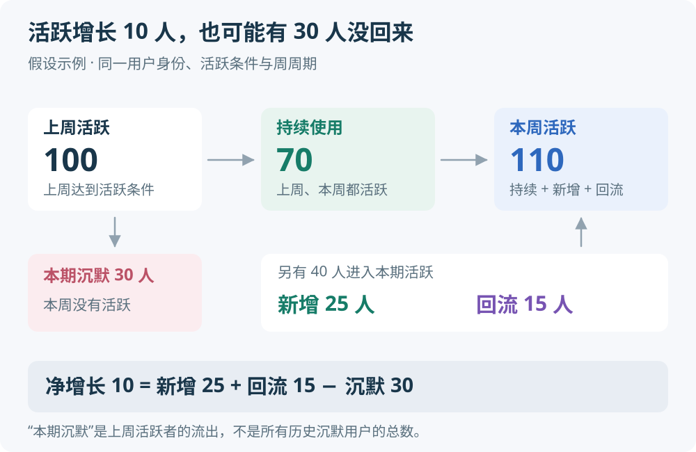
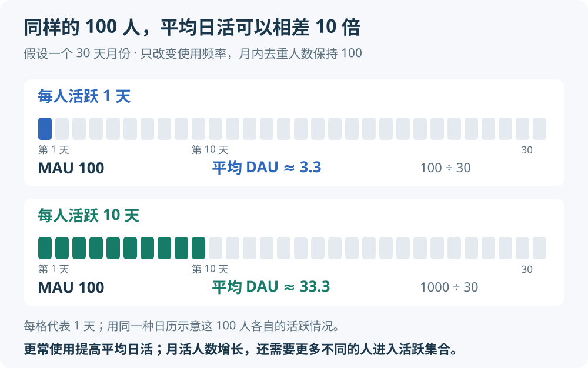
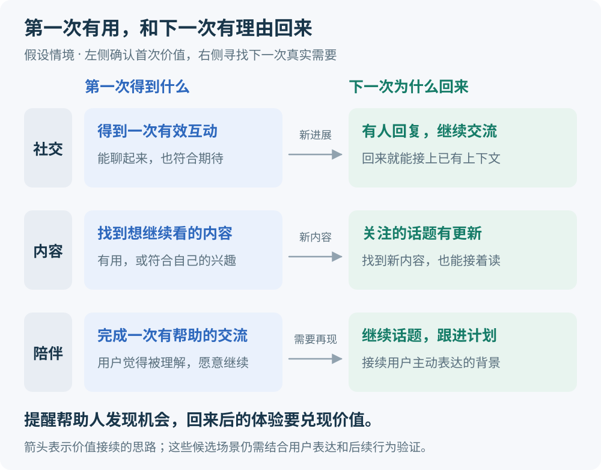
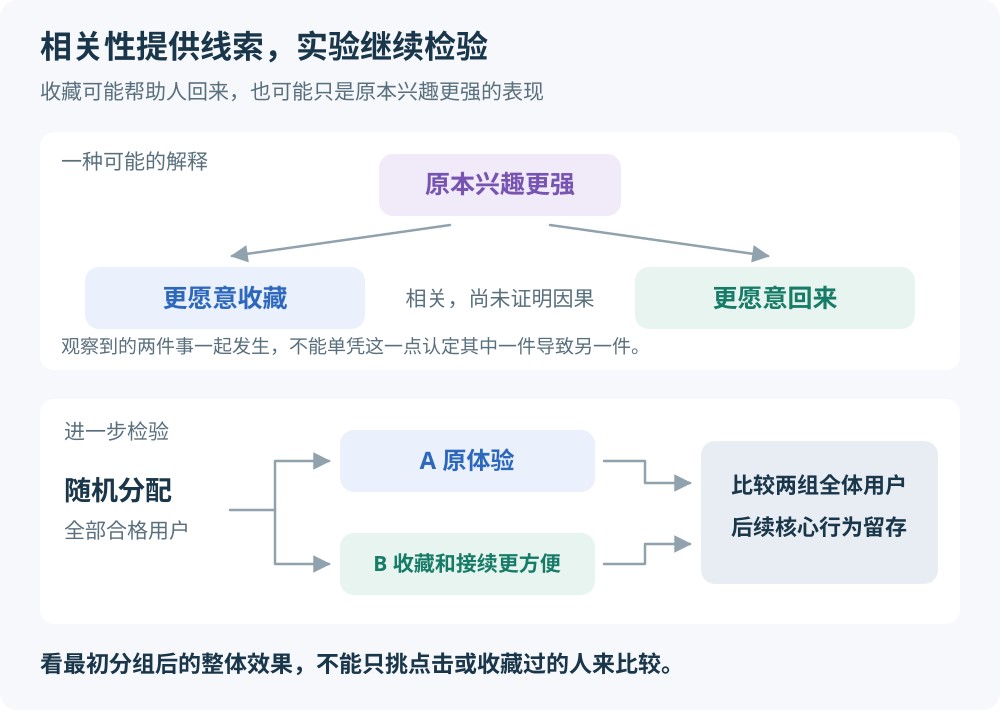
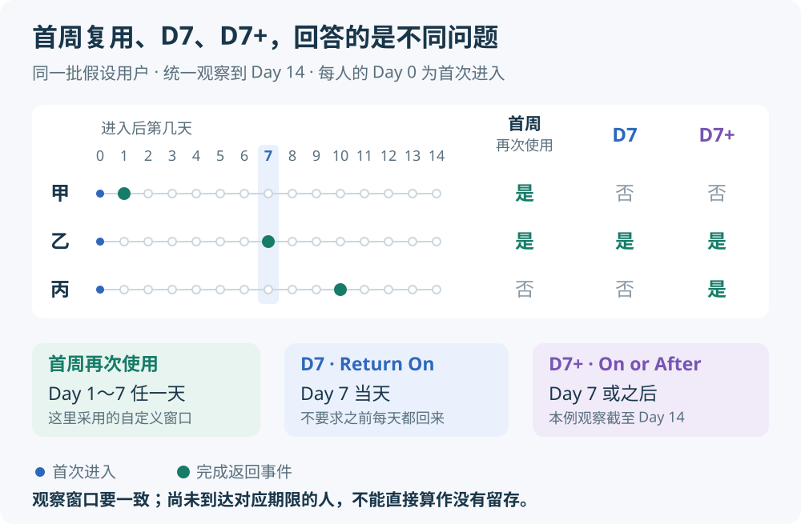

# 用户增长与留存

对于自然使用频率为每天或每周的社交、内容和陪伴类产品，可以先围绕两个问题理解增长：**用户第一次获得了什么价值，以及下一次为什么还需要它。** 获客决定谁进来，首次体验影响他们能否得到帮助，持续价值影响他们是否继续使用。

这是一条诊断线索，不能直接证明留存是某个产品最大的增长问题。应先看新增、持续使用、回流和停止使用各有多少，再判断投入方向。以下例子、实验思路和原创配图均为通用说明，不代表实际产品数据或已经验证的增长效果。

## 1 两篇资料分别解决什么问题

| 资料 | 重点 | 阅读时带着的问题 |
| --- | --- | --- |
| [Lifecycle: track the growth of your product's user base](https://amplitude.com/docs/analytics/charts/lifecycle/lifecycle-track-growth) | 用生命周期图拆开活跃用户的组成；分析前先确定关键事件和使用周期 | 活跃人数的变化主要来自哪类用户？ |
| [The Retention Lifecycle Framework](https://amplitude.com/books/mastering-retention/the-retention-lifecycle-framework) | 《Mastering Retention》手册第 3 章，按用户所处阶段理解留存 | 不同阶段的人，为什么继续使用或离开？ |

第一篇偏向分析工具与口径；第二篇属于一套更完整的留存方法。手册将活跃用户分为新用户、持续使用用户和回流用户，目标是让他们持续获得价值，成为稳定使用的人。[留存框架](https://amplitude.com/books/mastering-retention/the-retention-lifecycle-framework)

手册适合按下面的顺序读；章节由页面目录切换，若链接只显示介绍页，可在目录中选择对应章节。

| 顺序 | 章节 | 重点理解 |
| --- | --- | --- |
| 1 | [第 2 章 Your critical event and product usage interval](https://amplitude.com/books/mastering-retention/your-critical-event-and-product-usage-interval) | 什么行为代表获得价值，多久使用一次才合理 |
| 2 | [第 3 章 The Retention Lifecycle Framework](https://amplitude.com/books/mastering-retention/the-retention-lifecycle-framework) | 新用户、持续使用、回流与沉默之间的关系 |
| 3 | [第 5 章 New user retention](https://amplitude.com/books/mastering-retention/new-user-retention) | 引导、价值发现和习惯形成 |
| 4 | [第 6 章 Current user retention](https://amplitude.com/books/mastering-retention/current-user-retention) | 不同使用方式对应怎样的持续价值 |
| 5 | [第 7 章 Resurrected user retention](https://amplitude.com/books/mastering-retention/resurrected-user-retention) | 回来以后能否重新参与，并继续使用 |

[第 4 章 Product analysis toolkit](https://amplitude.com/books/mastering-retention/product-analysis-toolkit) 可作为分群、留存曲线和行为分析的查阅工具。

## 2 活跃总量为什么会掩盖问题

先选定同一个活跃条件和统计周期，例如“每周完成一次有价值的交流”，再按周期划分用户。下面使用通用业务含义，分析工具的具体分类规则还需单独核对。

| 用户组 | 本周期与上周期的关系 |
| --- | --- |
| 新用户 N | 本周期首次使用产品，并达到选定活跃条件 |
| 持续使用用户 C | 上周期和本周期都达到活跃条件 |
| 回流用户 R | 已有用户，上周期未达到活跃条件，本周期达到 |
| 本期转为沉默的用户 D | 上周期达到活跃条件，本周期没有达到 |

在身份、用户总体、事件和周期口径稳定，且分类互斥、完整时，可以得到：

```text
本期活跃 A = N + C + R
上期活跃 = C + D
活跃净变化 = N + R − D
```

这是人数分解，不是增长原因的因果模型。D 表示从上期活跃中退出的人，不是历史上所有沉默用户的总存量；沉默一个周期也不等于永久离开。



图中，本周活跃为 `70 + 25 + 15 = 110`，净增 10 人。总量上涨的同时，原来活跃的人中已有 30 人没有回来。观察总量之外，还要看哪一部分在流入、哪一部分在流出。

Amplitude 的 Pulse 用 `(N + R) / D` 表示流入与流出的比例；分母大于零时，大于 1 表示当期流入超过流出。它能提示人数变化，不能单独说明用户价值或获客效率。[生命周期图解读](https://amplitude.com/docs/analytics/charts/lifecycle/lifecycle-interpret)

**工具口径需要特别留意：** Amplitude 的 New 依据用户在 Amplitude 中的首次出现时间，不能简单等同于“第一次完成所选核心行为”。已有用户首次触发新埋点，可能被归为 Resurrected；因此图上的回流，不一定证明他过去做过该行为。迁移埋点或变更用户身份后，应先检查这一点。[分类规则](https://amplitude.com/docs/analytics/charts/lifecycle/lifecycle-interpret)

### 日活提高和月活增长的区别



图中假设一个月为 30 天。每人使用 1 天，共有 100 个活跃人日，平均日活约为 `100 ÷ 30 = 3.3`；每人使用 10 天，共有 1000 个活跃人日，平均日活约为 `1000 ÷ 30 = 33.3`。两种情况下，月内去重人数都是 100。

因此，提高现有月活用户的使用频率，可以提高日活；要扩大月活人数，还要让原本不在该月活跃集合中的人进入，并减少原有活跃者退出。这里包括新用户，以及跨越月度活跃边界的回流用户。

若比较相邻两个完整月份，上面的人数分解可以使用月周期。若使用滚动 30 天月活，则要逐日检查谁进入、谁离开滚动窗口，不能直接拿日周期的新增、回流和沉默人数代入。

## 3 第一次获得价值要落到真实结果

关键事件是贴近产品核心价值的用户行为；先明确它，再根据自然使用间隔选择分析周期。日常交流和偶尔发生的需求，不应使用相同频率来判断是否留存。[生命周期分析的准备条件](https://amplitude.com/docs/analytics/charts/lifecycle/lifecycle-track-growth)

“完成注册”“点了几个按钮”只能说明用户经过了流程。设计首次体验时，更有用的问题是：用户完成后，能否说清产品帮到了什么？



具体判断时，有效互动要区别于系统提示或无意义回复，内容兴趣要区别于误触或自动播放，有帮助的交流也不能只用时长代替。图中的左侧说明第一次得到什么，右侧说明这种价值怎样有机会继续成立。

这些是候选定义，需要结合用户表达和后续行为修订。手册把新用户早期体验区分为引导、价值发现和习惯形成；首次体验只是其中一段，之后还需要让价值反复成立。[新用户留存](https://amplitude.com/books/mastering-retention/new-user-retention)

由此可以推导出一种优化思路：选定一个价值场景，检查到达它之前的注册、配置、等待和操作，优先减少没有帮助的阻力。必要的匹配与偏好选择也可能提高结果质量，不能只追求步骤最少。

### 留得住的人做过什么 与 让人这样做是否有效

假设“收藏过内容的人更常回来”。可能是收藏帮助他下次继续阅读，也可能是原本兴趣更强的人既愿意收藏，又愿意回来。仅比较这两群人，无法区分这些解释。



Amplitude 的 Compass 文档也明确区分相关与因果，要求继续检验由行为相关性形成的假设。[相关性说明](https://amplitude.com/docs/analytics/charts/compass/compass-interpret-2)

可以进一步随机测试“让收藏和继续阅读更方便”的体验，观察被分配到新体验的全部合格用户，后续是否更常完成核心行为。若只是收藏点击增加，仍不足以证明持续价值提高。

## 4 回访理由要接得上实际价值

回访可以来自持续出现的需要，也可以来自与上次使用相关的新进展。前面的价值接续图中，社交的新回复、内容的话题更新、陪伴中可继续的话题或计划，都是候选理由。用户回来后，应能直接找到对应内容、接上上下文，或减少重新解释的负担。

提醒可以帮助用户发现价值，提醒后的体验也需要兑现这份理由。手册对回流用户的关注点包括重新参与，以及之后成为持续使用用户；短暂的活跃尖峰不能代替后续留存。[回流用户留存](https://amplitude.com/books/mastering-retention/resurrected-user-retention)

分析提醒时，可以沿着“收到提醒 → 回访 → 完成核心行为 → 下一个自然周期再次完成”检查。点击和打开适合作为中间指标，后两步更接近这次提醒有没有带来持续帮助。

## 5 先统一指标 再比较渠道和改动

“首周复用”“七日留存”“回来过”可能指不同事情。比较前要固定用户身份、进入条件、时区、观察窗口和返回事件。



甲在第 1 天回来，满足这里定义的首周复用，却不满足 D7；丙在第 10 天回来，满足观察期内的 D7+，却不满足首周复用。**同一批用户，返回时间定义不同，留存结果也可能不同。**

| 指标 | 一种明确的业务定义 | 解读时注意 |
| --- | --- | --- |
| 新用户首次价值完成率 | 固定窗口内完成候选核心行为的新用户数，除以同批全部合格新用户数 | 同时看结果质量和后续使用 |
| 到首次价值的时间 | 从首次进入到第一次完成核心行为的耗时分布 | 同时报未完成人数，避免只看到成功者变快 |
| 首周再次使用率 | 从首次进入记为 Day 0，在 Day 1 至 Day 7 至少再次完成一次返回事件的人数比例 | 此处是自定义窗口指标，区别于 D7 |
| D7 留存 Return On | 同批用户中，在 Day 7 当天完成返回事件的人数比例 | Day 7 由所选日界线或滚动时间规则决定 |
| 回流后的持续使用 | 回流人群在下一个完整自然使用周期再次完成核心行为的比例 | 回流当天完成行为，还不能算下一次留存 |
| 7 天平均日活 | 最近 7 个完整日的每日去重活跃人数之和除以 7 | 适合观察趋势，不能替代分群留存 |

Amplitude 的 Return On 表示指定时间点返回，Return On or After 表示该时间点或之后返回；后者也不等于“之前七天内回来过”。未到观察期限的用户不能直接当作未留存用户，应比较拥有完整、可比观察窗口的群体。[留存计算说明](https://amplitude.com/docs/analytics/charts/retention-analysis/retention-analysis-calculation)

对于自然每周使用的产品，可以用完整周窗口观察下一次使用；一次首周观察不足以判断长期习惯。几天适合检查埋点和发现明显阻力，实验结论还取决于自然使用周期、样本量和观察时长。

### 按留下来的人比较渠道

以下是由上述口径推导的渠道比较方法：把渠道、进入日期、首次价值完成情况和后续核心行为放在同一批用户上看，并同时保留获客人数与比例。

比较时，除了“完成首次价值的人后来留存多少”，还要看“全部获客用户中，后来仍完成核心行为的有多少”。只比较前者，会遗漏大量用户在首次体验前就离开的情况。渠道成本可进一步与后续仍活跃的人数结合，但这些指标本身不能保证盈利。

## 6 两项实验怎样形成可检验的问题

下面把首次价值和回访机制转成通用实验模板；实际优先级需要由用户分解和体验诊断决定。

| 实验 | 可检验的假设 | 主要观察 | 同时关注 |
| --- | --- | --- | --- |
| 缩短首次价值路径 | 减少某个具体阻力，会让更多新用户获得价值并继续使用 | 全部合格新用户的首次价值完成率，以及后续核心行为留存 | 结果质量、失败率、未完成比例 |
| 提供一次相关回访提醒 | 在真实更新或可接续内容出现时提醒，会增加后续持续使用 | 全部分组用户在固定窗口内完成核心行为的比例，以及下一周期再次使用 | 通知关闭、退订、负面反馈 |

在可随机化的条件下，为首次体验保留原流程对照组，为提醒保留不提醒的对照组。按照最初分组比较全部合格用户，避免只挑完成引导或点击提醒的人来比较。用户彼此互动会影响结果时，还需考虑分组之间的相互影响。

可按下列现象形成调查方向，但每一行都需要继续确认原因：

| 看到的现象 | 优先调查的问题 |
| --- | --- |
| 新用户少，但同批用户能够持续使用 | 有效渠道的规模、覆盖与成本是否限制增长？ |
| 新用户多，但首次价值完成率低 | 流量意图、体验阻力或核心结果质量出了什么问题？ |
| 首次价值完成率较好，之后少有复用 | 需求是否再次出现，后续价值和接续体验是否成立？ |
| 提醒当天回访增加，下一周期仍沉默 | 用户回来后得到了什么，提醒是否只是带来短期打开？ |

“先做首次价值与回访实验，同时小规模验证渠道”可以作为一条工作假设；如果证据显示获客受限，或用户本来就没有高频需要，投入顺序应相应调整。

## 7 来源与适用边界

| 来源 | 机构与日期 | 采用范围 |
| --- | --- | --- |
| [生命周期分析设置](https://amplitude.com/docs/analytics/charts/lifecycle/lifecycle-track-growth) | Amplitude Docs；页面元数据更新于 2026-09-22 | 活跃分组、关键事件与周期的分析前提 |
| [生命周期图解读](https://amplitude.com/docs/analytics/charts/lifecycle/lifecycle-interpret) | Amplitude Docs；页面元数据更新于 2026-09-22 | 工具分类、首次出现时间、沉默与 Pulse 定义 |
| [Mastering Retention 留存手册](https://amplitude.com/books/mastering-retention/the-retention-lifecycle-framework) | Amplitude；页面元数据发布于 2023-08-23，更新于 2024-01-19 | 章节导读、生命周期及首次体验与后续使用的概念框架 |
| [Compass 相关性说明](https://amplitude.com/docs/analytics/charts/compass/compass-interpret-2) | Amplitude Docs；页面元数据更新于 2026-09-08 | 行为相关性与因果判断的区别 |
| [留存计算说明](https://amplitude.com/docs/analytics/charts/retention-analysis/retention-analysis-calculation) | Amplitude Docs；页面元数据更新于 2026-09-08 | 返回时间的不同口径和未成熟观察窗口 |

核对日期为 2026-10-16。日期来自页面结构化元数据，手册日期属于书籍页面，不能视为每章各自的修订时间；动态网页也不是固定版本快照。工具分类以本次核对的官方文档为准，本文不依赖特定付费套餐或界面操作。

人数等式、假设数字、日活与月活示例、候选价值场景、渠道比较、实验模板和五张原创示意图属于基于定义的归纳；它们不证明某种体验或提醒一定提高增长。这里讨论的“留存”主要指用户主动完成事件，不能完整衡量后台备份等无需频繁操作的持续价值；付费与续订还涉及[免费与付费的边界](../monetization/免费与付费的边界.md)。

关键条目映射见[证据包](../../../evidence/product/growth/activation-and-retention/manifest.json)：`growth-retention-001` 对应第 1 节，`growth-retention-002` 对应第 2 节，`growth-retention-003` 对应第 3 至 4 节，`growth-retention-004` 对应第 5 节，`growth-retention-005` 对应第 6 节。映射区分来源定义与归纳，不表示验证过具体产品的增长原因或实验效果。
