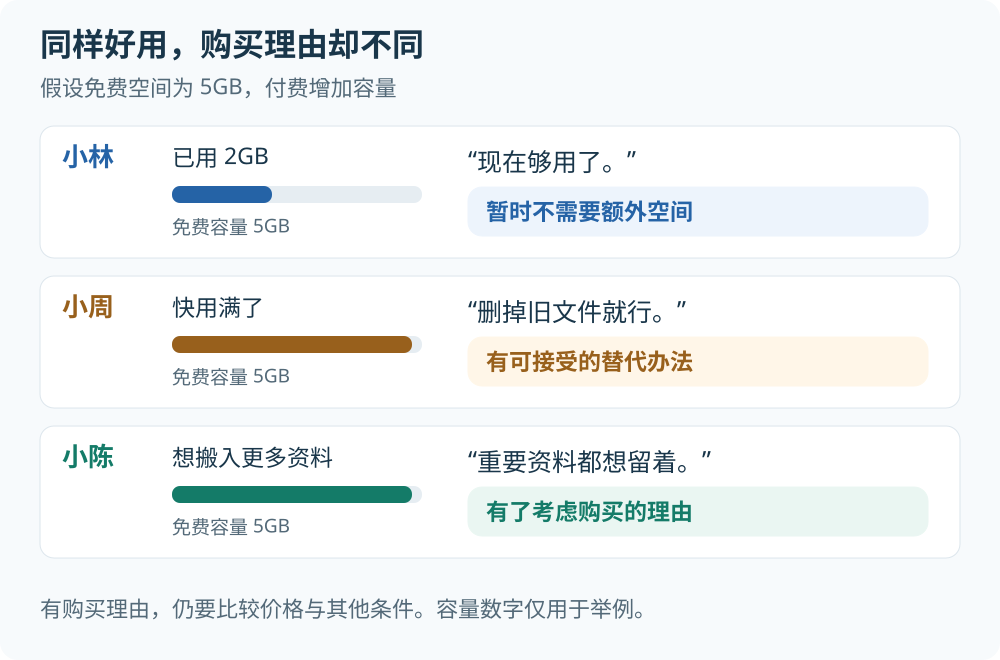
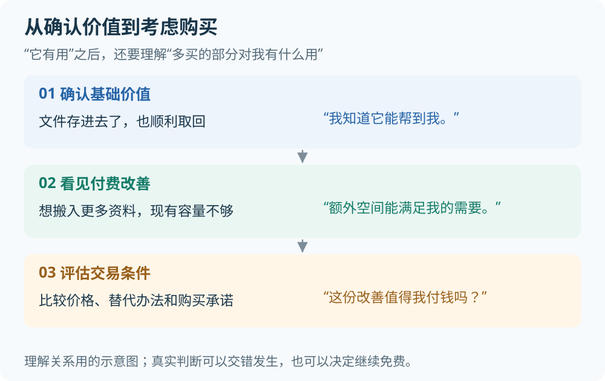
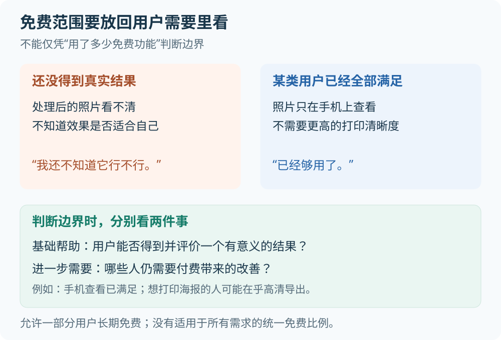

# 免费与付费的边界

一个人天天用免费云盘，还向朋友推荐，却一直不买会员。这并不矛盾：**他觉得产品有用，但付费多出来的好处，可能还不值得他花钱。**

理解免费到付费，可以先抓住三个问题：免费帮他完成了什么？他还想得到什么？付费带来的改善，值不值这个价？

下面用云盘贯穿讲解，再用修图、旅行和备份的例子补充。例子、数字和示意图均为假设，用来解释通用原则，不代表某款产品的方案或实测结果。

> 本文讨论可以长期保留免费版、另有可选付费权益的模式，通常叫“免费增值”。[来源 A](https://developer.apple.com/app-store/business-models/) “免费试用七天，到期后收费”有期限，不能直接套用同一套边界。

## 1 好用和值得付钱是两回事

假设一个云盘免费提供 5GB，付费可以增加空间。三个人都觉得它好用，想法却不同：

小林没有被产品打动吗？他已经把重要文件放进去了，显然得到了帮助。只是“更多空间”暂时帮不到他。

小周需要更多空间，却有另一个可接受的办法：删掉不需要的文件。小陈则愿意评估花钱换空间，因为这能让他保留资料、少操心。

**产品解决了问题，只说明它有价值；收费权益解决了用户仍然在意的问题，才有了具体的购买理由。** 有了理由，也还要看价格和其他条件。

Phil Carter 在《The Subscription Value Loop》中把创造价值、将产品带给目标用户、获取收入区分开来。这个区分帮助我们理解：做好产品与形成收入之间，还隔着用户对收费方案的判断。[来源 B](https://philgcarter.substack.com/p/the-subscription-value-loop)

## 2 用户买的是多出来的好处

小陈考虑买会员时，比较的是两种生活：继续免费，就要反复腾空间；买更多空间，就能把资料都留下来。后者多出来的帮助，就是**增量价值**。

相对地，云盘已经带来的保存、查找和取回文件的帮助，可以理解为用户从产品中获得的**总价值**。两者容易混淆：用户可能已经获得很多帮助，却不需要付费再多买一点。

这个区别不只适用于容量：

| 假设情境 | 免费已经帮到的部分 | 付费增加的部分 | 谁可能在乎这份改善 |
| --- | --- | --- | --- |
| 修图 | 调好照片，导出适合手机查看的图片 | 导出适合大幅打印的高清图 | 准备打印照片的人；只在手机看的人未必需要 |
| 记账 | 看清自己的日常收支 | 多人共同管理一本账 | 想一起记账的家庭；独自记账的人未必需要 |
| 外观装扮 | 使用默认主题完成日常操作 | 换成自己喜欢的主题 | 在乎风格和表达的人；它不一定提高效率 |

“多出来的好处”可以是省事、安心、质量更好，也可以是享受和个性表达。关键是用户在不在乎，而不是功能做起来有多难、开发花了多少钱。

比较对象也不只有免费版。小陈还可能买硬盘、换另一家云盘，或者暂时不整理资料。**付费是否值得，要放回用户实际可选的办法里看。**

## 3 从试试看走到愿意考虑购买

小陈刚注册云盘时，还不知道它是否可靠。等他成功存入一份重要文件，又在另一台设备上顺利取回，才有了依据说：“它确实能帮到我。”

这就是**确认价值**：用户不只是知道功能介绍，而是有理由相信它适合自己的需要。之后，他想把其他资料也搬进来，容量却不够了，“买更多空间”才对应上一个具体愿望。

*图中的箭头帮助理解关系，不是每个人必经的固定流程。熟悉同类产品的人可能很快判断，也可能先看价格，再回来试用。*

两个常见的概念，可以翻译成日常语言：

- **价值被确认的位置**：“我已经知道，它真的能帮到我。”
- **付费改善出现的位置**：“我还想得到这份额外帮助，而付费正好能提供。”

它们不一定是某个按钮或页面。付费权益可以提前介绍；这里讨论的是购买理由什么时候变得可信、具体。

那怎么知道用户已经确认价值？要把行为放回情境里看：

| 看到的表现 | 还需要理解什么 |
| --- | --- |
| 用户说“挺好玩的” | 是短暂的新鲜感，还是能说清它帮到了什么？ |
| 用户连续导出十次 | 是完成了十份需要的作品，还是前九次都不满意？ |
| 用户保留成果，下次又交来真实任务 | 这更贴近实际依赖，但仍要理解他的需要和选择原因 |

点击次数、停留时间、注册完成，都不能单独替代价值判断；低频使用也不等于没价值。例如，偶尔找回一份关键文件，也可能让人信任云盘。某个行为经常与购买一起出现，也不等于让人多做这个行为就能促成购买。

## 4 免费要给到什么程度

“免费少给一点，就能逼出购买”听起来直接，但少给可能发生在两个完全不同的位置：用户还没弄明白有没有用，或者用户已经得到帮助、希望获得更多。

以修图为例。如果用户只能点几个按钮，却始终无法看清处理结果，也无法判断能不能用于自己的照片，他可能仍在猜“这工具到底行不行”。这时看到收费，未必是在考虑升级，也可能是在犹豫要不要为不确定的结果冒险。

如果他已经拿到一张适合手机查看的照片，免费体验就兑现了一份有意义的帮助。后来想把照片打印成海报，才开始在乎高清导出。这里的“完整体验”，是**完成一个说得清的基础承诺**，并不意味着满足他今后所有用途。

RevenueCat 关于免费增值的实践文章也强调有实际价值的免费体验、清楚的付费差异，以及用户意愿的不同。[来源 C](https://www.revenuecat.com/blog/growth/how-to-turn-freemium-users-into-loyal-subscribers)

反过来，如果某类用户只在手机看照片，免费版已经长期满足他们，那么一直免费使用也很合理。不能仅因为他们不买，就断言免费给得太多；还要看是否存在另一类人，确实需要付费增加的帮助。

所以，没有一个脱离需求的“免费给 30% 最合适”。更有用的判断是：**免费是否足够让人理解并获得基础帮助，付费是否对应某些人真实存在的进一步需要。**

如果一次体验就彻底解决了问题，也没有自然的进一步需要，那么这种需求可能没有多少免费升级空间。继续缩减免费内容，并不会自动创造新的需要。

## 5 怎样知道用户真的愿意付钱

有人说“要是能高清导出就好了”，可以说明他对这个功能感兴趣，但还不知道他愿不愿意花钱。把这类表达直接当成购买意愿，会跳过一个关键问题：他愿意为此付出什么？

| 用户说或做了什么 | 我们知道了什么 | 还不知道什么 |
| --- | --- | --- |
| “高清导出很棒，我想要。” | 他对改善感兴趣 | 是否愿意支付价格 |
| 看到明确价格后说“可以接受” | 他表达了该条件下的购买意向 | 真正付款时是否仍这样选择 |
| 面对真实价格和免费选项，选择购买 | 他在这次情境下接受了交易 | 其他人是否会买、以后是否续费 |

即使用户需要那份改善，也可能因为预算有限、暂时用不上、不信任服务、嫌购买麻烦，或者不愿接受自动续费而没有购买。**不买，只是一个结果，不能直接说明是哪一步出了问题。**

理解免费到付费时，可以沿着四个问题往下看：

1. 他已经获得了什么有用的结果？
2. 他还希望得到什么，为什么在乎？
3. 他是否理解，付费能怎样满足这份需要？
4. 知道价格、限制和承诺后，他会怎样选择？

这些问题能帮助解释付费理由，本身不会算出最优价格，也不能保证盈利。

## 6 买一次和持续订阅还差一层

假设一个人为了这次旅行，付费做完了相册，而且非常满意。满意说明这次购买可能值得，却不能说明他下个月还有相册要做。需求也许下次旅行会再出现，但他未必愿意在两次旅行之间持续付费。

云盘备份则是另一种情况：用户这个月没打开应用，也可能仍然在获得文件保存、持续备份和随时取回的帮助。因此，订阅价值不要求每天操作，也不要求每个月都增加新功能。

| 第一次购买时 | 考虑续费时 |
| --- | --- |
| “根据介绍和试用，我相信这次花钱能帮到我。” | “根据自己的使用经历，我觉得下一段时间还值得继续买。” |

续费时，用户既会更新对产品的看法，也会更新对自己的认识：“功能确实不错，但我原来没那么需要。”收费周期不必等于使用间隔，但用户需要认可下一收费周期内能获得的帮助。

所以，免费到付费解释的是一次购买理由怎样成立；订阅还需要回答：**这份帮助为什么值得继续购买？**

## 7 来源与适用边界

| 来源 | 作者或机构及日期 | 采用范围 |
| --- | --- | --- |
| [A Choosing a business model](https://developer.apple.com/app-store/business-models/) | Apple；页面未标注发布日期 | 官方商业模式定义；不据此推断用户转化的因果机制 |
| [B The Subscription Value Loop](https://philgcarter.substack.com/p/the-subscription-value-loop) | Phil Carter；2024-04-11 | 补充创造价值与获取收入的概念关系；不采用案例增长数字作为通用结论 |
| [C How to turn freemium users into loyal subscribers](https://www.revenuecat.com/blog/growth/how-to-turn-freemium-users-into-loyal-subscribers) | Alice Muir Kocourková，RevenueCat；2025-06-04 | 补充免费体验、权益表达和意愿分层的实践解释；不采用固定免费比例或统一触发时机 |

来源核对日期为 2026-10-14。上述材料适用于免费增值及消费订阅的概念讨论，不绑定软件版本。商业模式定义以官方文档为依据，博客仅补充框架与实践动机；本文的判断关系、两个位置、假设例子及原创示意图属于概念归纳，不是来源原文的固定步骤，也不是转化效果的实测证明。

关键条目映射见[证据包](../../../evidence/product/monetization/free-to-paid/manifest.json)：`free-to-paid-001` 对应第 1 节，`free-to-paid-002` 对应第 2 至 3 节，`free-to-paid-003` 对应第 4 至 5 节，`free-to-paid-004` 对应第 6 节。映射记录来源和推断边界，不表示已验证普适的转化效果。
